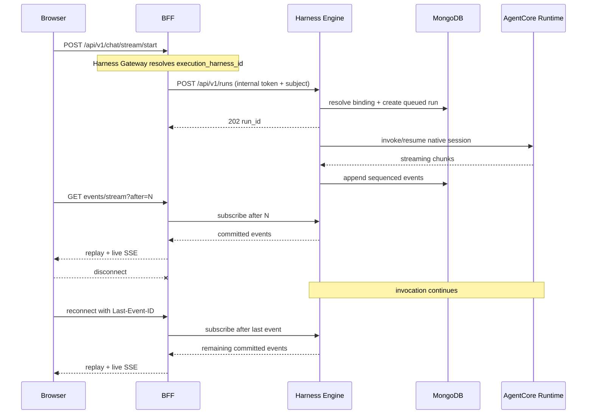

# Harness Engine

Provider execution owner behind the canonical CAIPE Harness Gateway. AgentCore
and Claude Agent SDK use its blueprint and adapter contracts. Native ACP retains
the existing Dynamic Agents execution service and coordinator; Engine does not
wrap that detached producer or duplicate its journal.

## Boundary

- Existing CAIPE client APIs remain the front door. The gateway resolves saved
  execution ownership before mutable agent defaults; each run has one owner
  and authoritative journal in canonical CAIPE MongoDB.
- `harness_agents` and `harness_agent_versions` retain provider projections and
  immutable compiled revisions of the canonical CAIPE definition.
- Durable `harness_sessions` bind an owner, agent version, and conversation to
  one native provider session. Existing conversations remain pinned when an
  agent is edited.
- `CAIPEAgentSessionManager` owns opaque binding IDs, ownership, version pinning,
  epochs, persistence, and clear. Each adapter supplies a narrow
  `ProviderSessionManager` for native open/observe/close behavior.
- Runs and replayable events are stored in `harness_runs` and `harness_events`.
- The same caller/agent/conversation tuple receives the same opaque binding.
  AgentCore derives a stable `runtimeSessionId`; Claude persists the SDK result
  session ID and supplies it through `resume` on the next turn.
- The Next.js BFF authenticates and authorizes callers, then uses an internal service credential. User bearer tokens never reach Harness Engine or AgentCore.
- A provider invocation belongs to Harness Engine, not to an SSE subscriber. Closing a browser or BFF connection only removes that subscription.
- The existing BFF `/api/v1/chat/*` routes form Harness Gateway. They read the
  canonical `execution_harness_id`, normalize native compatibility aliases and
  translate committed Engine events for existing clients.
- Gateway routing references atomically select one owner for a new authorized
  agent/context and preserve existing native/provider bindings. An unavailable
  explicitly selected provider fails rather than substituting another runtime.

## Agent Builder harness status

- LangChain Deep Agents is the **Stable** default.
- Claude SDK and AgentCore are **Experimental** CAIPE integrations. Agent Builder
  shows the catalog's certification status in the harness dropdown and beside
  the selected harness. `certified` is labeled **Stable**; `blocked` is labeled
  **Blocked** and remains disabled.

## Connect an existing AgentCore deployment

- In **Agent Builder → Execution harness**, a platform administrator chooses
  **Add existing AgentCore agent**, enters a connection ID beginning with `existing-`, a Harness or
  Runtime ARN, its matching AWS Region, and a qualifier.
- Registration saves an immutable `shared` operator profile in
  `harness_agentcore_profiles`. MongoDB preserves it across restarts; the
  development memory backend does not. Identical retries reuse the connection;
  an existing ID cannot be pointed at a different target.
- The current Builder selects AgentCore and the connection, preserving the
  draft's instructions, owner-team and sharing choices. Save the agent to apply it.
  The connection also remains available in the operator profile picker.
- Registration checks ARN syntax and Region consistency. The Engine uses its
  existing AWS credentials; IAM invocation permission is checked when chatting.
  Registering does not discover AWS resources or import configuration/history.
- Managed Harness calls use CAIPE instructions. Custom Runtimes must accept
  the adapter's request/response contract. Native provider tools keep their AWS
  permissions; CAIPE tool grants do not automatically constrain them.
- Registration requires both `admin_ui#admin` and CAS management permission on
  `system_config:platform` in the BFF. The internal endpoint additionally
  requires the service credential and an admin marker set only by that route.
  The normal catalog exposes profile aliases, never ARNs or credentials.
- Connections extend the operator allowlist for agent builders. Chat/run access
  still requires current CAIPE agent and conversation permissions. Each caller,
  agent and conversation keeps its own Engine binding/provider session.
- Shared connections never create, update or delete the AWS deployment. Removing
  a CAIPE agent removes its CAIPE records; the imported target remains external.

## App-owned chat streams

- The BFF's start, resume, cancel and status routes share one dispatcher after
  agent-use and conversation-write authorization.
- Installed apps use their server-declared assistant paths through the shared
  app proxy, preserving the resolved caller and canonical conversation ID.
  App errors, denials and unsupported operations return directly.
- Other start/resume/cancel requests resolve their runtime conversation ID and
  pinned Harness Gateway backend. Provider dispatch does not require the
  Dynamic Agents service configuration.
- App-owned assistants require streaming; non-streaming invoke returns `501`
  before creating a native/provider binding. Status is available only when an
  app declares it, with `501` for unsupported runtimes.
- Host chat panels, overlays and cross-window app status use the existing
  shared UI/store contracts. Provider runs retain Engine-owned detached
  execution and replay; app streams keep their app-owned session lifecycle.

## Authorization boundary

- The BFF checks current agent use and conversation write before execution,
  resume, Stop or clear. A saved agent participant must match the requested
  agent; an authorized request cannot substitute another agent's runtime.
- Direct Engine admission also verifies the pinned gateway target is a
  provider runtime, preserving native session ownership.
- Run detail, polling and replay subscriptions retain Engine owner checks and
  recheck current agent use plus conversation read in the BFF. Cancellation by
  run ID requires conversation write. Keeping a run ID does not retain revoked
  access.
- Service accounts retain their principal classification in platform checks.
  Engine uses internal credentials plus the verified caller subject; app-owned
  streams use the exact authenticated interactive user.
- Grants are checked per request/subscription. Existing streams are not
  continuously reauthorized; downstream app/tool resource checks remain
  authoritative for their own operations.

## Session flow



Web UI, Slack, and Webex use the same gateway routes and AG-UI contract. They
do not load provider SDKs or implement harness-specific routing. Current
non-default adapters support start, detached execution, replay, invoke, and
active-run cancellation. Human-input resume and attachments return an explicit
capability error until their portable contracts are implemented.

CAIPE CLI `0.2.24` also uses the AG-UI gateway contract. Harness Gateway emits
camel-case `toolCallId` fields expected by that release and carries its optional
per-turn `context` into the provider system prompt without modifying the saved
agent blueprint. The additive accessible-agents response includes `harness_id`
and `harness_name` for newer CLIs. Those clients retain `X-Harness-Run-ID` and
the SSE cursor so a dropped connection resumes the detached run through the
canonical replay endpoint without resubmitting the prompt.

The BFF remains horizontally stateless. Harness Engine is session-aware through
durable bindings and owns each provider task after returning `202`. `run_id`, an
event cursor, MongoDB, and the provider session ID form the reconnect contract.
This avoids sticky BFF sessions and keeps execution alive when a browser or BFF
subscriber disconnects. Process-failure takeover of an in-flight provider call
is not implemented yet; completed event replay and subsequent thread resume are.

## Portable contract

- `AgentBlueprint` owns portable prompt, model, tool, thread, memory, workspace,
  streaming, delegation, and run-limit policy.
- `HarnessDescriptor` advertises sanitized operator profiles, a bounded JSON
  Schema, and `native`/`emulated`/`unsupported`/`unavailable` capabilities.
- `HarnessRegistry` validates and normalizes a draft, returns a catalog revision
  and configuration fingerprint, then resolves the selected adapter at run time.
- Adapters receive `RunContext` and emit canonical events only.
- Adapters expose a provider-specific session manager; they do not persist or
  derive CAIPE binding ownership themselves.
- Broker protocols isolate thread state, memory, tools, sandboxes, prompts,
  delegation, and telemetry from SDK-specific code.

See [Portable abstractions](../../docs/docs/specs/2026-08-17-harness-engine/portable-abstractions.md)
for the full contract, UI flow, persistence model, and sandbox target architecture.

## Configuration

Runtime/provider settings use the `HARNESS_ENGINE_` prefix. Storage uses the
same canonical `MONGODB_URI` and `MONGODB_DATABASE` as CAIPE (default database
`caipe`). Legacy prefixed storage aliases remain accepted; explicitly conflicting
cluster/database coordinates fail with migration guidance. Existing deployments
with separate provider storage must migrate those collections before cutover:

- `HARNESS_ENGINE_INTERNAL_TOKEN`: required BFF-to-engine credential.
- `HARNESS_ENGINE_STORAGE_BACKEND`: defaults to `mongodb`; explicit `memory` is
  for isolated tests and disposable development.
- `MONGODB_URI` and `MONGODB_DATABASE`: canonical storage; the BFF and Engine
  verify the admitted storage identity without forwarding URI credentials.
- `HARNESS_ENGINE_AGENTCORE_RUNTIMES_JSON`: sanitized AgentCore profile map.
  - Backward-compatible shared target: `{"primary":{"provisioning":"shared","arn":"arn:aws:bedrock-agentcore:us-east-1:111122223333:harness/example-AbCdEf1234","qualifier":"DEFAULT","region":"us-east-1"}}`.
  - One AWS Harness per CAIPE agent: `{"primary":{"provisioning":"per_agent","execution_role_arn":"arn:aws:iam::111122223333:role/example-agentcore-role","region":"us-east-1","model_id":"global.anthropic.claude-sonnet-example"}}`.
  In `per_agent` mode, Harness Engine creates and deletes the AWS Harness and
  stores its ARN and provider-configuration fingerprint in the private
  `harness_provider_resources` collection. Provider-relevant edits update the
  same AWS Harness in place. Agent blueprints and browser responses contain
  only the profile ID.
- `HARNESS_ENGINE_AGENTCORE_PROVISION_TIMEOUT_SECONDS` and
  `HARNESS_ENGINE_AGENTCORE_PROVISION_POLL_SECONDS`: readiness polling bounds
  for per-agent Harness creation.

The workload policy for `per_agent` profiles must include the Harness actions
and their documented AgentCore dependencies: runtime/runtime-endpoint, memory,
and workload-identity create/update/delete permissions in the configured
account and Region. `iam:PassRole` must be restricted to the profile's execution
role and `bedrock-agentcore.amazonaws.com`.

Minimum lifecycle action groups:

- create: `CreateHarness`, `CreateHarnessEndpoint`, `CreateAgentRuntime`,
  `CreateAgentRuntimeEndpoint`, `CreateMemory`, `CreateWorkloadIdentity`, and
  `TagResource`;
- update: `UpdateHarness`, `UpdateHarnessEndpoint`, `UpdateAgentRuntime`,
  `UpdateAgentRuntimeEndpoint`, and `UpdateMemory`;
- inspect: `GetHarness`, `GetAgentRuntime`, `GetAgentRuntimeEndpoint`,
  `GetMemory`, and `GetWorkloadIdentity`;
- delete: `DeleteHarness`, `DeleteHarnessEndpoint`, `DeleteAgentRuntime`,
  `DeleteAgentRuntimeEndpoint`, `DeleteMemory`, and `DeleteWorkloadIdentity`.

Creation permissions use `Resource: *` with an `aws:RequestedRegion`
condition because the provider resources do not exist yet. Existing-resource
actions should be restricted to the deployment account/Region Harness,
runtime, memory, and default workload-identity directory ARN patterns.
- `HARNESS_ENGINE_CLAUDE_SDK_PROFILES_JSON`: alias-to-operator-owned Claude
  policy, for example `{"safe":{"model":"claude-example","cwd":"/workspace","permission_mode":"dontAsk"}}`.
- `HARNESS_ENGINE_EVENT_RETENTION_SECONDS`: TTL for replay events.

With the MongoDB backend, the Claude adapter mirrors the SDK's provider
transcript into `claude_session_transcripts`. CAIPE stores the opaque Claude
session ID in `harness_sessions`; the transcript is the other half of the
resume contract. Keeping both in shared storage lets another Harness Engine
replica resume the thread without depending on a container's local
`~/.claude` directory. Each run uses a private temporary SDK configuration directory, removed after
the provider closes. That local transcript copy is disposable; it is not a
shared filesystem or recovery authority.

The SDK adapter disables its built-in tools with `tools=[]`. No logical tool
broker or OS sandbox is implied by this experimental provider descriptor. Its
internal disposable transcript files are distinct from agent-visible tools.
New Mongo transcript entries are tagged to the admitted binding/run and checked
against its producer token, lease and canonical deletion guard. Mirror writes
are shielded and drained before acknowledging producer cleanup. A uniquely
owned legacy session can be adopted without changing its transcript JSON;
ambiguous ownership or an unresolved older writer fails before provider work.
Old orphan records without a known provider session cannot be safely attributed
and need operator reconciliation, rather than a blanket purge.

## Admission, replay and cleanup

Identical request IDs and input attach to one admitted run. Changed input or a
competing active turn fails. A renewable binding-scoped producer claim is checked
after asynchronous preparation and before dispatch; clear and permanent deletion
share that fence. Worker loss reports interruption and degrades the binding; it
does not replay an uncertain provider mutation.

Stop persists `cancellation_requested`. Before dispatch, the owner can stop
preparation; a dispatched provider drains before its reservation is released.
`cancelled: false, cancellation_requested: true` reports a pending stop, never
proof that an external invocation has ended.

A recoverable event intent is materialized idempotently before exposing its
committed cursor/outcome, without requiring MongoDB replica-set transactions.
Events are bounded and paged; a missing/expired prefix returns an explicit replay
error. The BFF consumes the complete committed head before reporting an invoke
result, and its standard-frame cursor preserves position within a projected event.

Permanent deletion first records the canonical context tombstone, stops/drains
known producers, then purges scoped journals and provider transcripts. An unknown
claimed producer returns a retryable conflict pending reconciliation, rather
than claiming its external work has stopped. Include routing references, session/
run/event collections, transcript entries and deletion guards in canonical backup
and retention procedures. Restoring records does not restart provider work.

The UI BFF requires:

- `HARNESS_ENGINE_URL`, for example `http://harness-engine:8010`.
- `HARNESS_ENGINE_INTERNAL_TOKEN`, matching the service value.

Run locally:

```bash
uv sync --all-extras
uv run uvicorn harness_engine.main:app --host 0.0.0.0 --port 8010
```

Quality gates:

```bash
uv run ruff check src tests
HARNESS_ENGINE_TEST_MONGODB_URI=mongodb://127.0.0.1:27017 uv run pytest -q
```
