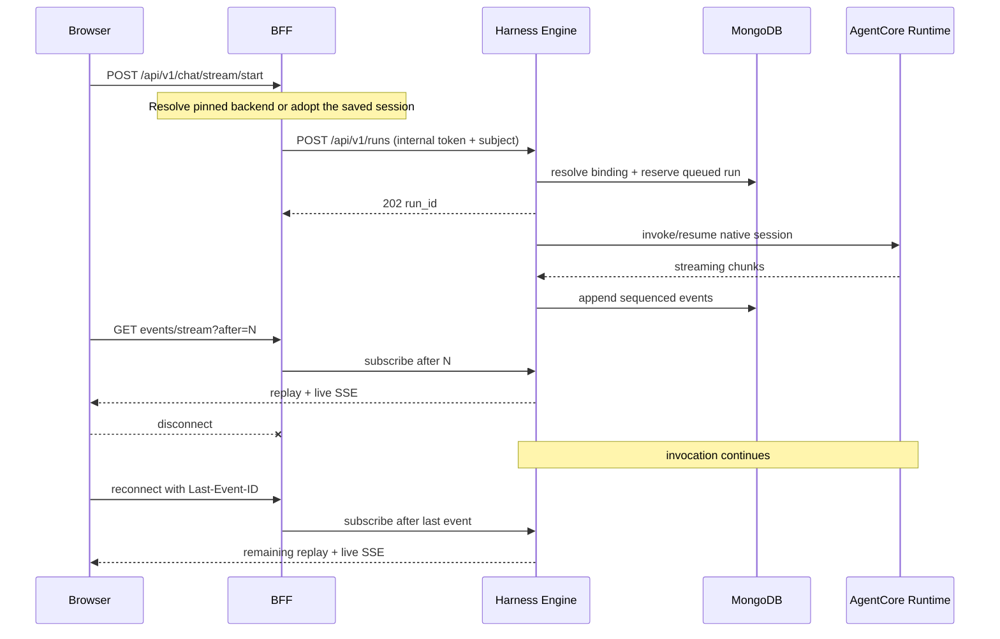

# Harness Engine

Execution control plane for opt-in Deep Agents, AgentCore and Claude Agent SDK
adapters. The default installation continues to use the existing Dynamic Agents
service until an operator enables the Engine integration.

## Boundary

- Deep Agents reuses the Dynamic Agents graph, tool, middleware, skill, file and
  checkpoint implementation. Compatibility HTTP routes remain available.
- Complete agent blueprints and immutable versions are stored separately in
  `harness_agents` and `harness_agent_versions`.
- Durable `harness_sessions` bind an owner, agent version, and conversation to
  one native provider session. Existing conversations remain pinned when an
  agent is edited.
- `CAIPEAgentSessionManager` owns opaque binding IDs, ownership, version pinning,
  epochs, persistence, and clear. Each adapter supplies a narrow
  `ProviderSessionManager` for native open/observe/close behavior.
- Runs and replayable events are stored in `harness_runs` and `harness_events`.
- The same caller/agent/conversation tuple receives the same opaque binding.
  AgentCore derives a stable `runtimeSessionId`; Claude persists the SDK result
  session ID and supplies it through `resume` on the next turn.
- The BFF authenticates and authorizes callers, then uses an internal service
  credential. Deep Agents additionally receives the current delegated bearer in
  transient execution context for CAS/MCP checks; it is excluded from persisted
  runs and events. Provider SDK adapters do not receive this delegated bearer.
- A provider invocation belongs to Harness Engine, not to an SSE subscriber. Closing a browser or BFF connection only removes that subscription.
- The existing BFF `/api/v1/chat/*` routes form Harness Gateway. They read the
  BFF-owned `execution_harness_id`, preserve Dynamic Agents for missing/default
  values, and translate Harness Engine canonical events for existing clients.
- The gateway pins each owner/agent/conversation backend in the BFF's
  `harness_gateway_bindings` collection. An agent edit does not change an
  existing conversation's runtime. Clear rotates the native epoch and retains
  routing ownership, including while the optional Engine is unavailable.
- On first use, the gateway adopts native checkpoints from the application's
  configured checkpoint collection and Engine sessions from the internal API.
  Conflicting contexts return `409`. Known native context remains usable when
  optional Engine lookup is unavailable. The BFF does not read Engine's private DB.
- Missing Engine configuration returns `503` for saved SDK agents or pinned
  Engine conversations. Legacy/default agents still use Dynamic Agents.

## Agent Builder harness status

- The compatibility service remains the **Stable** default. The opt-in Engine
  integration for LangChain Deep Agents is **Experimental**.
- Claude SDK and AgentCore are **Experimental** CAIPE integrations. Agent Builder
  shows the catalog's certification status in the harness dropdown and beside
  the selected harness. `certified` is labeled **Stable**; `blocked` is labeled
  **Blocked** and remains disabled.

## Connect an existing AgentCore deployment

- In **Agent Builder → Execution harness**, a platform administrator chooses
  **Add existing AgentCore agent**, enters a connection ID beginning with `existing-`, a Harness or
  Runtime ARN, its matching AWS Region, and a qualifier.
- Registration saves an immutable `shared` operator profile in
  `harness_agentcore_profiles`. MongoDB preserves it across restarts; the
  development memory backend does not. Identical retries reuse the connection;
  an existing ID cannot be pointed at a different target.
- The current Builder selects AgentCore and the connection, preserving the
  draft's instructions, owner-team and sharing choices. Save the agent to apply it.
  The connection also remains available in the operator profile picker.
- Registration checks ARN syntax and Region consistency. The Engine uses its
  existing AWS credentials; IAM invocation permission is checked when chatting.
  Registering does not discover AWS resources or import configuration/history.
- Managed Harness calls use CAIPE instructions. Custom Runtimes must accept
  the adapter's request/response contract. Native provider tools keep their AWS
  permissions; CAIPE tool grants do not automatically constrain them.
- Registration requires both `admin_ui#admin` and CAS management permission on
  `system_config:platform` in the BFF. The internal endpoint additionally
  requires the service credential and an admin marker set only by that route.
  The normal catalog exposes profile aliases, never ARNs or credentials.
- Connections extend the operator allowlist for agent builders. Chat/run access
  still requires current CAIPE agent and conversation permissions. Each caller,
  agent and conversation keeps its own Engine binding/provider session.
- Shared connections never create, update or delete the AWS deployment. Removing
  a CAIPE agent removes its CAIPE records; the imported target remains external.

## App-owned chat streams

- The BFF's start, resume, cancel and status routes share one dispatcher after
  agent-use and conversation-write authorization.
- Installed apps use their server-declared assistant paths through the shared
  app proxy, preserving the resolved caller and canonical conversation ID.
  App errors, denials and unsupported operations return directly.
- Other start/resume/cancel requests resolve their runtime conversation ID and
  pinned Harness Gateway backend. Provider dispatch does not require the
  Dynamic Agents service configuration.
- App-owned assistants require streaming; non-streaming invoke returns `501`
  before creating a native/provider binding. Engine status is available for pinned Engine sessions; app status remains
  available only when the app declares it. Unsupported runtimes return `501`.
- Host chat panels, overlays and cross-window app status use the existing
  shared UI/store contracts. Provider runs retain Engine-owned detached
  execution and replay; app streams keep their app-owned session lifecycle.

## Authorization boundary

- The BFF checks current agent use and conversation write before execution,
  resume, Stop or clear. A saved agent participant must match the requested
  agent; an authorized request cannot substitute another agent's runtime.
- Direct Engine admission also verifies the pinned gateway target is a
  provider runtime, preserving native session ownership.
- Run detail, polling and replay subscriptions retain Engine owner checks and
  recheck current agent use plus conversation read in the BFF. Cancellation by
  run ID requires conversation write. Keeping a run ID does not retain revoked
  access.
- Service accounts retain their principal classification in platform checks.
  Engine uses internal credentials plus the verified caller subject; app-owned
  streams use the exact authenticated interactive user.
- Grants are checked per request/subscription. Existing streams are not
  continuously reauthorized; downstream app/tool resource checks remain
  authoritative for their own operations.

## Session flow



Web UI, Slack, and Webex use the same gateway routes and AG-UI contract. They
do not load provider SDKs or implement harness-specific routing. Deep Agents supports start, pause/resume, attachments, native subagents, rewind,
files, cancellation, invoke and replay. Other adapters continue to reject
features they do not implement through their effective capability descriptors.

CAIPE CLI `0.2.24` also uses the AG-UI gateway contract. Harness Gateway emits
camel-case `toolCallId` fields expected by that release and carries its optional
per-turn `context` into the provider system prompt without modifying the saved
agent blueprint. The additive accessible-agents response includes `harness_id`
and `harness_name` for newer CLIs. Those clients retain `X-Harness-Run-ID` and
the SSE cursor so a dropped connection resumes the detached run through the
canonical replay endpoint without resubmitting the prompt.

The BFF remains horizontally stateless. Harness Engine is session-aware through
durable bindings and owns each provider task after returning `202`. `run_id`, an
event cursor, MongoDB, and the provider session ID form the reconnect contract.
This avoids sticky BFF sessions and keeps execution alive when a browser or BFF
subscriber disconnects. Process-failure takeover of an in-flight provider call
is not implemented yet; completed event replay and subsequent thread resume are.

## Admission and replay guarantees

- Each binding has one durable run reservation. Reserve before compiling the
  prompt; a distinct overlapping request returns `409`.
- Stop persists a cancellation request that the owning producer observes across
  replicas. A dispatched provider drains with further content suppressed before
  releasing its reservation. `cancelled: false, cancellation_requested: true`
  means stop is pending; a request handled by another replica cannot free the slot.
- `client_request_id` is scoped to owner, agent and conversation. Identical
  retries return the original run; reusing a key with different input returns
  `409`, including after completion.
- Clear closes the durable binding before provider cleanup. Dispatch uses a
  conditional write against the active reservation, so a start paused during
  compilation cannot invoke the provider after a successful clear.
- MongoDB publishes each event's payload, sequence and run status in one run
  document update. Appenders and readers idempotently copy the pending event
  into `harness_events`, recovering an interruption between the two writes.
- Missing or expired replay tails return `409` with `replay_unavailable` before
  subscription. A gap discovered on an open SSE stream emits `run.failed` with
  that code and closes the stream.
- Nonstreaming invoke consumes events through the committed terminal sequence
  before returning or persisting the response.
- A lost producer still requires an explicit clear; provider takeover after
  process failure remains outside this implementation.

## Portable contract

- `AgentBlueprint` owns portable prompt, model, tool, thread, memory, workspace,
  streaming, delegation, and run-limit policy.
- `HarnessDescriptor` advertises sanitized operator profiles, a bounded JSON
  Schema, and `native`/`emulated`/`unsupported`/`unavailable` capabilities.
- `HarnessRegistry` validates and normalizes a draft, returns a catalog revision
  and configuration fingerprint, then resolves the selected adapter at run time.
- Adapters receive `RunContext` and emit canonical events only.
- Adapters expose a provider-specific session manager; they do not persist or
  derive CAIPE binding ownership themselves.
- Broker protocols isolate thread state, memory, tools, sandboxes, prompts,
  delegation, and telemetry from SDK-specific code.

See [Portable abstractions](../../docs/docs/specs/2026-08-17-harness-engine/portable-abstractions.md)
for the full contract, UI flow, persistence model, and sandbox target architecture.

## Configuration

Harness Engine variables use the `HARNESS_ENGINE_` prefix:

- `HARNESS_ENGINE_INTERNAL_TOKEN`: required BFF-to-engine credential.
- `HARNESS_ENGINE_STORAGE_BACKEND`: `mongodb` for durable/replayable production sessions; `memory` for tests and local development.
- `HARNESS_ENGINE_MONGODB_URI` and `HARNESS_ENGINE_MONGODB_DATABASE`.
- `HARNESS_ENGINE_AGENTCORE_RUNTIMES_JSON`: sanitized AgentCore profile map.
  - Backward-compatible shared target: `{"primary":{"provisioning":"shared","arn":"arn:aws:bedrock-agentcore:us-east-1:111122223333:harness/example-AbCdEf1234","qualifier":"DEFAULT","region":"us-east-1"}}`.
  - One AWS Harness per CAIPE agent: `{"primary":{"provisioning":"per_agent","execution_role_arn":"arn:aws:iam::111122223333:role/example-agentcore-role","region":"us-east-1","model_id":"global.anthropic.claude-sonnet-example"}}`.
  In `per_agent` mode, Harness Engine creates and deletes the AWS Harness and
  stores its ARN and provider-configuration fingerprint in the private
  `harness_provider_resources` collection. Provider-relevant edits update the
  same AWS Harness in place. Agent blueprints and browser responses contain
  only the profile ID.
- `HARNESS_ENGINE_AGENTCORE_PROVISION_TIMEOUT_SECONDS` and
  `HARNESS_ENGINE_AGENTCORE_PROVISION_POLL_SECONDS`: readiness polling bounds
  for per-agent Harness creation.

The workload policy for `per_agent` profiles must include the Harness actions
and their documented AgentCore dependencies: runtime/runtime-endpoint, memory,
and workload-identity create/update/delete permissions in the configured
account and Region. `iam:PassRole` must be restricted to the profile's execution
role and `bedrock-agentcore.amazonaws.com`.

Minimum lifecycle action groups:

- create: `CreateHarness`, `CreateHarnessEndpoint`, `CreateAgentRuntime`,
  `CreateAgentRuntimeEndpoint`, `CreateMemory`, `CreateWorkloadIdentity`, and
  `TagResource`;
- update: `UpdateHarness`, `UpdateHarnessEndpoint`, `UpdateAgentRuntime`,
  `UpdateAgentRuntimeEndpoint`, and `UpdateMemory`;
- inspect: `GetHarness`, `GetAgentRuntime`, `GetAgentRuntimeEndpoint`,
  `GetMemory`, and `GetWorkloadIdentity`;
- delete: `DeleteHarness`, `DeleteHarnessEndpoint`, `DeleteAgentRuntime`,
  `DeleteAgentRuntimeEndpoint`, `DeleteMemory`, and `DeleteWorkloadIdentity`.

Creation permissions use `Resource: *` with an `aws:RequestedRegion`
condition because the provider resources do not exist yet. Existing-resource
actions should be restricted to the deployment account/Region Harness,
runtime, memory, and default workload-identity directory ARN patterns.
- `HARNESS_ENGINE_CLAUDE_SDK_PROFILES_JSON`: alias-to-operator-owned Claude
  policy, for example `{"safe":{"model":"claude-example","cwd":"/workspace","permission_mode":"dontAsk"}}`.
- `HARNESS_ENGINE_EVENT_RETENTION_SECONDS`: TTL for replay events.

With the MongoDB backend, the Claude adapter mirrors the SDK's provider
transcript into `claude_session_transcripts`. CAIPE stores the opaque Claude
session ID in `harness_sessions`; the transcript is the other half of the
resume contract. Keeping both in shared storage lets another Harness Engine
replica resume the thread without depending on a container's local
`~/.claude` directory. The SDK's local working copy lives under `/tmp` and is
disposable.

The UI BFF requires:

- `HARNESS_ENGINE_URL`, for example `http://harness-engine:8010`.
- `HARNESS_ENGINE_INTERNAL_TOKEN`, matching the service value.

Run locally:

```bash
uv sync --all-extras
uv run uvicorn harness_engine.main:app --host 0.0.0.0 --port 8010
```

Quality gates:

```bash
uv run ruff check src tests
uv run pytest -q
```

## Opt-in Deep Agents integration

- Install Python 3.14 and `uv sync --extra deep-agents`, or build
  `ai_platform_engineering/harness_engine/build/Dockerfile.deep-agents` from the
  repository root. Provider-only installations retain their existing image.
- Enable `HARNESS_ENGINE_DEEP_AGENTS_ENABLED=true` on both Engine and BFF.
  Configure `HARNESS_ENGINE_URL` and the matching internal token on the BFF.
- Engine reads the **same application database** as Dynamic Agents through
  `MONGODB_URI` / `MONGODB_DATABASE`. Its run/version database uses the separate
  `HARNESS_ENGINE_MONGODB_*` settings.
- Preserve `CHECKPOINT_COLLECTION`, `CHECKPOINT_WRITES_COLLECTION`, per-agent
  backend overrides, GridFS configuration, model configuration and middleware
  settings. The adapter calls the existing runtime rather than building a second
  graph implementation.
- Configure `AUTHZ_SERVICE_URL` to the BFF/CAS. SSO/delegated bearer authentication
  is required for Engine execution. Each run rechecks agent use and native child
  agent access; downstream MCP authorization continues to use the current bearer.
- Local attachment storage must be writable and shared by Engine replicas and
  the compatibility service. Use a shared volume for a single-host deployment,
  or the existing S3 attachment backend for multiple hosts.

An optional Compose overlay builds both upgraded producers and the UI without
changing the default install profiles:

```bash
# Configure SSO, model access and secrets in .env first.
# Add harness-engine to your existing profile list; keep dynamic-agents enabled.
docker compose --env-file .env \
  -f docker-compose.yaml \
  -f deploy/harness-engine/compose.deep-agents.yaml \
  --profile harness-engine up -d --build harness-engine dynamic-agents caipe-ui
```

The compatibility service remains required for management and file APIs. Do not
retire it as part of enabling Engine execution. Upgrade both producers before
migration so they enforce the same `execution_thread_leases` ownership fence.

### Migration and rollback

- New unbound chats use Engine when the BFF flag is enabled.
- Existing native checkpoint IDs stay unchanged. Automatic adoption of an
  unbound native context additionally requires
  `HARNESS_ENGINE_DEEP_AGENTS_ADOPT_EXISTING=true`; the default is `false`.
- Already pinned compatibility sessions use an explicit, authenticated
  `POST /api/harness-engine/sessions/migrate` with
  `{ "agent_id": "example-agent", "conversation_id": "example-thread", "action": "adopt" }`.
- `action: "rollback"` hands the same native thread back to the compatibility
  service. Stop the active run first. The operation blocks new gateway dispatch,
  reserves the native thread, reads its persisted interrupt, and changes the
  producer owner only after successful reconciliation. Failed inspection retains
  the previous producer owner. A late producer from the old runtime is rejected.
- Pending forms and tool approvals stay in LangGraph checkpoints. Adoption reads
  them before executing a new prompt. Responses identify the exact saved
  interrupt; replayed approval keys return the original run without executing
  the tool again.
- Clear creates a new native epoch and retains Engine routing ownership. Old
  checkpoints and files remain available as history. An Engine outage cannot
  silently restore the pre-clear native context.
- A process killed during a dispatched turn leaves a durable reservation. There
  is no automatic takeover or timeout-based lease stealing. Reconcile the native
  state before operator recovery; an ambiguous dispatched approval is fenced as
  degraded and cannot be replayed as a fresh start.

### Builder and publication

- Effective capabilities control model, tools, knowledge, skills and native
  feature controls. Advanced panels use bounded schemas and a host-owned renderer
  allowlist; descriptors cannot supply executable UI.
- Existing subagents remain native Deep Agents subagents. They do not invoke
  other harnesses. Middleware remains a Deep Agents extension.
- The BFF validates references and prepares an immutable execution version before
  updating agent metadata. `execution_blueprint_version` in the agent document is
  the publication pointer. New sessions use that pointer; existing sessions keep
  their pinned version. Unpublished prepared versions are not selected by the
  gateway. Concurrent metadata changes cause the conditional publication to fail.
- The builder asks users to acknowledge that a harness change applies to new
  conversations, while incompatible saved settings remain available for review.

### Validation

- Engine: `uv run --extra deep-agents --extra dev pytest -q`.
- Runtime: from `dynamic_agents`, run
  `uv run --project ../harness_engine --extra deep-agents --extra dev pytest -q tests`.
- Live transport/checkpoint E2E: `tests/harness_engine/live_e2e.py` accepts an
  isolated BFF URL, a private OIDC fixture file and a private environment file.
  `--engine-container` optionally restarts only the named test Engine.
- Chromium: `tests/harness_engine/browser_e2e.cjs` uses real SSO and the live chat
  UI. Supply `CAIPE_UI_BASE_URL`, `HARNESS_E2E_FIXTURE` and `HARNESS_E2E_REPORT_DIR`.
- Live fixtures are environment-owned secrets, not repository files. The fixture
  JSON supplies `client`, `secret` and `password` for the isolated OIDC client
  and `test-admin` / `test-user` identities. The environment file supplies
  `OIDC_ISSUER` and `HARNESS_ENGINE_INTERNAL_TOKEN`. Provision their agent and
  conversation permissions in the existing authorization service.
- `--replica-url` optionally exercises checkpoint resume, competing admission
  and cancellation through a second Engine replica sharing the same databases.
  The browser checks persisted transcripts/forms and refresh before the first
  assistant token; recovery subscribes to the admitted run without reposting.
- The deterministic model fixture in `tests/harness_engine/model_stub.py`
  replaces only model inference. OIDC, CAS/OpenFGA, BFF, Engine, graph execution,
  tools, checkpoint persistence and event replay remain real.
- These tests do not certify model quality or live Slack/Webex delivery. App-owned
  assistants retain their own declared stream and lifecycle.
