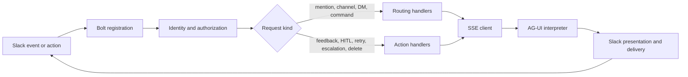

# Slack bot

The Slack integration is a Bolt application that routes Slack requests to
dynamic agents over AG-UI.

## Request path

- Authorization runs before every registered handler and fails closed.
- Mention routing takes precedence over ambient channel-message routing.
- Direct messages and slash commands use the personal agent-resolution chain.
- AG-UI events become protocol-neutral updates before Slack rendering or API calls.

## Module ownership

| Module | Owns | Must not own |
|---|---|---|
| `app.py` | Early redaction, dependency composition, handler registration | Request policy |
| `bootstrap.py` | Environment parsing, clients, health retry, process startup | Handler behavior |
| `handler_dependencies.py` | Narrow dependency contracts for each handler group | Construction or I/O |
| `handlers.py` | Bolt middleware/event/action/view registration | Business policy |
| `authorization.py` | Identity enrichment, OBO binding, deduplication, fail-closed RBAC | Bolt app construction |
| `routing.py` | Composition of channel and personal routing dependencies | Request policy |
| `channel_routing.py` | Channel, mention, and ambient-message dispatch | Personal agent selection |
| `personal_routing.py` | Direct-message agent selection and slash commands | Channel route selection |
| `conversation.py` | Conversation creation, interaction telemetry, and agent invocation | Slack route selection |
| `actions.py` | HITL, feedback, retry, escalation, deletion, and passive events | Route selection |
| `utils/agui_events.py` | AG-UI event and control-marker interpretation | Slack blocks or API calls |
| `utils/ai.py` | Streaming orchestration and Slack delivery | AG-UI wire-type mapping |
| `utils/slack_formatter.py` | Slack block construction and limits | Agent invocation |

## Startup ordering

1. `app.py` installs log redaction before importing Slack Bolt or Slack SDK.
2. `bootstrap.build_runtime()` parses settings and constructs process dependencies.
3. `handlers.configure_handlers()` supplies those dependencies to each handler group.
4. `handlers.register_handlers()` attaches the request boundary to Bolt.
5. `bootstrap.run_runtime()` waits for the API, starts the admin endpoint, and serves Slack.

Importing authorization, routing, action, or AG-UI interpretation modules does
not construct a Bolt app, call the platform API, retry, sleep, or exit the process.

## Tests

- Put domain behavior tests beside the owning extracted module.
- Keep application-boundary tests limited to construction, registration, and startup ordering.
- Preserve Slack-visible text, routing precedence, retry behavior, authorization denials, and audit calls with characterization tests.

## UI directory API

- The UI BFF calls authenticated `GET /admin/slack/directory/{channels,users,emoji,status}` on the bot admin port. Browser authorization stays in the UI.
- The bot owns all Slack Web API requests for these UI features. Configure Slack bot/app/signing credentials on the bot deployment only; remove them from UI secrets and ConfigMaps. The UI Helm chart rejects provider credential entries in `config` and `externalSecrets.data`; operators must also remove stale provider keys from any separately managed `existingSecret`.
- Service tokens must match the configured issuer, audience and allowed UI client, include `slack:directory:read`, and carry `slack-directory-service` in the signed `slack_bot_admin_roles` array. Keycloak's init script assigns that client role only to the BFF service-account user and maps its roles into access tokens. Browser user tokens with the same client, audience and scope are denied. Do not grant the service role to interactive users or add it to default user roles. Re-run the init/reconcile job when upgrading an existing realm; external issuers must provide an equivalent claim restricted to the BFF service account.
- Fixed query parameters are limited to search, paging, refresh and user kind; these endpoints cannot forward arbitrary Slack methods, URLs or tokens.
- Users and emoji refresh in the background every 24 hours. Searches serve the last complete snapshot while refreshing. Failed or truncated walks retain the previous snapshot; lookup results exclude email/search-only fields.
- Channel discovery remains restricted to bot-member channels. `platform_config.slack_discovery_cache_ttl_minutes` takes precedence over `SLACK_DISCOVERY_CACHE_TTL_MINUTES` (default 60); zero disables caching. The bot reads this configuration from its existing MongoDB connection.
- HTTP 429 cooldowns honor the full Slack `Retry-After` value and share the cooldown across replicas through the optional cache. The UI proxy has a 20-second deadline; a directory refresh can continue independently of that request.
- Users and emoji snapshots use `CAIPE_CACHE_REDIS_URL` when configured. They stay fresh for 24 hours and may be served while a refresh runs for up to seven days from collection. Redis stores complete JSON snapshots under hashed workspace identities; Slack tokens are never cache keys or log fields. Channel discovery keeps its existing MongoDB-configured TTL and does not use this snapshot cache.
- Channel requests share one background refresh per workspace and wait at most two seconds. Pending requests return HTTP 503 with `Retry-After: 1`; fresh cached reads continue immediately. The discovery controls distinguish pending refreshes from completed refreshes and configuration errors.
- User status counts describe the last complete snapshot; `refresh_progress` reports a running scan separately. Invalid emoji values reject the refresh and retain the previous complete snapshot.

For Compose, the production UI explicitly allowlists its supported environment settings instead of inheriting the shared `.env` file. The default first-install profiles do not require the Slack bot.
