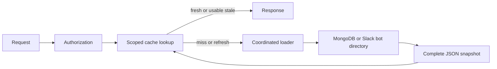

# Application caching

CAIPE uses explicit cache-aside calls for expensive read models. MongoDB owns
durable application state; the optional platform Redis holds replaceable JSON
snapshots. Authorization and effective resource scope are resolved before a
cached domain operation.



## Read policies

| Data | Fresh window | Total hard lifetime | Scope |
| --- | --- | --- | --- |
| Slack users and emoji | 24 hours | 7 days | Workspace and bot credential fingerprint |
| Slack channels | Configurable, default 60 minutes | Bounded by directory policy | Workspace and bot credential fingerprint |
| Insights statistics and Feedback | 60 seconds | 5 minutes | Current effective admin or personal scope and filters |

- A stale snapshot is served while one worker refreshes it in the background.
- A complete successful loader result replaces the snapshot atomically.
- Local coalescing and renewable Redis leases coordinate refreshes.
- Hard expiration limits data age during upstream failures.
- Redis errors trigger a cooldown and bounded local fallback.
- Expensive loaders have bounded concurrency and queue waits.
- A non-positive fresh TTL disables caching for that operation.

## Adding a cached operation

The UI helper lives in `ui/src/lib/server-cache.ts`. Compute the caller's current
authorization scope first, then include that scope and every effective filter in
the key. Cache JSON values and propagate loader failures.

```typescript
const result = await getOrLoad({
  namespace: "example.summary",
  freshMs: 60_000,
  staleMs: 300_000,
}, { scope: effectiveScope, filter }, async () => loadSummary(filter));
```

`staleMs` is the total lifetime from computation, including the fresh window.
The Python directory helper provides the same policy with seconds in
`integrations/slack_bot/utils/cache.py`. Cache metrics expose hits, misses,
shared loads, failures, Redis errors and accumulated snapshot age.

## Deploying platform Redis

- Enable `caipe-redis.enabled` in the parent Helm chart.
- Provide `caipe-redis.auth.existingSecret.name/key` containing the Redis password.
- Create a Secret containing `CAIPE_CACHE_REDIS_URL`, including the matching
  password and the `<release>-caipe-redis:6379` service address.
- Enable `caipe-ui.cacheRedis` and `slack-bot.cacheRedis`, and point their
  `existingSecret.name/key` at that URL Secret.
- Defaults use AOF, snapshots, a retained 1 GiB PVC, `maxmemory=512mb`,
  `allkeys-lru`, and a 1 GiB container memory limit.
- The service is ClusterIP. An ingress NetworkPolicy admits the same-release
  UI and Slack bot pods. Service mesh deployments should apply their normal
  workload mTLS policy to Redis and both clients.
- Use a new cache PVC. Retain the legacy RAG Redis volume through the documented
  migration and rollback window.

For Compose, add the `caipe-cache` profile and set
`CAIPE_CACHE_REDIS_URL=redis://caipe-redis:6379/0`. Its host port is bound to
loopback. The first-install profile set works with caching disabled.
