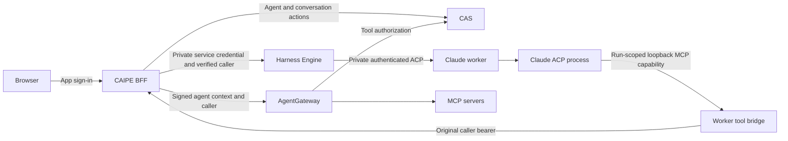

# Claude ACP in CAIPE

Claude (ACP) is a first-party Agent Builder and chat integration. It uses the
same conversations, sharing controls, tool timeline, Stop action and reconnect
flow as other CAIPE agents. The integration is experimental.

## Agent author workflow

1. Select **Claude (ACP)** and an available **Operator profile** in Agent Builder.
2. Write the agent instructions and choose individual MCP tools in **Tools**.
3. Save the agent and start a chat. The Claude session panel shows response
   activity and explains shared-viewer access.
4. Refresh or reopen the chat to reconnect to the server-owned run. Starting
   another browser subscription does not start another Claude process.
5. **Stop** cancels the current response and keeps the chat open. While an
   already-dispatched tool drains, the composer shows **Stopping** and waits
   for server confirmation before sending another prompt. Refresh preserves
   that state. Confirmed cancellation is shown as **Stopped**, not an error.

Model access and workspace policy are deployment settings. Agent authors cannot
supply a worker URL, executable command, provider credential or permission bypass.
Existing conversations retain their pinned execution configuration when an
agent's default harness changes.

## Authentication and authorization



| Boundary | Authentication | Authorization |
|---|---|---|
| Browser → BFF | Existing OIDC session or accepted caller bearer | CAS agent use and conversation write for execution; conversation read for shared replay |
| BFF → Engine | Deployment-managed internal service credential | Verified caller subject; exact conversation read scope cannot mutate a run |
| Engine → worker | Private allowlisted endpoint and distinct worker service credential | Original run ID, subject, binding and immutable agent version; worker rejects inconsistent contexts |
| Claude process → tool bridge | Random capability for one run, accepted only on loopback | Only pinned tool aliases; capability is removed when its turn ends |
| Worker → BFF → AgentGateway | Original caller bearer and signed real-agent context | Current agent availability, agent-use and conversation-write access, pinned tool bindings, current agent tool policy and MCP invocation grants are checked on every call |
| Worker → model provider | Operator-supplied provider credentials or supported workload identity | Provider IAM/model policy and configured model profile; independent of the user's app sign-in |

- CAS is the authorization boundary. It does not replace OIDC authentication.
- AgentGateway routes MCP traffic and enforces its caller/agent tool policy.
  ACP does not grant tool access by itself.
- The Claude process receives neither the user's bearer token nor the worker's
  internal service credential. Its MCP capability cannot invoke another run or
  expand the selected tool set.
- Shared readers may follow a response without agent-use permission. Sending,
  stopping and invoking tools retain the execution-owner and write checks.
- MCP calls are not automatically retried after an ambiguous result. Dispatched
  calls drain before the session reservation is released.
- Claude's MCP execution and idle limits are 15 minutes, below the broker's
  16-minute request limit. Automatic MCP backgrounding is disabled so the turn
  waits for its dispatched tools, including across browser refreshes.
- Selected MCP tools currently require `approval_policy: never`. Interactive
  tool approvals and user-input forms are not supported by this integration.
- Native workspace/shell tools are disabled by default. If an operator enables
  them, they run under the worker's OS/filesystem boundary; they do not pass
  through CAS or AgentGateway. CAS is not a filesystem sandbox.

## Deployment

Use the optional `deploy/harness-engine/compose.claude-acp.yaml` overlay with
the base Compose file and `compose.deep-agents.yaml`. The standard OSS install
profiles do not enable this worker.

- `CLAUDE_ACP_WORKER_INTERNAL_TOKEN`: distinct private worker credential.
- `CLAUDE_ACP_PROFILES_JSON`: local model/workspace profiles, for example
  `{"safe":{"model":"<approved-model-id>","cwd":"/workspace","permission_mode":"dontAsk"}}`.
- Add the corresponding connection to `HARNESS_ENGINE_CLAUDE_WORKER_PROFILES_JSON`:

```json
{
  "primary": {
    "url": "http://claude-acp-worker:8010",
    "token": "<worker-service-credential>",
    "profile_id": "safe",
    "runtime": "claude_code_acp",
    "tools_enabled": true,
    "description": "Managed Claude session with selected MCP tools"
  }
}
```

Use private networking or HTTPS between services. Run the container with an
init process (`init: true` in the overlay) so provider children are reaped;
the worker drains the dedicated process group before releasing a run. Mount its
persistent workspace volume and configure the BFF tool broker URL. The optional image pins
the upstream Claude ACP executable. Instructions, model options and selected
MCP tools are supplied through ACP session setup; built-in tools and settings
discovery remain restricted by operator policy.

The Engine exposes this connection as the `claude_code_acp` harness. Older
`claude_agent_sdk_remote` blueprints selecting the same connection remain valid.

## Persistence boundaries

- Engine bindings and canonical event journals live in MongoDB.
- Native Claude ACP transcripts live on the worker's persistent workspace volume.
  They are not mirrored by the Python SDK's Mongo transcript store.
- Reloading the browser replays Engine events. Replacing an idle worker can load
  the native transcript when the same workspace volume is available.
- In-flight process takeover after a worker failure is unsupported. An uncertain
  producer retains its reservation until operator reconciliation.
- The network leg is a private HTTP/NDJSON ACP v1 transport with the negotiated
  Harness extension, not the proposed standardized ACP Streamable HTTP transport.
