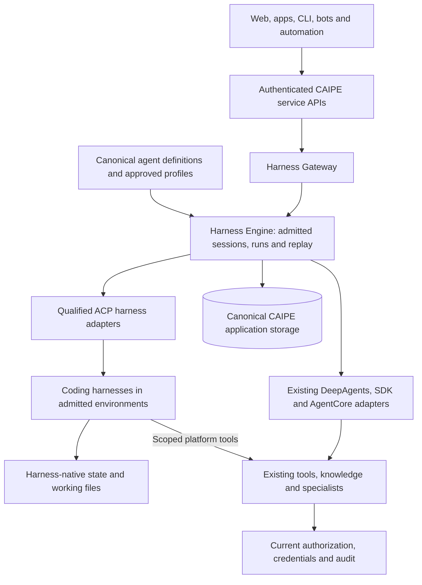
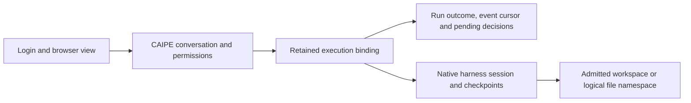

# CAIPE metaharness: shared execution and pluggable agent runtimes

**CAIPE should provide one platform contract for agents, conversations, durable execution and policy while allowing different harnesses to run the agents.** Agent Client Protocol (ACP) is the preferred interaction boundary for new coding harnesses. The first proof of concept connects Claude Code in a preprovisioned sandbox; it validates part of this architecture rather than defining its full scope.

Keep the valuable existing platform behavior: dynamic-agent definitions, default agents, tools and credentials, knowledge, workflows, automation, sharing and canonical history. New runtimes enter through the shared Harness Gateway and Engine. They do not create a competing CAIPE agent catalog, conversation service or workflow engine.

## One platform, with distinct responsibilities

| Responsibility | Owner |
| --- | --- |
| Platform metaharness | CAIPE coordinates identity, definitions, admitted capabilities, execution context and shared services. |
| Harness Gateway | The existing authenticated front door resolves the retained backend and presents the client API/event formats. |
| Harness Engine | The selected durable execution service owns admission, session bindings, run outcomes and ordered replay. |
| Agent harness | DeepAgents, Claude or another qualified backend owns the reasoning loop, native tools and executable continuation. |
| Environment service | Owns sandbox resources, persistent volumes, containment and lifecycle. |

This extends the foundation in [gateway discussion #2405](https://github.com/orgs/caipe-io/discussions/2405) and merged [#2401](https://github.com/caipe-io/ai-platform-engineering/pull/2401). [#3192](https://github.com/caipe-io/ai-platform-engineering/pull/3192) brings the existing DeepAgents runtime under Engine durability; [#3194](https://github.com/caipe-io/ai-platform-engineering/pull/3194) adds Claude ACP workers and shared session controls. These supersede the overlapping implementation direction in #2883, #2982 and #3083. They do not imply that every portable checkpoint, approval or sandbox feature described in those drafts is implemented.

**One native execution authority per run remains the invariant.** A trusted remote worker can supervise a provider process and retain its dispatch receipt. That transport boundary must not create an independently editable agent definition or a second platform owner capable of submitting the same turn.

## Shared definitions, qualified capabilities

Default agents, SRE and custom agents remain definitions, rather than separate deployments by default. The existing DeepAgents definitions can keep their runtime, logical filesystem, LangGraph checkpoints, tools, skills and specialists. They do not need artificial ACP wrappers to participate in the shared platform contract.

New filesystem-capable coding agents should use an admitted coding harness and environment profile. An author chooses the runtime/profile in the same Agent Builder, writes the system instructions and selects permitted platform resources. Operator settings select approved endpoints, executables, model routes and environmental limits; they are not another prompt editor.

| Concern | Shared contract |
| --- | --- |
| Instructions | Compile the canonical saved prompt and supported resources into an immutable admitted revision. Claude ACP session setup receives those instructions; an environment profile does not replace them. |
| Tools, knowledge and skills | Retain the existing owning services and current caller/resource authorization. Declare what each adapter can actually expose instead of silently omitting selected resources. |
| Specialist agents | Distinguish CAIPE custom-agent delegation from a coding harness's internal task/subagent features. Only advertise qualified dispatcher and parent/child-context behavior. |
| Definition edits | Existing sessions retain their execution binding. Supported next-turn updates and pending-input continuations follow the adapter's revision rules; incompatible state is not silently reinterpreted. |
| Runtime changes | Apply to a new conversation or an explicit migration that preserves native state and authority. Do not switch a retained conversation merely because an agent's default changed. |

Capability validation must reject unsupported required behavior before provider effects. An ACP handshake establishes protocol compatibility, not feature parity, isolation or backup support. Existing SDK/AgentCore adapters can retain their actual provider interfaces. ACP standardization is useful at the runtime boundary without forcing every internal tool or graph node to become an ACP deployment.

The authenticated accessible-agent catalog remains the initial discovery mechanism. Across environments, directory metadata can identify candidates; it does not grant access or activate a runtime. A connection still needs an admitted endpoint, verified capabilities and current caller grants. The separate [CLI ACP client contract #55](https://github.com/caipe-io/caipe-cli/pull/55) concerns external clients connecting to CAIPE, rather than the Engine connecting to a coding harness.

## A conversation is not a process

| State | Meaning and authority |
| --- | --- |
| UI/login session | Existing sign-in and local presentation state. It identifies the caller and visible conversation, not executable agent state. |
| Canonical conversation | CAIPE owns visible messages, sharing, personal-history protections and audit access. |
| Execution binding | Maps the owner, conversation, agent revision and execution context to the retained backend/profile, native session and storage coordinates. |
| Durable run | Stable request identity, ordered events, cancellation intent and outcome. Replay is output, not another model prompt. |
| Native continuation | The runtime's actual LangGraph checkpoint, Claude transcript/configuration and workspace, or another backend's supported session state. Visible text alone cannot recreate it. |

The existing browser chat store presents messages and drafts; canonical history APIs persist them. API invocation and server-owned Engine execution have their own history-writing responsibilities. Background execution is useful only when the final visible answer remains recoverable without the browser: keep server-owned history and message identities consistent with replay, rather than depending on a subscriber to save the result.

“Sticky” means retaining this mapping across connections and replicas. HTTP affinity and warm processes are optimizations. A fresh connection, changed profile alias or missing workspace cannot silently create a replacement session and call it continuation.

## Durable controls without uncertain reexecution

Persist admission and ordered output before acknowledging it. Reconnect to the same admitted run after the consumed cursor. Stable duplicate submissions attach or conflict; they do not start another producer. Keep cancellation reservations until the actual provider and dispatched tools have drained.

| Operation | Required behavior |
| --- | --- |
| Refresh/reconnect | Replay and continue the retained run without submitting its prompt again. Shared viewers read the same authorized stream. |
| Stop | Target the exact admitted run and confirm native/process/tool drain. A lost cancellation acknowledgement is an uncertain outcome, not success. |
| Human input | Persist and correlate the exact pending decision with its admitted revision and current permissions. An unattended client cannot invent approval. |
| Clear, rewind or edit | Follow the runtime's declared state capabilities. Unsupported native rewind must be explicit; editing visible text alone does not rewind executed effects. |
| Worker/environment loss | Retain committed output/state and surface interruption or uncertainty. Do not automatically replay an accepted prompt, approval or external mutation. |
| Deletion/retention | Distinguish transcript retention from native session/files and remote environment cleanup. Fence late execution, keep cleanup retryable and report what was actually removed. |

The current [Claude integration](./claude-acp.md) covers browser refresh, replay and native session reload from its retained volume. It does not provide automatic in-flight process takeover or interactive approval/form parity. Those are capability gaps, not consequences that ACP alone resolves. The same distinction applies to each future backend.

## One canonical database, with explicit native-state boundaries

The architectural destination remains **one canonical CAIPE application database**, with service-owned collections, consistent migrations, backup and retention. Conversation APIs and execution services own their records; applications do not gain unrestricted database access. Identity and authorization services remain the authorities for their own data.

The [storage discussion #2711](https://github.com/orgs/caipe-io/discussions/2711) remains relevant, especially [workload contention](https://github.com/caipe-io/ai-platform-engineering/discussions/2711#discussioncomment-18370797), [schema consistency](https://github.com/caipe-io/ai-platform-engineering/discussions/2711#discussioncomment-18371697) and [migration](https://github.com/caipe-io/ai-platform-engineering/discussions/2711#discussioncomment-18433485). Sharing a database does not make two services owners of the same collection or make external effects transactional.

| Record family | Storage and recovery responsibility |
| --- | --- |
| Definitions, conversations and visible messages | Existing canonical CAIPE services and access controls. |
| Sessions, admitted revisions, runs and replay | Harness Engine's authoritative bindings and lifecycle records. |
| Native checkpoints and logical files | Existing runtime-specific state, including DeepAgents namespaces and checkpoint coordinates. |
| Coding runtime state | Retain the actual native format and workspace until a qualified external-store or consistent checkpoint/restore integration exists. A copied transcript is not necessarily a complete native checkpoint. |

Current implementation has a gap against the destination: #3194 adds a `_claude_worker` database namespace for worker admission/replay, and native Claude ACP state lives on a persistent volume. Consolidating worker records requires collection namespacing and migration, not pointing both repositories at identical collections. The PoC must include the existing database/volume boundaries in backup and deletion; it must not describe the earlier drafts' portable GridFS archive design as already implemented.

A portable checkpoint integration remains a valid architectural capability: quiesce the native runtime, validate complete bounded state, publish its recovery reference under the live execution fence, and verify restoration before native load. Qualify it against the actual harness format and versions. Until then, native volume loss can prevent continuation even though CAIPE history is intact. Backup restoration cannot infer the result of an external mutation that lacked a recorded outcome.

## Apps reuse CAIPE services

The simple integration model remains **a frontend using CAIPE services**. Hosting a UI does not automatically integrate its history or agents. An integrated frontend uses protected CAIPE catalog, conversation, execution, history and file APIs under the current caller; it retains canonical references and treats local caches as derived.

| App action | Contract |
| --- | --- |
| Discover/select | Refresh the complete authorized catalog and retain stable agent/connection references. Newly created accessible agents do not require a credential per agent. |
| Start/reconnect | Create the canonical conversation before dispatch and reuse its original reference. A failed load cannot silently create another native session. |
| History and controls | Use shared replay, current permissions, supported pending decisions and exact run cancellation. Read access does not imply execution or shell ownership. |
| Data reuse | Call the owning APIs. Direct writes to canonical collections bypass the contract and are unsupported. |

The [apps discussion #2853](https://github.com/orgs/caipe-io/discussions/2853), including [versioned APIs](https://github.com/caipe-io/ai-platform-engineering/discussions/2853#discussioncomment-18705074) and [release coupling](https://github.com/caipe-io/ai-platform-engineering/discussions/2853#discussioncomment-18713829), complements this execution architecture. [#2852](https://github.com/caipe-io/ai-platform-engineering/pull/2852) provides app packaging; [#3082](https://github.com/caipe-io/ai-platform-engineering/pull/3082) extends secondary-agent/private-history host contracts rather than introducing basic primary app chat support.

An external coordinator such as [Paperclip](https://github.com/paperclipai/paperclip) also owns tasks, schedules and backend state. Integrating one is a different boundary from mounting its frontend. Define which system owns each task, native session and history; two coordinators must not independently drive the same CAIPE run. Its persistent harness-reference patterns are useful without replacing CAIPE's canonical execution services.

## Policy follows identity and resources

Use current supported user-subject forwarding through CAIPE's authenticated BFF and existing agent/conversation/resource checks. Broader delegation evolves with [CAS #1778](https://github.com/orgs/caipe-io/discussions/1778) and [shared authorization #2406](https://github.com/orgs/caipe-io/discussions/2406), including [trusted context](https://github.com/caipe-io/ai-platform-engineering/discussions/2406#discussioncomment-18248842). This proposal adds no channel-specific authority or separate policy decision service.

| Boundary | Enforcement owner |
| --- | --- |
| Agent, conversation and execution | CAIPE checks the actual caller, retained binding and current permissions for web, apps, CLI, bots and automation alike. |
| Platform tools and connected data | Existing broker/CAS/AgentGateway path narrows selected tools and resolves credentials server side. The harness receives a run-scoped capability. |
| Files, processes and network | The environment enforces real containment, mounts, resource limits and egress. ACP callbacks and prompt instructions do not virtualize or constrain arbitrary shell tools. |
| Model access | Approved model route, provider identity and usage/resource policy; separate from a user's app login. |
| Human decisions | Permit an exact action inside the admitted policy. Approval cannot widen a denied destination, mount or resource grant. |

Restricted command patterns and native-tool allowlists are useful reductions, not security boundaries by themselves. An allowed shell/interpreter can compose other operations. The trusted worker, database credentials and broad service/caller tokens must remain outside the coding shell's process/filesystem boundary.

### Sharing and environment choices

Share agent definitions, immutable images and capacity. Sharing a writable HOME, native session or credential store deliberately shares data; per-user directories inside the same unrestricted environment are not equivalent to OS isolation.

| Choice | Decision |
| --- | --- |
| Existing managed runtime | Keep existing DeepAgents/custom-agent behavior and logical files. No per-agent sandbox is required. |
| Private sandbox-backed harness | Admit a real filesystem/network environment and retain its owner/session/workspace binding. This is the initial coding PoC. |
| Shared writable environment | A separate, explicitly authorized collaboration model. It is not the default way to isolate unrelated callers or conversations. |
| Coding CLI with simulated filesystem | Not a supported shortcut unless the harness genuinely virtualizes all relevant built-in tools. ACP filesystem/terminal callbacks alone do not establish this. |

## Workflows and environment ownership

Keep the current workflow engine, scheduler and webhook owners. Agent steps carry their verified owner/service identity and execution context through an admitted runtime. A coding agent calling a workflow tool does not establish that every workflow can invoke that coding agent with full continuation and approval semantics. Qualify those directions separately. Existing knowledge and specialist services retain their ownership, consistent with [knowledge access #2325](https://github.com/orgs/caipe-io/discussions/2325).

CAIPE owns definition/profile/policy admission and execution binding. An environment service owns pods/VMs, volumes, capacity and actual policy enforcement. A thin provider/reconciliation boundary can coordinate these without duplicating a complete resource controller or adopting a second agent/session database.

Preprovisioning is a PoC deployment choice, not a permanent architecture constraint. Automatic allocation can later use an admitted provider contract keyed by the same definition/profile and owner/context, while the environment service remains the resource owner. It must preserve the same policy, sticky binding and recovery guarantees; it does not justify a second prompt editor or session authority.

[Kagent's harness model](https://kagent.dev/docs/kagent/1.x/agents/agent-harness/) and [Kubernetes SIGs Agent Sandbox](https://github.com/kubernetes-sigs/agent-sandbox) remain relevant infrastructure references. Reusing their lower-level environment capabilities is separate from adopting their definition/session control plane. The first PoC needs no new CAIPE provisioning controller: a preprovisioned environment and narrowly scoped data plane are sufficient.

## First PoC: Claude Code in a preprovisioned sandbox

The PoC tests native coding, sticky session identity, platform tools, real containment and durable controls under the shared gateway. It is not a migration of every agent or a final choice of sandbox infrastructure. [#3215](https://github.com/caipe-io/ai-platform-engineering/pull/3215) extends #3194 for this boundary; the [sandbox connection guide](./preprovisioned-acp-sandboxes.md) describes the concrete transport and acceptance cases.

| Stage | User experience | Operator responsibility |
| --- | --- | --- |
| Provision | Open the separate sandbox web app, choose an approved coding profile and wait for it to run. Its CAIPE connection panel exposes a reference and setup status. | Publish the approved image/profile and actual filesystem/network/model policy. |
| Connect | Have the connection reference registered for the user's CAIPE account; refresh connections in Agent Builder. Creating an environment alone does not admit it to CAIPE. | Register the private endpoint, immutable environment identity, owner and approved profile revision. Keep service credentials outside the browser and sandbox shell. |
| Configure agent | Choose Claude (ACP) and the admitted sandbox profile, write instructions, select supported MCP tools and start a conversation. | Validate required capabilities and current access before dispatch. |
| Operate | Use normal chat/reconnect/Stop. The session details link back to the pinned environment. | Retain execution reservations until remote process/tool drain is confirmed. |
| Manage | Inspect files, profile/configuration and lifecycle in the sandbox app. Suspend/resume/delete affect running work; chat deletion does not erase remote files. | Apply policy changes through approved revisions and revalidation. Report drift/unavailable state without silently repointing an existing session. |

The initial admission unit is one owner and conversation per sandbox. A shared agent definition does not make its private runtime available to another caller or conversation. Further placement modes can use the same platform contract when their isolation and lifecycle semantics are qualified.

## Protocol and harness compatibility

Use stable **Agent Client Protocol wire v1**, negotiated capabilities and qualified executable/SDK versions. The current worker's private HTTP/NDJSON extension and the sandbox process relay are documented custom transports, not claims of standardized ACP Streamable HTTP. [Stable schema releases](https://github.com/agentclientprotocol/agent-client-protocol/releases/tag/schema-v1.29.1) and [transport guidance](https://agentclientprotocol.com/protocol/v1/transports) inform adapter qualification; newer drafts are not platform defaults merely because they exist.

| Candidate | Current implication |
| --- | --- |
| Claude Code | First PoC, using the [Claude ACP adapter](https://github.com/agentclientprotocol/claude-agent-acp) already integrated in #3194. |
| OpenClaw | [First-party ACP bridge](https://docs.openclaw.ai/cli/acp); qualify its native lifecycle, tool and credential semantics as another provider. |
| Hermes | [First-party ACP server](https://hermes-agent.nousresearch.com/docs/user-guide/features/acp/); qualify session, permission and recovery behavior before admission. |
| Pi | Core [RPC](https://github.com/earendil-works/pi/blob/main/packages/coding-agent/docs/rpc.md) plus an [external ACP adapter](https://github.com/svkozak/pi-acp); do not assume native ACP or MCP parity. |
| AgentGateway | Reuse existing MCP/model routing and policy. Transparent proxying, where supported, does not replace Engine session authority, replay or sandbox enforcement. |

The common architecture is the retained definition, policy, session and run contract. Each implementation must demonstrate the features it advertises through that contract; the first PoC provides evidence for Claude Code without promising interchangeability for unqualified backends.
