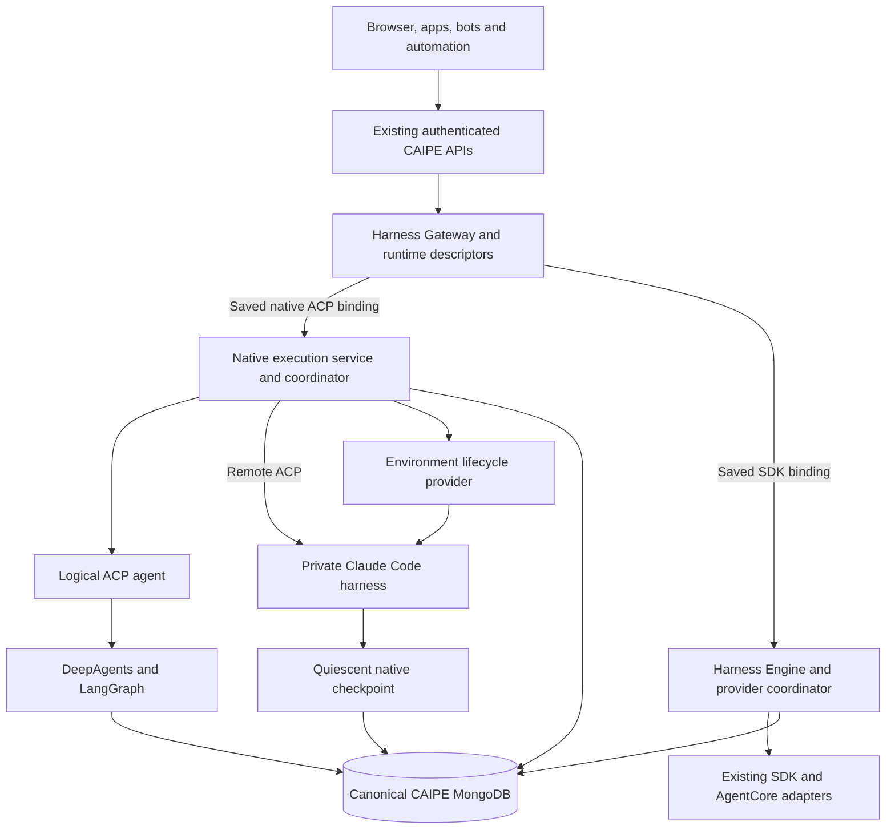
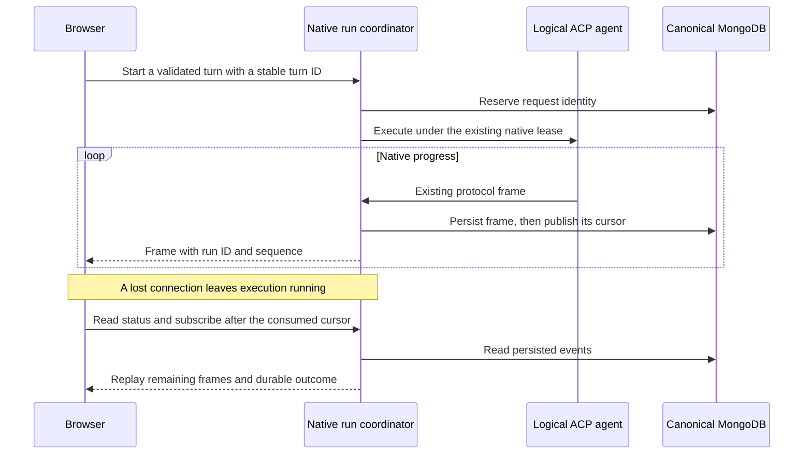
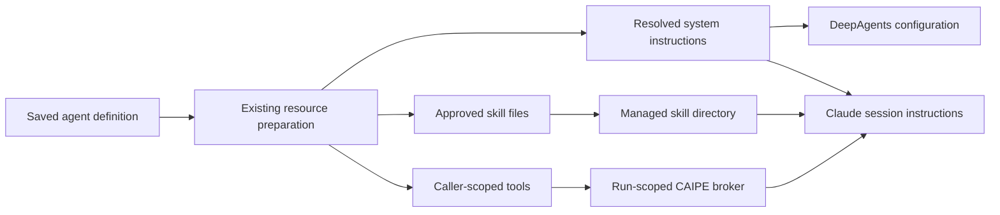

# Harness Gateway and native ACP execution

The [CAIPE metaharness proposal](https://github.com/orgs/caipe-io/discussions/2877)
extends the merged [Harness Gateway](https://github.com/caipe-io/ai-platform-engineering/pull/2401)
rather than introducing another router. The authenticated BFF selects the execution
owner and translates its output into the existing client APIs. Managed default,
SRE and custom agents retain DeepAgents/LangGraph; an admitted private coding
profile selects Claude Code through the same native owner. Their start,
human-input resume and invoke paths all cross native ACP.

## Native ACP execution models

| Model | Definition and user experience | Workspace and state |
| --- | --- | --- |
| **Managed Agent** | Existing default/custom DeepAgents agent; `execution.kind=native` remains the default. The saved prompt, model, tools, skills and current native features are retained. | Shared service with admitted logical files and LangGraph checkpoints. Interactive storage defaults to the conversation; existing authorized namespace and workflow-artifact scopes remain intact. Logical files do not provide OS containment. |
| **Private Coding Sandbox** | Opt-in Claude Code profile; `execution.kind=sandbox` and an operator-owned `profile_id`. Provisioning is automatic through the same editor and chat. | One whole private environment and native session per caller-owned conversation. HOME, writable workspace and credentials are not shared across callers or conversations. Committed native state lives in canonical MongoDB/GridFS. |

Existing agents and conversations keep their runtime binding. A shared agent definition does not create an agent per user, merge their conversations or grant access to another caller's workspace. Private coding runtimes use the native ACP execution owner. The existing provider-specific SDK adapters retain their separate Harness Engine owner; one run never executes through both coordinators.

| Identity | Authority |
| --- | --- |
| Agent definition | Shared, versioned instructions, selected resources and admitted runtime profile. |
| Caller | Independently authenticated principal with current agent/resource permissions. Scheduled owner runs and admitted service accounts retain their verified identities. |
| Conversation and run | Canonical history, native session, pending decisions, stable turn identity and execution lease. |
| Workspace | Admitted logical namespace or private conversation environment, with a lifecycle separate from transcript visibility. |

Viewing shared history does not grant shell access, transfer a native session or authorize continuation as its owner. The private model isolates the whole environment; user subdirectories in a shared HOME are not an equivalent boundary. Images and immutable tools can be shared without sharing writable state.

### Alternatives not adopted

| Alternative | Decision and reason |
| --- | --- |
| Shared team SDK sandbox | Excluded from this implementation. A shared directory is an intentional data-sharing boundary, and one conversation's whole-environment restore could overwrite another's work. It does not satisfy the private owner-bound checkpoint contract. |
| Coding harness with simulated files only | Excluded from this implementation. Optional ACP file/terminal callbacks cannot virtualize a CLI's built-in tools. Restricting all native shell/file tools would change the coding feature set; Claude's `allowed_tools` setting is auto-approval, not a tool-removal boundary. |

These alternatives are absent from the executable runtime catalog. DeepAgents already provides the retained logical-filesystem model; Claude Code uses a real isolated environment.

## One front door, one owner per run

| Boundary | Responsibility |
|---|---|
| BFF gateway | Existing authentication and conversation authorization; descriptor-driven selection; saved execution-owner lookup; client stream translation. |
| Native execution owner | Existing native admission leases, runtime lifetime, ACP dispatch, human input, tools, files and replay journal. |
| Engine execution owner | SDK/provider session binding, detached execution and provider event journal. |
| Client | Existing visible-message writer and presentation; reconnect after a consumed cursor without submitting another prompt. |

An immutable `harness_gateway_bindings` routing reference atomically selects
one owner per agent and authorized execution context at first admission.
Read-only lookups do not pin a new context, and existing backend bindings
remain authoritative evidence when establishing that reference. It stores no
provider session, prompt, token or journal.

Each run belongs to exactly one coordinator and journal. Engine does not wrap
`AgentExecutionService.start_run`, and native execution does not copy its output
into Engine collections. Both use the canonical CAIPE MongoDB. A saved binding
selects the owner before the current agent default is read; changing an agent
cannot redirect an active or retained conversation into another runtime. Installed app
claims follow the same rule: retained ownership is checked before app dispatch,
and an app-only invoke rejection cannot hide a saved native/provider binding.
Conversely, a server-managed `conversation.app_binding` retains external app
execution and fails closed if that installation is removed or rebound. New app
admissions record that binding on the existing conversation. Editable overlay
metadata only associates a conversation with an app UI; Managed and SDK overlays
continue to use their ordinary retained backend. Older external app histories
without a server binding require explicit adoption before relying on that
retained-app guarantee. App/native cutovers
require quiescent migration because existing app streams do not share the native
and SDK backends' atomic admission contract. Missing
provider configuration and inconsistent bindings fail explicitly.

The gateway reuses its existing descriptor catalog, editor, harness badges and
SDK/AgentCore adapters. Those adapters retain their declared provider contracts;
appearing in the same catalog does not make them ACP implementations. Native
DeepAgents uses ACP by default, without an enablement flag. The separate
[coding-sandbox extension](https://github.com/caipe-io/ai-platform-engineering/pull/2982)
adds an opt-in placement through this same selector and gateway.

## Native execution and feature preservation

The native ACP client and logical agent exchange JSON-RPC inside Dynamic Agents.
This is an interaction boundary, not a new deployment or public ACP endpoint.
Capability negotiation precedes prompting, and the client converts validated
native progress into the existing AG-UI or custom SSE frames.

| Native contract | Behavior |
|---|---|
| Runtime | Keep DeepAgents/LangGraph, MCP integrations, native subagent delegation and logical files. ACP does not grant a real host filesystem. |
| Protocol | Pin Python SDK 0.12.1 and wire protocol 1. Typed `caipe.io/native-acp` metadata and acknowledged `_caipe/event` requests preserve the native features beyond standard progress. |
| Session identity | Reuse the original native thread and admitted storage coordinates. Do not reconstruct executable state from the UI transcript. |
| Human input | Preserve checkpointed forms and edited batch approvals, exact pending identities and current narrowed MCP, built-in, URL-domain, workflow and subagent grants. |
| Client output | Preserve attachments, tool/subagent progress, reasoning and native form detail through both existing encodings. |
| Automation | Keep the workflow engine, scheduler and invoke lifetimes and their authorized execution-context mappings. |

LangGraph chunks are interpreted once into typed events. Neither the logical
agent nor the protocol bridge parses UI event strings to infer execution state.
Runtime construction, binding validation and administrative deletion share the
native storage resolver. The native bridge does not advertise unsupported ACP
session loading, listing/forking, client filesystem or terminal capabilities.
A new connection for a turn reuses trusted native state without repeating history.

For retained Engine runs, the BFF projects the provider's committed canonical
events into standard client frames. Its cursor also records the projected part
within an event, so reconnecting between parts cannot lose or repeat output.
The projection does not create another persisted journal. Native frame cursors
retain their existing strict ordering and validation.

The [gateway discussion](https://github.com/orgs/caipe-io/discussions/2405)
provides the shared session-management foundation. This extension retains native
feature and lifecycle protections behind that foundation. Runtime choice,
interaction protocol and sandbox placement remain distinct contracts.

## Sessions and the canonical database

The admitted effective agent configuration and its session binding are stored
in `native_acp_sessions`, in the same configured MongoDB database as CAIPE
records and native checkpoints. The binding uses the agent ID and original
native session ID. It does not copy the checkpoint into a new history format
or store caller tokens and MCP credentials.

| State | Owner and persistence |
|---|---|
| Admitted agent configuration and execution binding | The native ACP integration stores the effective configuration snapshot and binding in `native_acp_sessions`. |
| Active-turn ownership | `native_acp_runs` stores an owned lease for each agent/session pair so multiple replicas coordinate admission and cancellation. |
| Native runtime state | LangGraph continues to use the existing checkpoint collections and thread IDs. DeepAgents files retain their existing storage namespace. |
| Interactive conversation messages and progress | The browser still writes the existing CAIPE conversation records through the BFF. |
| Workflow and automation history | Existing services keep their current history-writing responsibilities and execution-context mapping. |
| Streaming run lifecycle and replay | `native_acp_execution_runs` stores request identity, native lease association and outcome; `native_acp_execution_events` stores sequenced stream frames in canonical MongoDB. The service owns execution and clients subscribe independently. |

Normal interactive conversation IDs and automated execution-context IDs keep
their existing relationship to LangGraph `thread_id`. New ACP bindings must not
rename those threads or invalidate existing checkpoints. Ordinary `/invoke`
continues to honor `INVOKE_PERSIST_HISTORY`; the ACP boundary does not make an
ephemeral invocation durable.

Admission acquires the turn lease before updating the binding or runtime
cache. A unique agent/session index permits one owner; the worker extends a
120-second lease and polls cancellation every second. Cancellation can reach
the owner even when its HTTP request lands on a different replica. Caller
identities, tokens and tool credentials are not stored in either ACP collection.

Workers need synchronized clocks. If a lease expires, another worker can
admit a later request using the existing native checkpoint. Expiry does not
automatically restart the previous run or provide exactly-once external tool
effects. The run journal replays already persisted output without calling tools.
A run whose worker lease disappears or expires becomes explicitly interrupted. A stale worker is not fenced from an
external service by this MongoDB lease. Ephemeral `/invoke` uses transient
turn coordination while retaining its existing nonpersistent history behavior.

Starting a subsequent turn admits the latest effective agent configuration so
existing prompt, model and reasoning edits continue to work. The first
admitted backend/checkpoint/filesystem binding remains fixed. Human-input
resume restores the last admitted configuration after runtime-cache eviction,
including workflow overrides. Resume intersects its saved tool scope with the
current validated definition so removing or narrowing MCP tools and selected
remote-agent tools takes effect
without expanding the saved scope. Configuration snapshots have the same
sensitivity as agent definitions and need the same database access controls.
They are not a redaction layer for sensitive values placed in prompts or
middleware configuration. Changing the database, checkpoint collection or
file-store coordinates of an existing binding fails admission rather than
silently pointing the session at different state; migrate that state first.
Snapshot integrity is checked against the stored configuration before new
optional model defaults are applied. Adding a configuration field must not make
a previously valid session unreadable; the next admission records the current
normalized configuration while retaining the same native state.

The gateway owns `harness_gateway_bindings`; retain those routing references
and the canonical deletion ledger in the same backup. Engine owns its `harness_sessions`, `harness_runs`, `harness_events` and provider
revision/session-store collections. Native ACP owns the collections described
above. These are different execution owners' records, not competing histories
for a single run. Engine admission reserves its binding before asynchronous
preparation and rechecks the producer fence before dispatch. An identical
request attaches to its existing run; changed input conflicts. A recoverable
event intent is reconciled before the committed replay head is exposed, including
on standalone MongoDB. Missing or expired output fails explicitly.

Configure the UI, Dynamic Agents and Harness Engine to use the same
`MONGODB_URI` and `MONGODB_DATABASE`. Include the new ACP collections and native checkpoint/file
collections in that database's existing backup and restore procedures. Restored
lease records can expire; they are not instructions to restart a run. The
implementation does not migrate transcripts
or consolidate databases that a deployment previously configured separately.

## Identity and filesystem boundaries

Existing authenticated caller identity, agent authorization and tool credential
delegation remain the admission boundary. ACP negotiation is not an
authorization grant. A caller must still have permission to use the agent and
the conversation or automated execution context.

Existing chat-management requests retain their BFF conversation authorization.
Stopping an active run keeps the existing cancellation semantics, including
when agent-use permission has been revoked. The native in-service ACP connection adds no public agent endpoint. The private
coding relay uses the admitted environment identity and policy described below.

Cached runtimes are refreshed when the admitted configuration, current caller,
client context or bearer changes. Each request therefore uses its current
authorization and tool credential context rather than retaining the caller who
first initialized the cache entry.

DeepAgents retains its logical filesystem, backed by its existing checkpoint or
MongoDB file store. The ACP wrapper does not grant access to the host filesystem
or create a per-agent sandbox. Existing tool-level network controls still apply;
ACP itself does not enforce an operating-system network policy.

Shared Claude SDK execution disables its built-in host file and shell tools. No
logical file-tool broker is advertised until that contract is connected. SDK-private
transcript scratch is disposable and distinct from the filesystem available to
agent tools. Managed DeepAgents retains the existing logical file-tool contract. A remote provider must enforce its approved tool/file
profile at the runtime or a trusted broker; ACP negotiation alone cannot impose
those restrictions on remote code.

## Durability and compatibility acceptance

Preserving current durable behavior is an acceptance gate for this migration.
ACP session creation must not create a new CAIPE conversation, rename the native
thread, replay stored messages as new turns, or discard an outstanding approval.

| Existing behavior | Required verification |
|---|---|
| A conversation created before ACP | Its original checkpoint, turn IDs, CAIPE transcript rows and logical files remain available on its first ACP turn. |
| Cache eviction or a new worker | Reconstruct the native graph from MongoDB with the admitted storage binding and continue the same thread. |
| Pending human input | Restore both form input and batched edit/reject tool approvals from pre-ACP and ACP checkpoints, then resume without duplicating the turn. |
| Conversation management | Rewind, restart and clear use the admitted checkpoint/file coordinates and leave other sessions intact. |
| Current tool integrations | Preserve subagent, attachment and remote-tool progress events across serialized ACP and both existing UI stream formats. |
| Caller and workflow contracts | Retain authorization, refreshed credentials, narrowed tool scope, explicit cancellation and persistent/ephemeral invocation behavior. |

`tests/test_native_acp_mongodb.py` runs migration, reconstruction and approval
cases against an isolated real MongoDB, using a deterministic graph instead of
model calls. The Dynamic Agents CI job supplies MongoDB so these checks execute
on every PR run. Local runs may set `NATIVE_ACP_TEST_MONGODB_URI`; each test owns
and removes a random test database. The test does not use a deployed application
database or establish provider/sandbox readiness.

### Reconnect and browser reload

Streaming start and human-input resume admit a service-owned task with a stable
turn identity. The browser saves the user turn and assistant placeholder through
the existing conversation writer before starting it. Closing a tab or dropping
the stream disconnects that subscriber; it does not cancel execution. Explicit
Stop requests still cancel the native owner and wait for its cleanup.

| Situation | Result |
|---|---|
| Temporary network loss | Reconnect to the same run after the last consumed sequence. Never resubmit the prompt to recover output. |
| Browser reload or detached completion | Locate the run for the saved turn and reconstruct its unfinished assistant message from the journal, then use the existing message upsert. |
| Clear or rewind native context | Retire prior replay journals under the native session lease so old output or an obsolete approval cannot reappear. The canonical conversation writer keeps its existing history responsibilities. |
| Retry with the same turn identity | Attach to the original run. Reusing that identity with changed validated input fails with a conflict. |
| Human-input pause | Persist an awaiting-input outcome. A submitted form or batch approval has its own stable turn identity so retries do not apply it twice. |
| Worker loss | Keep checkpoints and persisted output, report interruption and do not automatically repeat tools. |
| Journal gap or unavailable database | Return an explicit replay/storage failure instead of presenting partial output as a complete response. |

Run and turn identities in JSON retain their original values. The optional
`X-CAIPE-Turn-Id` response header percent-encodes opaque IDs so Unicode or control
characters cannot invalidate an admitted stream. UUID turn IDs are unchanged.

Both UI encodings retain their exact persisted message and tool IDs. Every frame
has a monotonic cursor; a final `CAIPE_RUN_STATUS` control event confirms the
durable outcome. Reading status or replay requires agent-use and conversation
read access through the existing authorization boundary. The backend additionally
checks the original caller identity or canonical conversation-read permission.
Credentials stay in the running task's memory, never in the journal.

The browser remains the interactive transcript writer. The journal is durable
execution output for recovery, not another independently authored conversation.
A minimal `native_acp_deleted_sessions` ledger prevents a request admitted around
permanent deletion from recreating that session. It retains only the removed
session ID and deletion timestamp, with no output or credentials. Soft deletion
keeps the existing archive/restore behavior.

The journal contains agent output and tool results, so apply the same access, backup
and restoration controls as conversation and checkpoint data.

Journal writes are bounded to 8 MiB per frame, 64 MiB per run and 100,000 frames
per run. Exceeding a bound produces an explicit failed outcome; it never silently
truncates a successful turn. Replay uses bounded pages and no subscriber queue.
No automatic journal expiry is introduced; these collections participate in the
canonical database's retention and backup policy. This phase does not implement
automatic recovery of execution after worker loss or exactly-once tool effects.

The sandbox extension adds an authenticated remote ACP relay, owner-bound native
checkpoints and environment lifecycle integration under this same native owner.
Cross-environment discovery and OpenShell/NemoClaw execution are outside this implementation.

## Deployment and rollback

ACP is part of the Dynamic Agents execution path. Deploy the service image
through the existing Helm/GitOps process; no separate ACP enablement setting is
required. The HTTP API, native thread IDs and cached, persistent or ephemeral
runtime lifetimes retain their existing roles.

To undo a release, restore the previous image pin and release values through
the normal deployment process. Keep binding, checkpoint, file and conversation
collections intact. Deployment rollback changes the deployed version rather
than selecting another execution path inside this implementation.

See the [Dynamic Agents configuration reference](https://github.com/caipe-io/ai-platform-engineering/tree/main/ai_platform_engineering/dynamic_agents#configuration-reference)
for component settings.

A sandbox binding pins the original caller, configured connection, profile revision, namespace, environment UID, cwd and native session ID. A changed profile, image, policy or incompatible runtime needs explicit migration or a new conversation. A transcript is not a portable checkpoint, and DeepAgents state is not imported as Claude state.

## One runtime selection in the existing editor

The Harness Gateway catalog includes Native ACP alongside the provider-specific SDK descriptors. Native ACP profiles project the admitted Managed Agent and Private Coding Sandbox choices from the existing runtime catalog. The editor uses one harness selection and its dependent operator profile; no independently editable second runtime selector exists.

| Selection | Saved authority | Validation |
| --- | --- | --- |
| Managed Agent | `execution_harness_id=dynamic_agents`, `execution.kind=native` | Existing native model and resource checks. |
| Private Coding Sandbox | `execution_harness_id=dynamic_agents`, `execution.kind=sandbox`, admitted `profile_id` | Existing operator profile, revision and capability checks; selected skills and tool settings remain visible. |
| Provider-specific SDK | Existing Engine harness ID and immutable blueprint/profile | The original Engine catalog revision remains its draft-validation revision. Choosing an SDK clears the native sandbox selection. |

Native profiles remain available when Harness Engine is unconfigured. A native profile outage leaves Managed Agent available, preserves a saved unavailable coding profile as a blocker, and offers an explicit retry. Conversation badges distinguish execution ownership from runtime identity: an owner ID alone is shown as Native ACP, never assumed to mean DeepAgents.

## Native checkpoints for coding harnesses

Claude Code keeps its native file layout while running. Quiescent archives preserve native transcripts, child state, compaction, file history, settings, workspace files and local database/WAL files without translating them into CAIPE messages or replacing native file checkpointing with an experimental external session-store API.

| Boundary | Guarantee |
| --- | --- |
| Settled successful turn | Close/drain ACP, validate the complete archive and persisted hash, then publish its head under the current live lease before success. A capture/storage failure cannot become a completed turn. |
| Subsequent load | Restore the committed head before `session/load`, even on a healthy volume. Each hydration has a new restore identity; uncommitted working files cannot replace canonical state. |
| Lost environment | Recover only from a committed checkpoint with the same owner, profile/native versions and session ID. Persist recovery intent, verify the exact restore receipt and fence the replacement binding before execution. |
| Stop or graceful failure | Attempt bounded quiescent capture while the worker owns its lease. Failure retains the previous committed head and remains visible. |
| Before the first checkpoint | The journal is durable, but total working-storage loss can lose the unfinished first native state. A fresh state is not fabricated from displayed history. |
| Hard loss during an external effect | Report interruption. The last checkpoint does not establish whether an external mutation completed. |

Uploads remain unpublished until fully validated. The checkpoint head shares the existing lease document, preventing stale workers from publishing over a new owner. An unfinished restore blocks execution.

Archives retain the managed-file manifest so revoked skills and inputs can be removed. Fixed exclusions omit operational scratch/locks and known native login files; deployment credentials are supplied again. Tool-produced secrets can still enter workspace/native archives, so their access, encryption and backup controls match other sensitive CAIPE state.

The archive contract bounds both archive and expanded state to 256 MiB, each file to 128 MiB and entries to 20,000. Capacity includes the whole working HOME and repository/native history. Active snapshots retain three recent recovery versions plus restore provenance; retained edit boundaries pin additional native state for conversation history. Clear/delete removes live records/blobs, and bounded cleanup retires interrupted uploads. Backup expiry remains an operator policy.

## Prompts, skills and platform tools

Request-only app-context prompt projection is a Managed Agent capability. Private coding profiles reject that setting.

The saved system-prompt field remains the editor and source of instructions. Resource preparation resolves the admitted configuration without asking a model to translate it. Claude receives the resolved `systemPrompt`, managed `CLAUDE.md`/`AGENTS.md` and selected `.claude/skills` files. Managed-file reconciliation removes revoked skills; existing refresh/resume rules and immutable placement still apply.

The sandbox receives a random run capability for one configured CAIPE MCP endpoint. Caller bearers and downstream connected-provider tokens stay in trusted producer-side tool closures. Any API replica may validate and queue the request; only the lease-owning producer executes it.

| Integration | Behavior and limit |
| --- | --- |
| Tools, knowledge and workflows | Existing resource preparation, built-ins, selected MCP/remote tools and workflow services remain authoritative. Each call rechecks current agent use, configuration and resource admission. |
| Native children | Configured native children have their own execution context, admission and lease. References and evidence boundaries are rechecked, including after pauses. A child cannot borrow its parent's capability. |
| Human input | Native approvals, ACP permissions and supported forms use persisted exact options/schema. Model-authored values do not become human decisions. Replies are idempotent and resume the waiting producer. |
| Model retries | The pinned SDK retries within one ACP prompt; CAIPE never resends the whole prompt to imitate inference retries. Differing middleware semantics are reported. |
| Model budget | The native `maxTurns` budget maps the configured per-run limit. Exhaustion is not success. Thread-wide middleware limits are explicitly rejected. |
| Platform retries and budgets | Existing retry middleware applies only to server-declared read-only/idempotent tools; each attempt rechecks grants/configuration/lease. Counts live in the durable run record. Uncertain mutations are not automatically repeated. |

Native parents delegating to sandbox children and Codex admission are excluded. Native shell/file tools remain governed by the admitted runtime/environment policy. Instructions and repository skills do not widen filesystem, network, credential or tool authority.

## Workspace and policy boundaries

DeepAgents retains its logical filesystem. The private coding runtime requires an isolated real filesystem and enforced network policy. ACP permissions and capability flags supply neither OS containment nor egress enforcement; disabling client callbacks does not disable a harness's built-in shell/file tools.

| Workspace operation | Implemented boundary |
| --- | --- |
| Prepare instructions, skills and inputs | One managed snapshot; at most 128 files, 1 MiB total and 256 KiB/file. Preparation is locked against active execution and removes stale managed files. |
| Copy canonical inputs | Permission-checked text/binary inputs become `inputs/<safe relative path>`. The CAIPE bridge allows 64 files, 512 KiB total and 256 KiB/file. Required workflow inputs fail if over budget; interactive omissions produce visible warnings. |
| Read and export | Ordinary regular files only; private metadata, credentials, symlinks, hardlinks and special files are excluded. Provider listing is bounded to 1,000 results/4,096 visited entries. CAIPE content reads allow 512 KiB/file and output export totals 4 MiB. |
| Edit, upload and format | Ordinary fixed-cwd atomic writes are bounded to 256 KiB. `format_file` remains text-only and mirrors its formatted result back into the real workspace. Instruction/native-state paths are not exposed as ordinary writable artifacts. |
| Binary exchange | Strict base64, decoded byte counts and SHA-256 receipts. Existing canonical GridFS records use `encoding=base64`; downloads preserve original bytes. Text previews remain text-only. |

Artifact reads/writes can operate during ACP; managed preparation is exclusive. Artifact publication excludes instructions, skills, inputs, credentials and private native state. Omitted/oversized files are not represented as complete exports.

Effective access is the intersection of caller/resource grants, saved agent selections, the admitted runtime/environment profile and narrower workflow/run constraints. Browser, CLI, app, bot and webhook entry points normalize independently verified identity and enter the same admission path. Channel names and email headers do not grant a human's identity or resources. Existing CAIPE/CAS authorization remains authoritative; no ACP-specific policy database is added.

| Authority | Responsibility |
| --- | --- |
| CAIPE | Caller, agent, conversation and resource admission; approvals; tool budgets; leases and current grants. A user approval cannot override a denied profile/resource boundary. |
| Operator profile | Pinned harness/image/policy revision, model route, limits and workspace scope. Definitions contain no caller-selected commands, images, URLs or secrets. Catalog metadata describes this contract rather than attesting to live enforcement. |
| Environment provider | Independent CAIPE issuer/audience/JWKS validation, owner/generation checks, process identity and OS filesystem/network enforcement. Denied mounts, metadata/control-plane access and unapproved destinations remain blocked below the model. |

A run-bound capture grant keeps bounded workspace exchange and native-state export available after the handshake bearer expires, up to the admitted deadline plus capture grace. The provider stores only its hash and rechecks identity, policy and expiry. The grant cannot provision, restore, start ACP or operate lifecycle controls, and is revoked after capture. Neither it nor the caller's bearer reaches the agent. Reconnect reauthenticates; operator deadlines and revocation still apply.

The harness may receive a scoped deployment-owned model credential. Process groups, session labels and per-user paths are not a boundary against hostile same-UID code; containment belongs to the provider. [ACP files](https://agentclientprotocol.com/protocol/v1/file-system), [terminals](https://agentclientprotocol.com/protocol/v1/terminals) and [DeepAgents storage backends](https://docs.langchain.com/oss/python/deepagents/backends) describe interaction/storage interfaces, not OS enforcement.

## Provider ownership and reuse

CAIPE uses a thin integration with the configured environment provider. The provider owns allocation, worker pools, isolation, network enforcement and snapshots; CAIPE owns its canonical definition, policy admission and state binding. There is no new complete CAIPE Pod/VM controller or second independently editable agent definition. A Kubernetes projection can reference admitted CAIPE/profile identity without containing user tokens, history or duplicate prompts.

| Comparison, as of 20 October 2026 | Decision |
| --- | --- |
| [Kagent 0.10.3](https://github.com/kagent-dev/kagent/releases/tag/v0.10.3) | Its OpenClaw/Hermes harness path uses ACP internally, but a shared Actor does not provide private writable-state isolation per caller. It is not the selected Claude provider contract. |
| [Kagent 1.0.0-alpha16](https://github.com/kagent-dev/kagent/releases/tag/v1.0.0-alpha16) | Claude/Codex/BYO and per-session Actors provide useful infrastructure, but the API/runtime line is alpha. Its complete session service owns PostgreSQL/task state and Substrate snapshots, so adopting that stack would introduce a separate state authority. It is not adopted here. |
| [SIGs Agent Sandbox 1.0.7](https://github.com/kubernetes-sigs/agent-sandbox/releases/tag/v1.0.7) | Lifecycle, templates, claims and warm pools are infrastructure rather than a replacement CAIPE history service. It is not an implemented provider in this change. |

The selected boundary reuses the existing provider through the narrow lifecycle/state contract. Provider internals are interchangeable only when their identity, ACP, policy and verified native export/restore behavior match that contract. Internal ACP use alone establishes none of those guarantees. The [kagent persistence contract](https://github.com/kagent-dev/kagent/blob/v1.0.0-alpha16/docs/architecture/persistence-checkpoints-and-forks.md) explains why wholesale session-service adoption differs from environment reuse.

## Conversation operations and recovery

| Operation | Managed runtime | Private coding sandbox |
| --- | --- | --- |
| Reconnect/reload | Replay retained output and continue checkpointed state. | Same journal; restore committed native state before the next native load. |
| Stop | Cancel the owning turn and wait for cleanup. | Cancel the actual ACP prompt and its producer/tool/input work; retain committed context. |
| Clear | Retire obsolete replay and admitted checkpoints/files. | Delete the exact pinned environment, purge owned checkpoints, then reset its provider reference/files. Failures remain visible and retryable. |
| Permanent deletion | Fence late admission, clear state and remove canonical history through existing authorization. | Same fence plus owner-bound generation/version-checked remote cleanup. |
| Rewind | Existing checkpoint rewind. | Restore the selected turn's pre-prompt native state and linked native-child checkpoints. A durable edit intent gates later prompts until UI history is reconciled. First-turn edit creates genuinely fresh native state; a missing retained boundary fails explicitly. |
| Restart runtime | Rebuild cached runtime/resources. | Reconnect ACP/MCP and reload the same native session/workspace; no deletion or repeated prompt. |

The minimal deletion ledger prevents late requests recreating a permanently removed context. Soft deletion retains archive/restore behavior. Clear/delete does not prove physical erasure of retained provider volumes or backups.

All canonical services use the same `MONGODB_URI`/`MONGODB_DATABASE`. A consistent backup includes conversation history, bindings, leases, execution/events, tool requests, checkpoint manifests and complete GridFS buckets. A restore recovers committed native state; leases expire rather than restart work. A database backup cannot preserve a live process or determine an in-flight external mutation's outcome. Provider volume copies are optional additional recovery copies.

Rollback changes reviewed deployment image pins while preserving compatible state. It cannot convert a coding session into a DeepAgents checkpoint. A compatible pinned runtime or an explicit migration is required.

## Configuration and verification boundary

The [component README](https://github.com/caipe-io/ai-platform-engineering/tree/main/ai_platform_engineering/dynamic_agents#sandbox-runtime-configuration) owns environment variables, provider request fields, artifact bounds and local test commands. An empty `SANDBOX_SERVICE_URL` leaves sandbox placement unavailable; configuring it does not switch saved definitions or deploy an environment.

| Verification | What it establishes |
| --- | --- |
| ACP and real-MongoDB source tests | Serialization, bindings, leases, replay, human decisions, child admission, artifact boundaries, rewind/restart and cleanup behavior. |
| Pinned native resume | A genuine Claude ACP session, production archive export, working-state deletion, verified restore and fresh-process load of the same native session/context using loopback inference. |
| Canonical backup recovery | MongoDB dump/drop/restore recovers archive, binding, head and journal; a fresh Claude process loads the recovered native state. |
| Deployment acceptance | Actual provider authentication, model/tool/skills compatibility, enforced filesystem/network policy, process/Pod-loss recovery, cancellation and retained-volume lifecycle. Source/prebuild tests alone do not establish these deployment properties. |

### Read authorization and transient storage loss

Shared readers authorize against the visible CAIPE conversation. When automation
uses a separate execution-context ID, the native backend independently verifies
the canonical conversation-to-runtime and agent mapping before reading retained
output. An arbitrary supplied conversation alias grants no access.

A failed cancellation read or heartbeat acknowledgement is not itself proof that
a producer lost authority. Retry transient database failures within the last
confirmed lease budget, without extending that budget on an uncertain write.
Stop execution at lease expiry or explicit revocation, including when a database
call remains blocked, and drain cleanup before releasing the session.
