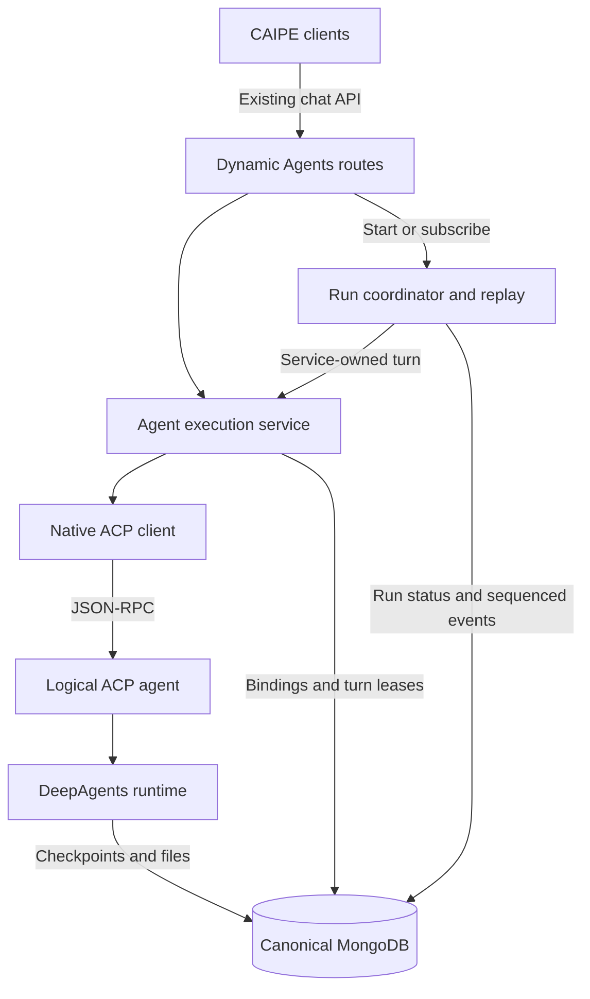
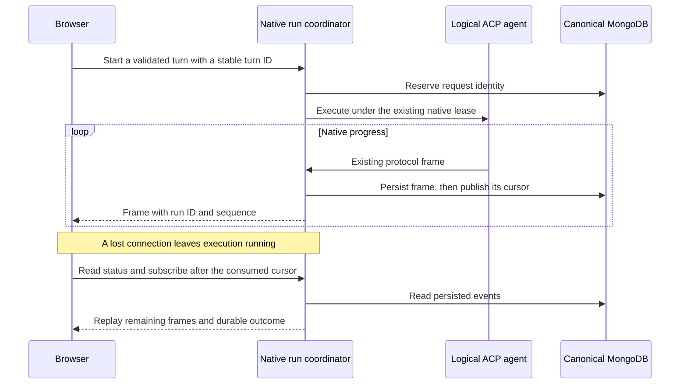

# Native ACP metaharness

The first implementation of the [CAIPE metaharness proposal](https://github.com/orgs/caipe-io/discussions/2877)
establishes one Agent Client Protocol (ACP) execution path for native Dynamic
Agents. Streaming, human-input resume and invoke all cross this boundary.
Default, SRE and custom agents remain logical agents in the shared service;
DeepAgents and LangGraph still execute them.

## Initial phase and later runtimes

This phase makes the existing SDK runtime use ACP by default. Changing the
interaction boundary does not replace the model SDK, make an agent remote, or
require sandboxing. The prebuild covers the current DeepAgents runtime; it does
not advertise Claude SDK, Bedrock AgentCore or Codex execution.

| Area | Initial phase | Later integration |
|---|---|---|
| Agent interaction | Every native start, resume and invoke uses the serialized ACP boundary. | Other SDK/provider runtimes implement the same logical agent interaction and advertise only qualified capabilities. |
| Execution placement | Shared DeepAgents/LangGraph runtime with existing native tools and logical files. | Provider-managed execution or an isolated environment when a harness requires shell commands and a real workspace. |
| Session durability | Retain native state and CAIPE history ownership, detach streaming execution from browser connections and persist a replayable run journal. | Qualify provider-native session restoration through the same lifecycle. |
| Agent UI | Keep current chat, agent configuration and workflow behavior. | Reuse compatible identity/configuration UI from the gateway work without showing unsupported runtime choices. |

The [gateway implementation PR](https://github.com/caipe-io/ai-platform-engineering/pull/2401)
contains useful provider session handling, Claude transcript persistence, agent
identity/configuration UI and detached-run/event replay work. This phase adapts
its service-owned execution and cursor journal behind the canonical ACP path. Its existing provider routing and
session locks should not become a second execution path or a second database.
The native phase establishes the interaction boundary while preserving current
native features; the gateway draft's provider adapters still need qualification
for attachments, human-input resume and complete tool/reasoning events.

Bedrock AgentCore integration does not depend on a local sandbox implementation:
it uses a provider-managed runtime. A Claude SDK integration needs an explicit
CAIPE logical tool/filesystem profile; an ordinary SDK working directory is not
that profile. Runtime choice, ACP interaction and sandbox placement are separate
decisions.

## Execution path

The client and logical ACP agent exchange JSON-RPC messages inside the Dynamic
Agents service. This is a protocol boundary, rather than a new deployment or a
public ACP endpoint. The client negotiates capabilities before prompting the
agent and converts native progress back into the caller's existing stream.

| Boundary | Behavior in this implementation |
|---|---|
| Browser, bots and automation | Keep existing chat endpoints and AG-UI or custom SSE frames. The browser adds cursor reconnect and reload recovery; workflows retain their invoke contract. |
| ACP client and logical agent | Use the pinned `agent-client-protocol` Python SDK 0.12.1, released schema 1.19 and wire protocol 1. |
| Native feature preservation | Negotiate `caipe.io/native-acp` metadata and acknowledged `_caipe/event` requests carrying validated native stream events. Trace, turn and human-input resume context retain their runtime behavior. |
| Execution | Use the current agent runtime and MCP integrations; subagents remain native in-process delegation. |
| Workflows and triggers | Keep the current workflow engine, scheduler and autonomous trigger services, including their invoke and execution-context contracts. |

The execution service owns session admission, MCP resolution, runtime lifetime,
dispatch and state operations. HTTP routes retain authorization, request
validation and response translation. Streaming, human-input resume and invoke
share this service; conversation interrupt inspection, rewind, clear, restart
and cancellation use it as well.

LangGraph chunks are interpreted once into typed stream events. The native ACP
agent publishes standard ACP progress and acknowledged native events directly;
the client renders those events through the existing AG-UI or custom SSE
encoder. The native runtime implements execution behind the logical ACP agent,
and the shared execution service dispatches every native turn through ACP.
Neither the agent nor the protocol bridge parses UI event strings to infer
execution state. Runtime construction, binding validation and administrative
deletion share one resolver for checkpoint and logical filesystem coordinates.

The bridge implements stable initialization, session creation, prompting,
updates and cancellation. It does not advertise ACP session loading, session
listing/forking, client filesystem access or terminal execution. Native
attachments and tool-produced files use the existing runtime and store. A new
protocol connection for a turn reuses the trusted native thread ID; it does
not recreate or replay the transcript through ACP.

The released SDK and native extensions preserve checkpointed forms and edited
batch tool approvals. Newer release-candidate elicitation capabilities do not
replace that lifecycle, so this stage does not depend on them. External
transport registration and additional harness backends remain later
extensions; an in-service native wrapper alone does not provide remote
pluggability.

The [Harness Engine discussion](https://github.com/orgs/caipe-io/discussions/2405)
describes a wider gateway and session-management foundation. This first stage
establishes the native ACP boundary and durable bindings while retaining the
current runtime. It now also adopts service-owned streaming and durable cursor
replay. Remote runtime routing and provider session restoration remain separate
integrations.

## Sessions and the canonical database

The admitted effective agent configuration and its session binding are stored
in `native_acp_sessions`, in the same configured MongoDB database as CAIPE
records and native checkpoints. The binding uses the agent ID and original
native session ID. It does not copy the checkpoint into a new history format
or store caller tokens and MCP credentials.

| State | Owner and persistence |
|---|---|
| Admitted agent configuration and execution binding | The native ACP integration stores the effective configuration snapshot and binding in `native_acp_sessions`. |
| Active-turn ownership | `native_acp_runs` stores an owned lease for each agent/session pair so multiple replicas coordinate admission and cancellation. |
| Native runtime state | LangGraph continues to use the existing checkpoint collections and thread IDs. DeepAgents files retain their existing storage namespace. |
| Interactive conversation messages and progress | The browser still writes the existing CAIPE conversation records through the BFF. |
| Workflow and automation history | Existing services keep their current history-writing responsibilities and execution-context mapping. |
| Streaming run lifecycle and replay | `native_acp_execution_runs` stores request identity, native lease association and outcome; `native_acp_execution_events` stores sequenced stream frames in canonical MongoDB. The service owns execution and clients subscribe independently. |

Normal interactive conversation IDs and automated execution-context IDs keep
their existing relationship to LangGraph `thread_id`. New ACP bindings must not
rename those threads or invalidate existing checkpoints. Ordinary `/invoke`
continues to honor `INVOKE_PERSIST_HISTORY`; the ACP boundary does not make an
ephemeral invocation durable.

Admission acquires the turn lease before updating the binding or runtime
cache. A unique agent/session index permits one owner; the worker extends a
120-second lease and polls cancellation every second. Cancellation can reach
the owner even when its HTTP request lands on a different replica. Caller
identities, tokens and tool credentials are not stored in either ACP collection.

Workers need synchronized clocks. If a lease expires, another worker can
admit a later request using the existing native checkpoint. Expiry does not
automatically restart the previous run or provide exactly-once external tool
effects. The run journal replays already persisted output without calling tools.
A run whose worker lease disappears or expires becomes explicitly interrupted. A stale worker is not fenced from an
external service by this MongoDB lease. Ephemeral `/invoke` uses transient
turn coordination while retaining its existing nonpersistent history behavior.

Starting a subsequent turn admits the latest effective agent configuration so
existing prompt, model and reasoning edits continue to work. The first
admitted backend/checkpoint/filesystem binding remains fixed. Human-input
resume restores the last admitted configuration after runtime-cache eviction,
including workflow overrides. Resume intersects its saved tool scope with the
current validated definition so removing or narrowing MCP tools and selected
remote-agent tools takes effect
without expanding the saved scope. Configuration snapshots have the same
sensitivity as agent definitions and need the same database access controls.
They are not a redaction layer for sensitive values placed in prompts or
middleware configuration. Changing the database, checkpoint collection or
file-store coordinates of an existing binding fails admission rather than
silently pointing the session at different state; migrate that state first.
Snapshot integrity is checked against the stored configuration before new
optional model defaults are applied. Adding a configuration field must not make
a previously valid session unreadable; the next admission records the current
normalized configuration while retaining the same native state.

Configure the UI and Dynamic Agents to use the same `MONGODB_URI` and
`MONGODB_DATABASE`. Include the new ACP collections and native checkpoint/file
collections in that database's existing backup and restore procedures. Restored
lease records can expire; they are not instructions to restart a run. The
implementation does not migrate transcripts
or consolidate databases that a deployment previously configured separately.

## Identity and filesystem boundaries

Existing authenticated caller identity, agent authorization and tool credential
delegation remain the admission boundary. ACP negotiation is not an
authorization grant. A caller must still have permission to use the agent and
the conversation or automated execution context.

Existing chat-management requests retain their BFF conversation authorization.
Stopping an active run keeps the existing cancellation semantics, including
when agent-use permission has been revoked. This stage adds no remote ACP
endpoint with a separate authentication contract.

Cached runtimes are refreshed when the admitted configuration, current caller,
client context or bearer changes. Each request therefore uses its current
authorization and tool credential context rather than retaining the caller who
first initialized the cache entry.

DeepAgents retains its logical filesystem, backed by its existing checkpoint or
MongoDB file store. The ACP wrapper does not grant access to the host filesystem
or create a per-agent sandbox. Existing tool-level network controls still apply;
ACP itself does not enforce an operating-system network policy.

Future SDK agents in the shared service must use that same simulated filesystem
contract. Their agent-visible file operations need to use the session-scoped
logical store, with built-in host file and shell tools disabled. SDK-private
transcript scratch, if required by a provider, is distinct from the filesystem
available to agent tools. A remote provider must enforce its approved tool/file
profile at the runtime or a trusted broker; ACP negotiation alone cannot impose
those restrictions on remote code.

## Durability and compatibility acceptance

Preserving current durable behavior is an acceptance gate for this migration.
ACP session creation must not create a new CAIPE conversation, rename the native
thread, replay stored messages as new turns, or discard an outstanding approval.

| Existing behavior | Required verification |
|---|---|
| A conversation created before ACP | Its original checkpoint, turn IDs, CAIPE transcript rows and logical files remain available on its first ACP turn. |
| Cache eviction or a new worker | Reconstruct the native graph from MongoDB with the admitted storage binding and continue the same thread. |
| Pending human input | Restore both form input and batched edit/reject tool approvals from pre-ACP and ACP checkpoints, then resume without duplicating the turn. |
| Conversation management | Rewind, restart and clear use the admitted checkpoint/file coordinates and leave other sessions intact. |
| Current tool integrations | Preserve subagent, attachment and remote-tool progress events across serialized ACP and both existing UI stream formats. |
| Caller and workflow contracts | Retain authorization, refreshed credentials, narrowed tool scope, explicit cancellation and persistent/ephemeral invocation behavior. |

`tests/test_native_acp_mongodb.py` runs migration, reconstruction and approval
cases against an isolated real MongoDB, using a deterministic graph instead of
model calls. The Dynamic Agents CI job supplies MongoDB so these checks execute
on every PR run. Local runs may set `NATIVE_ACP_TEST_MONGODB_URI`; each test owns
and removes a random test database. The test does not use a deployed application
database or establish provider/sandbox readiness.

### Reconnect and browser reload

Streaming start and human-input resume admit a service-owned task with a stable
turn identity. The browser saves the user turn and assistant placeholder through
the existing conversation writer before starting it. Closing a tab or dropping
the stream disconnects that subscriber; it does not cancel execution. Explicit
Stop requests still cancel the native owner and wait for its cleanup.

| Situation | Result |
|---|---|
| Temporary network loss | Reconnect to the same run after the last consumed sequence. Never resubmit the prompt to recover output. |
| Browser reload or detached completion | Locate the run for the saved turn and reconstruct its unfinished assistant message from the journal, then use the existing message upsert. |
| Clear or rewind native context | Retire prior replay journals under the native session lease so old output or an obsolete approval cannot reappear. The canonical conversation writer keeps its existing history responsibilities. |
| Retry with the same turn identity | Attach to the original run. Reusing that identity with changed validated input fails with a conflict. |
| Human-input pause | Persist an awaiting-input outcome. A submitted form or batch approval has its own stable turn identity so retries do not apply it twice. |
| Worker loss | Keep checkpoints and persisted output, report interruption and do not automatically repeat tools. |
| Journal gap or unavailable database | Return an explicit replay/storage failure instead of presenting partial output as a complete response. |

Run and turn identities in JSON retain their original values. The optional
`X-CAIPE-Turn-Id` response header percent-encodes opaque IDs so Unicode or control
characters cannot invalidate an admitted stream. UUID turn IDs are unchanged.

Both UI encodings retain their exact persisted message and tool IDs. Every frame
has a monotonic cursor; a final `CAIPE_RUN_STATUS` control event confirms the
durable outcome. Reading status or replay requires agent-use and conversation
read access through the existing authorization boundary. The backend additionally
checks the original caller identity or canonical conversation-read permission.
Credentials stay in the running task's memory, never in the journal.

The browser remains the interactive transcript writer. The journal is durable
execution output for recovery, not another independently authored conversation.
A minimal `native_acp_deleted_sessions` ledger prevents a request admitted around
permanent deletion from recreating that session. It retains only the removed
session ID and deletion timestamp, with no output or credentials. Soft deletion
keeps the existing archive/restore behavior.

The journal contains agent output and tool results, so apply the same access, backup
and restoration controls as conversation and checkpoint data.

Journal writes are bounded to 8 MiB per frame, 64 MiB per run and 100,000 frames
per run. Exceeding a bound produces an explicit failed outcome; it never silently
truncates a successful turn. Replay uses bounded pages and no subscriber queue.
No automatic journal expiry is introduced; these collections participate in the
canonical database's retention and backup policy. This phase does not implement
automatic recovery of execution after worker loss or exactly-once tool effects.

Remote ACP transport, agent discovery across environments and sandbox policy
enforcement are later stages. Separate sandboxed runtimes will require enforced
filesystem and network boundaries before admission. This implementation does
not add OpenShell or NemoClaw execution.

## Deployment and rollback

ACP is part of the Dynamic Agents execution path. Deploy the service image
through the existing Helm/GitOps process; no separate ACP enablement setting is
required. The HTTP API, native thread IDs and cached, persistent or ephemeral
runtime lifetimes retain their existing roles.

To undo a release, restore the previous image pin and release values through
the normal deployment process. Keep binding, checkpoint, file and conversation
collections intact. Deployment rollback changes the deployed version rather
than selecting another execution path inside this implementation.

See the [Dynamic Agents configuration reference](https://github.com/caipe-io/ai-platform-engineering/tree/main/ai_platform_engineering/dynamic_agents#configuration-reference)
for component settings.
