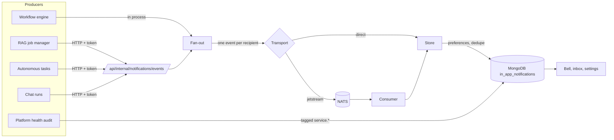

# Event Notifications

Users choose which events notify them. Ingestion, workflow, and agent runs publish events. The UI server applies each person's preferences and writes their notification inbox.

Tracked in epic #2934. Architecture target: discussion #2937.

## How an event flows



- Producers never know about users or preferences.
- A producer failure never reaches the job that produced the event.
- Each recipient's preferences are checked before anything is written.

## Events

| Event | Fires when | Default |
|---|---|---|
| `ingestion.completed` | Ingestion job finishes, including with errors | On |
| `ingestion.failed` | Ingestion job fails or is terminated | On |
| `ingestion.started` | Ingestion job begins | Off |
| `workflow.completed` | All steps finish | On |
| `workflow.failed` | A step aborts the run, authorization is denied, or the run exceeds its time limit | On |
| `workflow.requires_input` | A step pauses for human input | On |
| `workflow.started` | A run begins | Off |
| `agent.completed` | An autonomous task succeeds, or a chat run lasting at least `NOTIFICATION_CHAT_MIN_SECONDS` finishes | On |
| `agent.failed` | An autonomous task or chat run fails | On |
| `agent.started` | Reserved. No producer emits it yet | Off |
| `service.degraded` | Platform health opens an incident | On |
| `service.recovered` | Platform health confirms recovery | On |

Not implemented: `agent.requires_approval`, `integration.*`, and `ingestion.progress`. No lifecycle hook exists for them today.

The catalog is in `ui/src/lib/notifications/taxonomy.ts`.

## Who is notified

| Source | Recipients |
|---|---|
| Workflow | The run owner |
| Ingestion | The datasource creator and owner, anyone who created or edited a job for it, and org admins |
| Autonomous task | The task owner |
| Chat run | The user who sent the message |
| Service events | Org admins |

- "Org admins" are direct `admin` members of the organization in OpenFGA. Admins who hold the role only through a team are not expanded.
- Service accounts have no inbox and are skipped.
- A request is capped at 50 listed recipients and 200 after expansion.

## Preferences

- Order of precedence: the event setting, then the category setting, then the default.
- Settings are stored per user, in `user_settings.notification_preferences`. Only overrides are stored.
- `null` removes an override. Clearing an event override falls back to its category setting, then its catalog default. Clearing a category override falls back to the catalog defaults for events without their own overrides.
- Turning off an event stops new notifications. It never changes the job, ingestion, or workflow.
- Preferences are enforced on the server when the event is written. The UI does not filter.
- Preference edits are guarded by a revision number. Two tabs or replicas editing at once both keep their changes. If the document keeps changing, the API answers `409` and the client should reload and retry.
- Service events are stored once for all admins, so they are filtered when the inbox is read.

Manage them in **Settings → Notifications**, or from the toggle on the workflows, ingestion, and agent pages. Both write the same stored preference.

## Transports

| Mode | Setting | Behavior |
|---|---|---|
| Direct | `NOTIFICATIONS_TRANSPORT=direct` (default) | Accepted into the MongoDB notification queue before returning. No broker. |
| JetStream | `NOTIFICATIONS_TRANSPORT=jetstream` | Published to a durable stream. A consumer in the UI server writes the inbox. |

- NATS is optional and off by default.
- With JetStream selected and NATS unreachable, publishing reports `failed`. It does not fall back to direct.
- Stream `CAIPE_NOTIFICATIONS`: file storage, 7-day retention, 2-minute duplicate window.
- Durable consumer `caipe-notifications`: explicit acks, 5 delivery attempts, 5-second retry delay after a storage failure. Malformed messages are dropped.
- Subjects are `caipe.notifications.v1.<event type>`. They never contain user IDs, and browsers never connect to NATS.
- Delivery is at least once. The inbox ignores repeats using a deterministic key, so duplicates are harmless.

## Duplicates, retries, and replicas

- Inbox key: `type : resource type : resource id : attempt id : recipient`.
- A retried workflow or job has a new attempt ID, so it creates a new notification. A redelivery of the same attempt does not.
- A unique index on `event_key` makes this safe across replicas.

## Failure behavior

| Situation | Result |
|---|---|
| NATS down at startup | The app starts. The consumer retries every 5 seconds. |
| NATS down while publishing | Publish reports `failed` and the job is unaffected. |
| Consumer crashes mid-write | The message is redelivered. The key prevents a duplicate. |
| Preference changed while an event is in flight | The latest preference wins, checked when the event is written. |
| Recipient cannot be resolved to a subject and email | Skipped and counted. |
| OpenFGA unavailable | Explicit recipients still receive. Org admins are skipped. |

Known limit: a process that stops between finishing a job and sending its event can lose that event. An outbox would close this gap and is not built.

## Security

- The internal endpoint needs `NOTIFICATIONS_INTERNAL_TOKEN` as a bearer token and answers `503` without one. Tokens are compared in constant time.
- Recipients are resolved from the UI server's own user records. Both the subject and the email are taken from that one record, never from the request.
- A request that names a subject and an email belonging to different users is rejected for that recipient. A complete pair with no matching user record is skipped. The response counts both as `rejected` and `skipped`.
- Notification text is generic. Prompts, step errors, documents, and tool output are never included.
- Links must be relative paths. External URLs are rejected.
- "Send test" only ever notifies the caller, and is limited to 10 per minute.

## Retention

- Event notifications expire after `NOTIFICATION_RETENTION_DAYS` (default 90) through a MongoDB TTL index on `expires_at`. `0` keeps them forever.
- Platform health incidents carry no expiry, so open incidents are never deleted.

## Configuration

| Variable | Where | Default |
|---|---|---|
| `NOTIFICATION_EVENTS_ENABLED` | UI and producers | `true`. `false` makes every producer a no-op. |
| `NOTIFICATIONS_INTERNAL_TOKEN` | UI and producers | Unset. Producers send nothing until set. |
| `NOTIFICATIONS_INTERNAL_URL` | Producers | `http://caipe-ui:3000` |
| `NOTIFICATIONS_TRANSPORT` | UI | `direct` |
| `NATS_URL`, `NATS_TOKEN` | UI | `nats://nats:4222`, unset |
| `NOTIFICATION_RETENTION_DAYS` | UI | `90` |
| `NOTIFICATION_CHAT_MIN_SECONDS` | dynamic-agents | `30` |

- Docker Compose: set the variables in `.env`. Add `nats` to `COMPOSE_PROFILES` for a local JetStream server.
- Helm: set non-secret values under `caipe-ui.config`. Reference secrets with `caipe-ui.notifications.internalToken.secretName` and `caipe-ui.notifications.natsToken.secretName`. The Helm chart does not install a NATS server.

## Publishing a new event

- Add the type to `taxonomy.ts` with its category, default, and severity.
- From the UI server, call `publishNotificationRequest` with the event and its recipients.
- From another service, POST the envelope to `/api/internal/notifications/events`. See the [API reference](../ui/api-reference.md#internal-service-routes).
- Only add an event that actually fires. Keep the summary free of prompts, errors, and document content.

## Local testing

- Run `NOTIFICATIONS_MONGO_TEST=1 MONGODB_URI=... npx jest notifications-mongo` for the database tests.
- Start the optional Compose `nats` profile, then run `NATS_INTEGRATION_URL=nats://127.0.0.1:4222 NATS_TOKEN=<configured-token> npx jest notifications-jetstream`.
- In Settings, enable a channel and use **Test**. Check the bell or delivery status.

## App registration and subscriptions

Installed native and hosted apps use the same notification contract. The app
manifest declares `host.notifications` version `1.0` under
`consumes.platformApis`; the operator binds its service-account client ID in
`installation.bindings.serviceAccountClientId`. The caller cannot choose another
app's source identity or publish to teams, administrators, or all users.

1. The app registers up to 30 notification types with
   `POST /api/notifications/registrations`:

   ```json
   {"events":[{"id":"report.ready","label":"Report ready","description":"A report you requested has finished."}]}
   ```

2. The user opens **Notifications → Subscriptions** in the bell, or
   **Settings → Notifications**, and subscribes to the app. New app sources
   are off by default. Followed projects and other domain-specific resources
   remain managed by the app, linked from the source's settings card.
3. The app calls `POST /api/notifications` with its service-account bearer
   token and a stable `eventKey`, registered `eventType`, explicit
   `recipientUserSubjects`, `title`, `message`, optional relative `href`, and
   optional `severity`. Recipient identities are resolved from host user records.
4. The host returns `202` after accepting durable notification jobs. Workers
   recheck app availability, current app roles, and user preferences before
   delivery. Registering or publishing does not subscribe anyone.

The source ID and label come from the installed app. Updating registrations keeps
choices for stable event IDs. Removing a type prevents queued delivery of that
type. The older unregistered app API remains compatible with in-app delivery.
Apps authorize their own resource-specific recipient list before publishing;
`host.notifications` is not a grant to read those resources.
Registration is limited to 10 requests per minute per app. Publishing accepts
up to 200 recipient deliveries per minute per app and 20 per recipient. Excess
requests return `429`; retry with the same stable event key.

## Delivery channels and pause controls

- **In-app inbox** keeps unread and read history. Existing shared platform
  incident entries retain their lifecycle and resolution controls.
- **Browser web push** uses device subscriptions, VAPID, and the existing
  service worker. Alerts contain generic copy, not app content or agent output.
  Devices expire after 30 days without renewal. A `404` or `410` from the push
  service removes that device. Browser and operating-system restrictions still
  apply when the page is closed. Settings renews an existing device subscription
  and lets users subscribe or remove the current browser independently of their
  account-wide delivery toggle.
- **Webex** sends a personal plain-text message through the configured bot to
  the recipient's verified `webex_user_id` link.
- **Slack** opens a direct conversation for the verified `slack_user_id` link
  and sends plain text through the existing bot. Its token needs `im:write`
  and `chat:write`. The provider message identity is stable across retries.

External channels require operator configuration and explicit user enablement.
Apps cannot supply a Slack channel, Webex space, device endpoint, or bot token.
Global channel enablement is required before source or event overrides apply.
Users can subscribe, unsubscribe, pause for an hour, resume, and choose channels
per source and event. Subscription writes are scoped to the current user and use
atomic field updates so changes from different tabs do not overwrite each other.

Quiet hours use an IANA time zone and apply to external delivery; the inbox still
collects updates. Workers defer external attempts until the window ends and
recheck preferences before sending. Muted or paused deliveries are skipped;
resuming does not replay them. Existing inbox preferences also filter shared
platform events at read time.

## Durable acceptance and independent retries

`notification_jobs` is the durable acceptance record for one source event and
recipient. Expansion into `notification_deliveries` is idempotent and resumable.
Each channel/device delivery has its own state, attempt count, next attempt,
lease token, and expiry. Replicas claim work atomically; a stale worker cannot
complete another worker's lease. Each failed channel gets up to five attempts
with backoff. Successful channels are not retried with a failed channel.

**Settings → Notifications → Delivery status** shows queued, processing,
delivered, skipped, and failed attempts. A user can retry their own failed
attempts. "Delivered" means accepted by the provider, not read by a person.
Web push also records **Shown by browser** after the service worker's display
call succeeds. This is a best-effort receipt using the current user session;
an expired session or a blocked network request can prevent the receipt.
Neither status confirms that operating-system settings allowed a visible banner.
A provider can accept a message just before a process exits; external delivery
is therefore at least once. Webex has no application-level deduplication
promise across that uncertain outcome. The idempotency window for delivery jobs
is 90 days.

JetStream, when enabled, hands accepted envelopes to the same Mongo-backed
notification queue. Its stream is `CAIPE_NOTIFICATIONS`, with subjects under
`caipe.notifications.v1`. This remains a notification subsystem; generic event
pub-sub, webhook ingestion, and agent commands are separate work.

The durable queue protects notifications once accepted. A service that exits
between committing its work and publishing can still lose the notification;
this change does not introduce distributed transactions or producer outboxes.

## Helm configuration

Producer wiring is optional and disabled by default. In the platform chart:

```yaml
global:
  notifications:
    enabled: true
    tokenSecret:
      name: example-notification-token
      key: token
```

The existing Secret is shared by the UI, dynamic agents, and autonomous agents.
For a separate RAG release, configure the same values in `rag-stack` and set
`global.notifications.internalUrl` to the UI Service URL. The Secret must exist
in each workload's namespace. Keep the internal endpoint on trusted ingress;
its bearer token authorizes platform notifications and must never reach browsers.

For web push, set `caipe-ui.notifications.webPush.secretName` to an existing
Secret with `publicKey`, `privateKey`, and `subject` VAPID keys. Configure bot
admin authentication through the existing Slack/Webex deployment settings and
enable `NOTIFICATION_SLACK_ENABLED` or `NOTIFICATION_WEBEX_ENABLED` explicitly.
Configuring a channel never enables it for a user.


## Operator exports: Splunk and OpenTelemetry

Notification events can also be exported to **Splunk HEC** and **OTLP/HTTP JSON
logs collectors**. These are operator-controlled observability destinations,
separate from the four personal delivery channels. They do not create a generic
event bus or ingest arbitrary events.

- Both exports are **off by default**; personal subscriptions and quiet hours
  do not control them. `NOTIFICATION_EVENTS_ENABLED=false` disables all delivery.
- Exported fields are restricted to a stable hashed event ID, source ID, event
  type, occurrence time, severity, resource type, and hashed resource ID.
  Message bodies, titles, links, recipients, and credentials are excluded.
- Each logical event queues once per sink, independently of recipient fanout.
  Platform events with no matching user records can still export.
- Each sink has its own lease, status, and up to five attempts with backoff and
  jitter. Successful sinks are not repeated when another fails. Workers honor `Retry-After`;
  permanent errors and OTLP partial rejections fail immediately.
- Delivery is at least once. Use the event ID for downstream deduplication.
  Splunk success means HEC accepted the event; indexer acknowledgment is not used.
- Collector records use `kind: "export"` in `notification_deliveries`; they are
  excluded from personal delivery-status responses. Operators can inspect those
  records using existing database access. Retention and deduplication last 90 days.

Configure non-secret values through the UI chart's `config` (or server env):

```yaml
caipe-ui:
  config:
    NOTIFICATION_SPLUNK_ENABLED: "true"
    NOTIFICATION_SPLUNK_HEC_URL: "https://collector.example.test:8088/services/collector/event"
    NOTIFICATION_OTEL_ENABLED: "true"
    OTEL_EXPORTER_OTLP_LOGS_ENDPOINT: "https://collector.example.test:4318/v1/logs"
    # Optional exact event-type allowlist; unset exports all notification types.
    NOTIFICATION_EXPORT_EVENT_TYPES: "workflow.failed,agent.failed,ingestion.failed"
  notifications:
    splunk:
      tokenSecretName: example-hec-token
      tokenSecretKey: token
    otel:
      headersSecretName: example-collector-headers
      headersSecretKey: headers
```

`NOTIFICATION_SPLUNK_HEC_TOKEN` is required for HEC. Optional
`NOTIFICATION_SPLUNK_INDEX` and `NOTIFICATION_SPLUNK_SOURCETYPE` select an approved
index and sourcetype. OTLP supports `OTEL_EXPORTER_OTLP_LOGS_HEADERS` (URL-encoded
comma-separated `key=value` entries) and `OTEL_SERVICE_NAME`. When logs-specific
settings are absent, `OTEL_EXPORTER_OTLP_ENDPOINT` (with `/v1/logs` appended) and
`OTEL_EXPORTER_OTLP_HEADERS` apply. Only OTLP/HTTP JSON is supported, not gRPC.

Endpoints and authentication must come from deployment configuration and existing
Secrets; apps cannot choose destinations. Redirects and embedded URL credentials
are rejected. HTTPS with certificate validation is required unless an operator
explicitly sets `NOTIFICATION_COLLECTOR_ALLOW_HTTP=true` for a trusted private
collector. Export acceptance does not prove the downstream retention or access
policy; configure those at the collector.

Protocol references: [Splunk HEC event format](https://help.splunk.com/en/data-management/collect-http-event-data/use-hec-in-splunk-cloud-platform/format-events-for-http-event-collector)
and [OTLP/HTTP logs](https://opentelemetry.io/docs/specs/otlp/).
