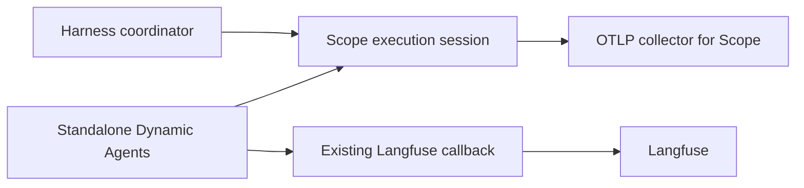

Scope export is opt-in. Langfuse retains its existing configuration and callback
behavior. Both backends can run in the same process.

- A shared lightweight `agent-telemetry` package owns Scope configuration and
  lifecycle. A private provider avoids replacing the application's global provider.
- The coordinator owns detached-run sessions. A nested in-process runtime reuses
  the active Scope context; browser subscriptions do not own its lifecycle.
- LangChain callbacks add model/tool metadata. Other harness adapters contribute
  their canonical reported tool events. Remote worker internals are not inferred.
- Local Deep Agents delegations create child agent spans, with model and tool
  spans attributed to the delegate that executed them. Only the selected delegate
  identifier is read from a task request; its instructions and results are omitted.
- Scope exports metadata only. Existing Langfuse capture and redaction rules remain
  unchanged. Collector failures do not fail an agent execution.

See the runtime README at `ai_platform_engineering/harness_engine/README.md`
for the four backend combinations and the precise lifecycle and capture limits.
