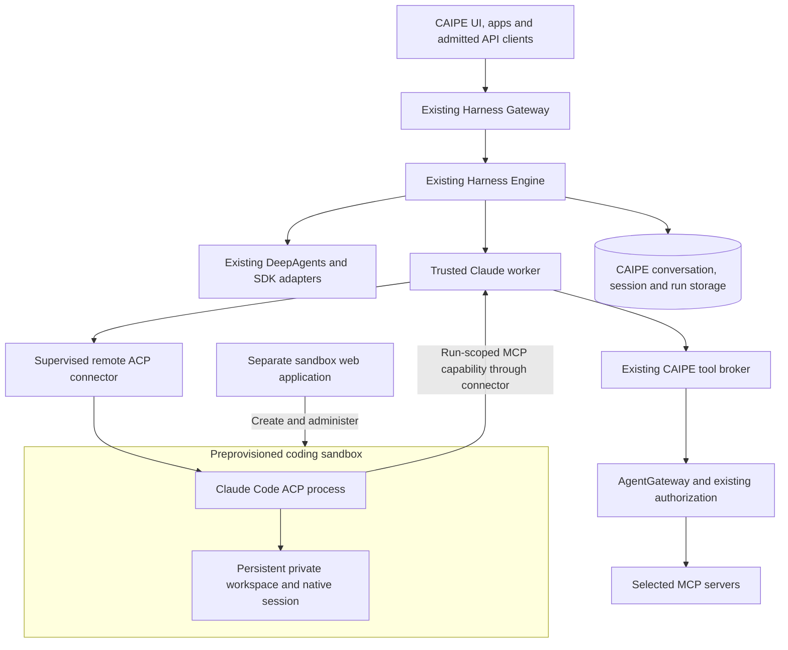
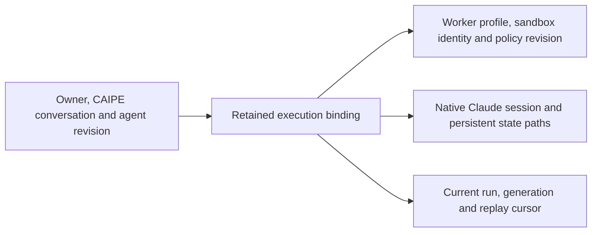

# Claude Code in a preprovisioned sandbox

**Extend the existing Harness Engine with a supervised connection to Claude Code in a sandbox created through a separate sandbox web application.** CAIPE owns conversation admission, execution, replay and platform authorization. The sandbox service owns the environment. CAIPE does not need access to its management API for this proof of concept.

This is the proposed integration boundary, not a claim that the remote sandbox connector is implemented. The [existing Claude ACP integration](./claude-acp.md) supplies the gateway, trusted worker, agent editor and durable lifecycle. The remaining integration separates that worker from the shell-accessible agent while preserving its session, tool and cancellation contracts.

CAIPE is the metaharness: its gateway selects an admitted runtime and its Engine owns the platform run; the selected coding harness owns its reasoning loop and native tools. The implementation comparison below was checked on 3 November 2026 against #3194 at `38a85d849`.

## Build on the shared gateway

| Existing work | Contribution | Consequence |
| --- | --- | --- |
| [#2401](https://github.com/caipe-io/ai-platform-engineering/pull/2401), merged | Harness Gateway, Engine, provider routing, sessions and replay. | Retain the canonical execution services. |
| [#3192](https://github.com/caipe-io/ai-platform-engineering/pull/3192), open | Engine-managed DeepAgents execution and refresh recovery using the existing runtime and checkpoints. | A logical ACP wrapper for DeepAgents is unnecessary. |
| [#3194](https://github.com/caipe-io/ai-platform-engineering/pull/3194), open on #3192 | Claude ACP/SDK workers, authorized MCP, native session continuation, canonical history and shared replay controls. | Reuse these implementations and add the sandbox process boundary. |
| [#3190](https://github.com/caipe-io/ai-platform-engineering/pull/3190), open independently | Standard installation and image publishing. | Packaging readiness is separate from sandbox qualification. |

The earlier [#2883](https://github.com/caipe-io/ai-platform-engineering/pull/2883), [#2982](https://github.com/caipe-io/ai-platform-engineering/pull/2982) and [#3083](https://github.com/caipe-io/ai-platform-engineering/pull/3083) are replaced as the implementation direction. This does not mean every guarantee in those drafts has landed: portable native checkpoints, interactive approvals and sandbox provisioning are not established by #3194. The [proposal discussion](https://github.com/orgs/caipe-io/discussions/2877) tracks the combined direction.

The **trusted worker** retains database and service credentials. The **coding sandbox** contains the real shell, repository and native state. Sharing a container or UID would allow shell tools to inspect the worker's files or processes despite a filtered subprocess environment. Keep separate process/secret boundaries; do not place the credential-bearing worker in an unrestricted coding container.

## Proposed attach flow

1. Create a sandbox in its web application from an approved coding profile, with a private persistent workspace and filesystem/network policy.
2. Establish a private, authenticated agent data-plane endpoint for the pinned Claude ACP executable. Keep management and browser login outside the CAIPE connection.
3. The follow-up integration binds an operator-owned CAIPE profile to the trusted worker and admitted sandbox identity. Agent authors choose its alias, rather than supplying endpoints, commands or credentials.
4. Select **Claude (ACP)** in Agent Builder, supply instructions and select supported MCP tools. Use an explicit PoC agent and new conversation; existing DeepAgents/SRE definitions retain their defaults.
5. Reopen that conversation to resume or replay. A missing, replaced or unavailable sandbox produces an explicit unavailable/interrupted state, not an unnoticed replacement session.

**Initial isolation unit: one execution owner and conversation per sandbox.** The definition can be shared; writable HOME, workspace and native session cannot be shared by unrelated callers or conversations. Reuse images and capacity, not another caller's files. Additional conversations need a separately admitted environment for this PoC. Sharing a transcript does not grant shell ownership or permission to continue its agent.

The existing browser terminal is not an ACP endpoint and does not provide a byte-clean, supervised ACP transport contract. A fixed, authenticated non-PTY launcher is a possible connector implementation. SSH would require a configured server, pinned host identity, private routing and remote drain supervision; none is implied merely by creating a sandbox.

### The exact transport boundary

| Leg | Existing behavior | Required sandbox integration |
| --- | --- | --- |
| Client to CAIPE | Existing authenticated APIs, gateway and UI event formats. | Preserve the interface; clients need not implement ACP. |
| Engine to trusted worker | #3194 uses ACP v1 over private HTTP/NDJSON with negotiated `caipe.io/harness` admission, replay and drain extensions. | Reuse this protocol. A raw ACP endpoint is not a substitute. |
| Worker to Claude process | #3194 launches the pinned executable over local stdio. | Add a supervised remote process seam, preserving ordered messages, native session identity and explicit termination outcomes. |
| Agent to platform tools | A run-scoped loopback MCP bridge returns through CAIPE under the original caller and real agent. | Forward only that capability. Its current loopback URL is not remotely reachable; never export caller or worker bearer tokens to solve this. |

Changing `HARNESS_ENGINE_CLAUDE_ACP_COMMAND` to a remote launcher alone is insufficient. The connector must map `cwd` and `CLAUDE_CONFIG_DIR` to persistent remote paths, carry the selected MCP capability, retain a remote process/run handle and confirm process-tree drain. Killing the local connector does not prove that Claude or its tools stopped.

## Sticky means a retained execution binding

Stickiness is a persisted mapping, not a browser cookie or load-balancer affinity. Retain placement, immutable sandbox instance identity, native session ID, workspace/configuration paths and policy revision with the owner/conversation binding. Repointing a profile alias cannot silently attach an old conversation to another environment. Resolve the retained binding before an agent's current default.

A fresh connection or ACP handshake cannot recreate executable state. Existing sessions stay pinned. Changing runtime, placement or an incompatible definition requires a new conversation or an explicit qualified migration.

### Dynamic-agent instructions and tools

The saved dynamic-agent definition remains canonical. The existing Engine compiles instructions, operator profile and selected tools into an immutable admitted revision. #3194 delivers system instructions and selected MCP configuration at ACP session setup. The sandbox profile supplies the environment; it is not another prompt editor.

Keep operator settings separate from agent instructions. #3194 disables settings discovery and admits a configured native-tool allowlist; it does not establish arbitrary repository settings, skills or specialist-agent delegation. Qualify each required capability. Existing DeepAgents definitions, tools, skills, checkpoints and logical filesystem remain available without conversion to ACP.

## Durability and storage

| Event | Existing guarantee or PoC requirement |
| --- | --- |
| Browser refresh or subscriber disconnect | #3194 reconnects to the same Engine run and replays committed events without dispatching another prompt. |
| Engine-to-worker transport disconnect | Durable worker admission reattaches using the original run ID and cursor. A lost response is not permission to resubmit work. |
| Next turn after an idle restart | Native `session/load` needs the same transcript and workspace. The connector must restore the admitted paths and identity. |
| Stop or cancellation connection loss | Release the reservation only after confirmed remote process/tool drain. An uncertain outcome retains a blocked reservation for reconciliation. |
| Worker or sandbox crash during a turn | No automatic in-flight takeover. Preserve committed events and report interrupted/uncertain work without repeating a prompt or mutation. |
| Lost workspace or deleted sandbox | History remains readable but cannot reconstruct executable state. Fail resume explicitly; portable recovery is a separate capability. |

**Current storage must not be described as everything living in one database.** Engine sessions, runs and visible history use MongoDB; #3194's worker adds a `_claude_worker` database for admission/replay, while native Claude ACP state lives on a persistent volume. The SDK's Mongo transcript store does not mirror that ACP volume.

The destination remains one canonical CAIPE application database with distinct collection ownership, as discussed in [storage simplification #2711](https://github.com/orgs/caipe-io/discussions/2711). Consolidating worker records requires collection namespacing and an explicit migration; pointing both repositories at identical collections would collide. The PoC must account for the current worker database and volume in backup, retention and deletion. It does not claim the earlier drafts' portable GridFS archive model is implemented.

The native volume is authoritative for Claude's executable continuation until verified portable checkpoints exist. Back it up with the binding/journals as a consistent recovery set; qualify an idle, quiescent backup and matching restore. Restoring text is insufficient, and restoring files does not make an external effect exactly once. Sandbox deletion remains an explicit action in the separate application; transcript deletion is not evidence that remote files were erased.

## Command, filesystem and network policy

**Use an approved shell/tool policy inside a real sandbox.** Restricted tool names and command patterns reduce available actions; they do not replace containment. A permitted shell or interpreter can compose commands, invoke subprocesses and access anything the environment allows.

| Layer | Policy for the PoC |
| --- | --- |
| Native tools | Operator-owned allowlist, starting with required file/shell operations. No permission bypass or implicit unrestricted enablement. #3194 defaults to no native tools and declines interactive permissions; keep that limitation visible. |
| Files and processes | Private writable workspace/configuration, bounded resources and genuine separation from trusted services, host mounts, orchestration credentials and other callers. DeepAgents' simulated filesystem is not OS containment. |
| Network and model | Enforce approved destinations and model access. Keep management services, metadata credentials, arbitrary internal services and broad provider credentials outside shell access. |
| CAIPE tools | Reuse caller, agent, conversation, pinned-tool and current-resource checks through the broker/AgentGateway. Revoke the run-scoped capability at turn end. |
| Entry points | Apply the same policy to web, app, CLI, bot and automation callers. Channel membership or an app launch token does not confer shell authority. |

Human approval authorizes only an operation inside the admitted policy. The current integration supports selected MCP tools with `approval_policy: never` and declines interactive ACP permissions. Do not label it full approval/form parity. Future decisions should extend the existing durable pending-input contracts with exact run/decision correlation. Broader delegation belongs with [central authorization #2406](https://github.com/orgs/caipe-io/discussions/2406), rather than a channel-specific policy service.

Qualify the pinned executable's actual native-tool/permission mapping. The current ACP adapter explicitly sets `plan` mode; accepting another SDK profile mode does not prove equivalent ACP behavior. Denied actions must remain visibly denied.

## Other harnesses and AgentGateway

| Harness or gateway | Current connection model | Implication |
| --- | --- | --- |
| Claude Code | The [Claude ACP adapter](https://github.com/agentclientprotocol/claude-agent-acp) is integrated by #3194. | The only coding harness in this PoC; retain its qualified executable/SDK pins. |
| OpenClaw | Its [official ACP bridge](https://docs.openclaw.ai/cli/acp) connects stdio clients to its gateway/session service. | A candidate provider, not a drop-in #3194 worker; qualify lifecycle, tools and isolation. |
| Hermes | Its [ACP server](https://hermes-agent.nousresearch.com/docs/user-guide/features/acp/) exposes native sessions and harness behavior. | Qualify resume, approvals, credentials and cancellation before admission. |
| Pi | Core exposes [RPC](https://github.com/earendil-works/pi/blob/main/packages/coding-agent/docs/rpc.md); [ACP support](https://github.com/svkozak/pi-acp) is an external adapter. | Do not advertise native ACP or selected-MCP parity based on the adapter name. |
| AgentGateway | Already routes selected MCP calls; [supported backends](https://agentgateway.dev/docs/standalone/latest/documentation/configuration/backends/) include model/tool and HTTP traffic. | Reuse model/MCP policy and, if needed, transparent routing. It does not replace Engine admission, native resume, replay or containment. |

External coordinators such as [Paperclip](https://github.com/paperclipai/paperclip) illustrate retained harness-session references, but also own tasks and scheduling. They are not simply interchangeable frontends. An app acting as a CAIPE frontend should use protected CAIPE agent/conversation APIs; a separate coordinator needs an explicit authority/history boundary and cannot create a second owner for the same run.

Use released **Agent Client Protocol wire v1**, negotiated capabilities and the versions qualified with #3194. [Schema v1.29.1](https://github.com/agentclientprotocol/agent-client-protocol/releases/tag/schema-v1.29.1) is a newer stable schema, not a reason to upgrade a qualified executable blindly. [ACP transports](https://agentclientprotocol.com/protocol/v1/transports) distinguish stdio/custom transports from draft remote transports. Preserve the CAIPE worker extension; do not call it standardized Streamable HTTP.

## PoC acceptance

| Check | Evidence required before calling the sandbox integration working |
| --- | --- |
| Placement and isolation | Pin an admitted sandbox; deny another caller/conversation; shell tools cannot read worker secrets or other workspaces. |
| Instructions and coding | Saved instructions reach Claude; approved file edits/shell actions stay inside its workspace. Denied destinations/files remain denied. |
| CAIPE tools | A selected MCP tool works with current caller authorization across the remote boundary. Unselected tools/revoked capabilities fail. |
| Refresh and reconnect | A long turn survives refresh and transport interruption with one native producer and one final visible answer. |
| Stop and uncertain loss | Confirm remote drain before another turn; missing confirmation retains the reservation without automatic resend. |
| Persistence | An idle restart reloads the same session/files. Sandbox loss, deletion, backup and restore have explicit outcomes. |

This document changes no default agent, deployment or sandbox management API. The follow-up implementation is the remote process/tool seam and its binding, capability and policy validation. The shared gateway, editor, replay, history and existing runtimes remain the foundation.
