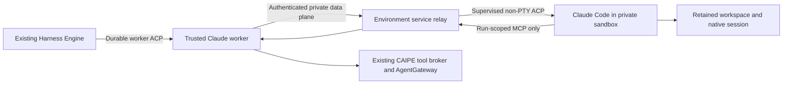

# Claude Code in a preprovisioned sandbox

This is the first PoC within the [broader CAIPE metaharness architecture](./metaharness.md). Its manual provisioning and current provider limits do not narrow the shared agent, app, session, storage or policy contracts.

The integration extends the [existing Claude ACP worker](./claude-acp.md). Sandbox creation and administration stay in a separate web application. CAIPE admits a connection to the agent data plane; it does not receive sandbox create/delete privileges.

## Create, connect, configure

| Step | What the user does | What CAIPE does |
| --- | --- | --- |
| **Create environment** | Open the sandbox application from **Set up a Claude Code sandbox** in Agent Builder. Choose an approved Claude coding profile and resource size; wait until it is running. | Does not provision or silently replace the environment. |
| **Register connection** | Open the sandbox's **CAIPE connection** panel and give its nonsecret reference to the platform operator. | The operator admits the exact environment, approved configuration revision and verified CAIPE subject. Creating a sandbox alone does not connect it. |
| **Select profile** | Click **Refresh sandbox connections**, choose **Claude (ACP)** and the registered operator profile. | Lists only connections admitted for that caller. A configured profile is not a health or model-login attestation. |
| **Define agent** | Write system instructions and select supported MCP tools. Save, then start a conversation. | Compiles the canonical definition and checks capabilities, access and retained placement before dispatch. |
| **Continue** | Reopen the original conversation and use ordinary chat/Stop. | Replays the existing run and reloads its native session without resending a prompt. |

**The PoC reserves one sandbox for one owner and conversation.** Shared definitions and shared transcripts do not grant shell access. Another conversation needs another admitted environment. Existing DeepAgents/SRE defaults are unchanged.

Model access is configured by the approved profile, using a model-scoped gateway credential or approved workload identity. The terminal's default Claude login is not automatically imported into the connection's native configuration directory. Users should not paste model, worker or service credentials into chat or connection forms.

## Manage the environment

The selected profile and the owner's chat session details expose **Manage sandbox**. The chat link comes from the retained binding, rather than an agent's mutable current default. Shared viewers do not receive that management metadata.

| Task | Where it belongs |
| --- | --- |
| Files | Sandbox terminal/file tools and its private persistent workspace. Chat attachments are unavailable in this Claude integration; the composer explains this before sending. |
| Profile and configuration | The sandbox application's configuration view shows the retained profile and supported synchronization/drift information. |
| Filesystem/network/model policy | Operators manage the approved environment profile and actual platform enforcement. Runtime-specific policy panels expose only their supported edits. A free-text summary or profile hash is not proof that enforcement is active. |
| Suspend/resume/resources | Existing sandbox lifecycle controls. Stop the CAIPE run first; active or unconfirmed work must not be reset or reassigned silently. |
| Stop | CAIPE targets the admitted process and waits for remote process/tool drain. A successful Stop allows the next turn in the same conversation. |
| Start fresh | A bound private environment cannot be cleared into another native binding. CAIPE keeps the original history/state and explains how to create another sandbox/profile. Native file rewind is unsupported. |
| Delete | Explicit sandbox administration, with its actual data/lifecycle effects. Deleting CAIPE history does not prove that sandbox files were erased. |

Changing the admitted environment or approved configuration revision invalidates the old execution target rather than repointing it. The history remains readable. For this PoC, an incompatible change requires a newly admitted environment/conversation. Model/service credential rotation through the same approved reference does not by itself change placement.

## Execution and trust boundary



The trusted worker and relay retain service/database/caller credentials outside the coding shell's process and filesystem boundary. The agent receives only its native runtime/model access and a capability for the selected tools in its current run. A filtered environment alone would not protect same-UID worker processes or their files.

The fixed sandbox runner has a non-PTY byte stream and a separate supervised control channel. A browser terminal is not that transport. Native stdout cannot invent a trusted process-drain receipt. Stop and EOF must settle the process tree, including detached children; killing a connector or losing its socket does not prove settlement.

| Boundary | Contract |
| --- | --- |
| Client to CAIPE | Existing authenticated APIs and UI event formats. Clients do not implement ACP to use chat. |
| Engine to worker | The existing private HTTP/NDJSON ACP v1 transport and negotiated `caipe.io/harness` extension. Sandbox profiles additionally require `sandboxTransportVersion: 1`. |
| Worker to relay | A private authenticated WebSocket connection. Its opening frame pins owner, environment identity/configuration, conversation, binding and run. The ready receipt pins process identity and persistent native paths. |
| Agent to tools | Bounded MCP POST frames target only the current run's existing tool bridge. No sandbox-supplied URL, general caller token or service identity is accepted. |
| Process completion | An exact run/process drain receipt, plus settled dispatched tool calls. Missing confirmation preserves an uncertain reservation. |

This is a documented custom transport, not standardized ACP Streamable HTTP. The parent Engine remains the CAIPE run authority; environment binding/process records do not become another conversation or event-history service.

## Operator connection configuration

Use deployment-managed Secret references for the JSON settings. The examples below show field relationships; placeholder credentials are not production defaults. The environment service must admit the matching subject, immutable identity and configuration before these settings can connect.

**Parent Engine:** the profile points to the trusted worker. Its public metadata drives the setup and management UI.

```json
{
  "primary": {
    "url": "https://worker.example.test",
    "token": "<worker-service-secret>",
    "profile_id": "coding",
    "runtime": "claude_code_acp",
    "tools_enabled": true,
    "sandbox": {
      "instance_id": "sandbox-unique-id",
      "display_name": "Private coding environment",
      "portal_url": "https://sandbox.example.test/environments/unique-id",
      "owner_subject": "verified-caipe-subject",
      "policy_revision": "approved-configuration-revision",
      "policy_summary": "Private files and operator-managed network policy",
      "workspace_root": "/home/sandbox/workspace"
    }
  }
}
```

Supply this as `HARNESS_ENGINE_CLAUDE_WORKER_PROFILES_JSON`. Set `HARNESS_ENGINE_SANDBOX_PORTAL_URL` to the public sandbox application URL for the provisioning link, including when the caller has no registered connection yet. Only sanitized metadata and aliases reach the browser; private endpoints and tokens do not.

**Trusted worker:** the corresponding local profile in `HARNESS_ENGINE_CLAUDE_SDK_PROFILES_JSON` retains the approved model and adds the private process connection.

```json
{
  "coding": {
    "model": "<approved-model-id>",
    "permission_mode": "dontAsk",
    "sandbox": {
      "instance_id": "sandbox-unique-id",
      "display_name": "Private coding environment",
      "portal_url": "https://sandbox.example.test/environments/unique-id",
      "owner_subject": "verified-caipe-subject",
      "policy_revision": "approved-configuration-revision",
      "policy_summary": "Private files and operator-managed network policy",
      "workspace_root": "/home/sandbox/workspace",
      "url": "wss://relay.example.test/api/acp/connections/primary/stdio",
      "token": "<distinct-relay-service-secret>"
    }
  }
}
```

No local Claude executable is needed in that trusted worker for a remote sandbox profile. The approved sandbox image contains the pinned ACP executable and protected runner. Keep model-only credentials/workload identity in the admitted coding profile; the relay credential stays in the trusted services.

The private connection maps the verified CAIPE subject separately from the environment application's account identity. Do not infer it from email or browser-supplied headers. Both services check the admitted identity and placement. Endpoint/profile/environment changes cannot silently alter a retained session; public descriptions do not authorize execution.

Native tool names remain operator-controlled through `HARNESS_ENGINE_CLAUDE_ACP_TOOLS`; selected platform MCP tools retain their existing broker configuration. A native-tool allowlist is not a shell-command firewall. Required filesystem/process/network containment is enforced by the environment, independently of prompt instructions and ACP permission messages. Interactive permission requests are still declined; selected MCP tools require `approval_policy: never`.

## Persistence, failure and recovery

| Event | Outcome |
| --- | --- |
| Browser refresh | Existing Engine events and final history are recovered without another prompt. |
| Parent-to-worker interruption | The existing durable worker protocol reattaches to the same admitted run and cursor. |
| Idle native restart | Reload the same Claude session and files from the retained environment paths. |
| Confirmed Stop | Process tree and admitted tools settle; the same conversation can continue. |
| Lost relay, worker or sandbox during execution | Preserve committed output and uncertain reservations. Do not resend or automatically take over the process. Operator reconciliation is required. |
| Missing native state | Visible history remains useful, but it cannot manufacture executable continuation. Fail resume explicitly. |

Current #3194 storage still includes a worker database namespace and native persistent volume. The [canonical database direction](./metaharness.md#one-canonical-database-with-explicit-native-state-boundaries) is broader than this PoC. Back up the actual binding/journals, environment metadata and native volume as a matched recovery set. Portable checkpoints and automatic live-process recovery are not implemented by this connector.

## Qualification

Qualification covers the actual worker/relay/runner boundary, owner/conversation separation, real native process-tree drain and scoped MCP forwarding. The pinned Claude ACP executable must also demonstrate native session reload, a selected MCP call and a real file/shell action through this connection. A scripted model provider proves protocol/tool compatibility, not live model-account readiness or reasoning quality.

Before a dev rollout, verify the actual image digests, environment profile, policy, model route, current caller authorization and complete UI setup path together. Preserve the existing host's app integrations and defaults when composing a prebuild. This PoC does not itself activate SRE or migrate existing conversations.
