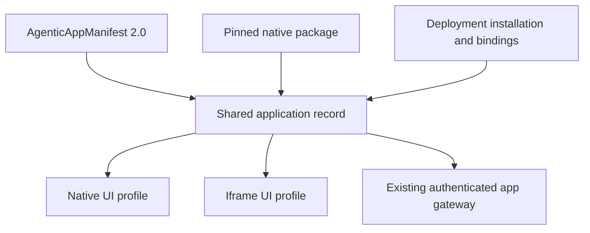

# Shared AgenticAppManifest

The **CAIPE App Contract** is the application integration contract. It includes
the shared manifest format and rendering-profile interfaces; it is not a browser
security sandbox.

`AgenticAppManifest` API version **2.0** describes an application independently
of its UI renderer. Native packages and hosted iframe apps use the same identity,
capability references, service policy, and installation model.

This is Phase 1 of the [application-contract proposal](https://github.com/orgs/caipe-io/discussions/2853).
The native component interface of the CAIPE App Contract is **2.0**;
`@caipe-io/app-sdk` release candidate
**2.0.0-rc.1** aligns the new
publisher and component contracts. Native interface **1.1** remains an explicit
compatibility path. This release does not change component props or privileges.

| Phase | Included here? |
| --- | --- |
| 0: native package build, host routes, component integration | Yes |
| 1: shared manifest, installations, profile selection, migration | Yes |
| 2: CAS application permissions and granted capability enforcement | No |
| 3: shared iframe/native lifecycle and messaging SDK | No |
| 4: generic Agent Builder capability discovery/composition | No |
| 5: complete compatibility, performance, and release evidence | No |

## Publisher declarations and installation configuration



| Publisher manifest | Deployment installation |
| --- | --- |
| Stable ID, display name, description, exact app version | Installed/enabled/visible flags |
| Native/iframe profiles, route references, optional navigation/slot | Explicit selected profile when multiple profiles exist |
| Authentication mode and HTTP policy declarations | Private runtime origin and resource bindings |
| Provided MCP/agent/workflow registry references | Optional expected app version |
| Required/optional platform API references | Existing role overrides |
| Requested resource/actions | No automatic grants |

The shared types and validator live in
`ui/app-sdk/agentic-app-manifest.{mjs,d.mts}`. UI code re-exports
the shared `AgenticAppManifest` type from `ui/src/types/agentic-app.ts`.
`NativeExtensionManifest` remains a compatibility input and a derived view
for the declared native component interface; it is not a second mutable app record.

## Manifest shape

The full reference manifest is
`ui/examples/agentic-apps/shared/manifest.json`. Its structure is:

```json
{
  "id": "example-app",
  "displayName": "Example App",
  "description": "An independently maintained application",
  "apiVersion": "2.0",
  "version": "1.0.0",
  "ui": {
    "profiles": [
      { "id": "native", "mode": "native-package", "package": "@example/native-app", "contractVersion": "2.0" },
      { "id": "hosted", "mode": "iframe" }
    ],
    "routes": [{ "id": "home", "path": "/example" }],
    "navigation": { "label": "Example", "routeRef": "home", "placement": "after-chat" }
  },
  "api": { "mounts": ["/api/example"] },
  "auth": { "mode": "app-scoped-token" },
  "runtime": { "kind": "proxied-next-zone", "mountPath": "/apps/example-app" },
  "surfaces": { "showInHub": true },
  "access": {
    "requiredRoles": ["user"],
    "tokenScopes": ["example-app:read"],
    "policyActions": [{ "action": "proxy:GET", "defaultEffect": "allow", "requiredScopes": ["example-app:read"] }]
  },
  "provides": { "mcp": ["example-mcp"], "agents": [], "workflows": [] },
  "consumes": { "platformApis": [{ "id": "agents.invocation", "version": "1.0", "required": false }] },
  "requestedPermissions": [{ "resourceType": "agent", "resourceRef": "assistant", "actions": ["use"] }]
}
```

- `ui.routes` establishes named route intent. Native routes retain reserved-path
  and collision checks. Navigation resolves `routeRef`; optional `href` must
  remain within that route.
- Native custom paths and API aliases are compiled into the image. Hosted apps
  currently launch under `/apps/<id>`; profile selection does not create a new
  iframe routing/message contract.
- `ui.slots: ["home"]` supports a route-less native contribution. Navigation and
  the assistant are optional.
- `provides` contains references to existing registries. It does not provision
  agents, MCP servers, or workflows.
- `consumes` declares compatibility requirements. Unknown required capabilities
  are rejected; optional future references can remain descriptive metadata.
- Currently recognized native host references are `host.navigation`,
  `host.breadcrumbs`, `host.theme`, `host.session`, `host.chat`, and `app.gateway`, version
  `1.0`. Required host references cannot be satisfied by selecting the current
  iframe profile. A required gateway reference needs a declared runtime.
- Unknown manifest fields, duplicate profiles/routes, ambiguous ownership,
  missing route references, undeclared policy scopes, and unsafe paths fail
  validation.

### Permission requests are declarations

`requestedPermissions` describes resource/action intent for review and future
CAS integration. It does not change role access, token scopes, HTTP policy,
credential access, or any OpenFGA relationship. There is no `grants` field in
the publisher schema. Do not rely on this metadata to enforce resource access.

Phase 2 will add application resources/actions through the approved CAS
adapter. Existing services must continue enforcing their current resource and
agent/tool authorization. Forwarded role headers and browser app IDs are not
proof of permission.

## Install one selected UI profile

A compiled native package provides the complete shared manifest. Its deployment
configuration contains only the installation; repeating the shared manifest in
the runtime file is rejected.

```yaml
agentic_apps:
  installations:
    - app_id: example-app
      app_version: 1.0.0
      installed: true
      enabled: true
      visible: false
      selected_ui_profile: native
      bindings:
        runtimeOrigin: https://runtime.example.test
        resources:
          assistant: example-agent
```

- Select `hosted` to use the same app's declared iframe profile and services.
- Every new multi-profile installation must select a profile explicitly.
- A hosted-only deployment can supply the publisher manifest in the existing
  `agentic_apps.packages` section. The native profile can remain an alternative;
  enabling it requires its package to be compiled into the image.
- `app_version`, when specified, must match the declared artifact version.
- Private origins belong in installation bindings. Conflicting legacy/new
  origin bindings are rejected. Bindings are excluded from public app records.
- Resource bindings remain references; they neither reveal credentials nor
  create permission grants.
- Native UI code is selected at build time. Runtime enablement cannot install it.

### Creating notifications from an app

An installed app can create in-app notifications for named users.

- The manifest declares `host.notifications` version `1.0` in
  `consumes.platformApis`, for example
  `{ "id": "host.notifications", "version": "1.0", "required": true }`.
  This HTTP capability supports native, hosted, and service-only apps.
- The installation names the app's service-account client id in
  `bindings.serviceAccountClientId`. Each client id may be bound to only one app.
- The app calls `POST /api/notifications` with that service account's bearer
  token and `{ eventKey, recipientUserSubjects, title, message, href?, severity? }`.
- Only an installed, enabled app that declares the capability and is bound to the
  calling client may create notifications. Anything else is a `403`.
- Recipients are user subjects only (1 to 50). `href` must be a host-local path
  starting with `/`. Absolute URLs, `//`, backslashes, and control characters
  are rejected.
- The host prefixes `eventKey` with `app:<app_id>:` and sets the source label to
  the app's display name. A repeated `eventKey` creates nothing: `201` when
  created, `200` when already there.

### Internal apps

`visible: false` hides public catalog/navigation entries. It does not deny an
otherwise authorized deep link. The shared role/session and HTTP policy checks
remain enforced for both profiles.

The iframe shell uses `GET /api/agentic-apps/<id>` for authorized lookup instead
of requiring an entry in the public catalog. The catalog omits hidden and
service-only apps. Selecting native UI redirects the app's hosted entry to its
native entry point.

### UI-only and service-only apps

- UI-only native app: omit `runtime`, keep only its native profile, and use empty
  `api.mounts`, `access.tokenScopes`, and `access.policyActions`. No dummy backend
  origin is required.
- Native app with proxy API mounts: an installed, enabled app must have an
  approved service-origin binding even if `runtime` metadata is omitted.
  The gateway fails closed when no service origin is available.
- Service-only app: use empty `ui.profiles` and `ui.routes`, no navigation/slot,
  and `surfaces.showInHub: false`. A runtime is optional; when declared, its
  authenticated gateway still requires service policy and an origin binding.

## Migration and rollback

| Existing input | Compatibility behavior |
| --- | --- |
| Hosted `apiVersion: "1.0"` | Existing parser validates it, then normalizes to the shared record |
| Native `contractVersion: "1.1"` | Generator derives a shared record but preserves the legacy component contract; matching modules remain supported |
| Shared native profile `contractVersion: "2.0"` | Module export must declare `2.0`; all new reference packages use this version |
| Legacy native package plus hosted deployment policy | Shared loader joins the legacy service/role policy and compiled native UI |
| Shared manifest in a compiled native package | Runtime declarations cannot overwrite its policy or identity |

Legacy hosted metadata may lack an app version; migration does not invent one.
Legacy native deployments retain their default native selection while migrating.
Their authentication mode must still agree with the compiled package.
The host never upgrades a component's contract version by rewriting its manifest. Upgrade
the publisher profile and module export together, then rebuild the pinned host
image. Schema versions use `2.0`; SDK package releases use semver `2.0.0`.
An application's package version is independent and need not be `2.0.0`.

Origins/mounts and required roles in existing installation configuration remain
supported. Updating native metadata still requires a pinned package/image
rebuild. Rollback restores the compatible image and installation configuration.

## Publisher and host checks

```sh
node ui/app-sdk/bin/check-manifest.mjs ui/examples/agentic-apps/shared/manifest.json
node ui/scripts/check-native-extension.mjs /path/to/compiled-package
```

The SDK package provides `caipe-app-check <manifest.json>` and
`caipe-native-check <package-directory>`. Native package version/name must match
the shared manifest; package exports, existing artifact budgets, peer
declarations, and integrity pins remain checked.

## Trust and later phases

- Native code shares host browser privileges. The manifest does not provide
  Android-style isolation or per-package browser identity.
- The current same-origin iframe shell is unsandboxed and also shares
  same-origin privileges. Less-trusted publishers require an isolated profile.
- `"use client"` does not prevent Next.js from prerendering initial HTML. The
  client-component contract is not a browser-only execution guarantee.
- CAS app grants, trusted delegation adapters, immediate revocation guarantees,
  generic capability invocation, a shared iframe SDK, and per-app lazy loading
  remain follow-on phases.

## App identity in agent catalogs

- `catalog.icon` names a same-origin asset: `/app-icons/<app-id>/<filename>`.
  Supported extensions: `svg`, `png`, `webp`, `jpg`, `jpeg`. URLs, query strings,
  encoded paths and traversal are rejected. Legacy symbolic icon names remain valid
  and use the generic app icon.
- Native publishers include the asset at `public/app-icons/<app-id>/<filename>`
  in the pinned npm package. The host copies the declared file during generation;
  missing files, symlinks outside the package and images over 256 KiB fail the build.
  Hosted installations may provision the same public asset namespace on the host.
  Logos are public, reviewed assets; never put private content in this directory.
- Authorized agent responses include read-only `presentation: { app: { id, name,
  icon? }, available }`. The BFF derives it from the resolved
  `bindings.resources.assistant` identity. Stored or submitted presentation fields
  are ignored. Runtime origins and stream paths are not exposed in this projection.
- App agents use the shared App spark mark (application window + sparkle), with
  an `App: Example App` tooltip. The Apps destination, hub heading and generic
  app fallbacks use the same mark. Catalog cards may display packaged app branding.
  The legacy navigation value `layout-grid` now renders App spark.
  The app's internal SDK is not inferred from an absent `execution_harness_id`.
  Legacy platform agents keep their existing Deep Agents fallback.
- Agent CAS permissions still apply. App role/launch policy further restricts the
  chat catalog; an app stream also requires an interactive user. Disabled or
  uninstalled apps are excluded from new-chat choices, while authorized details
  retain app identity with `available: false`. Duplicate assistant claims fail
  closed. Presentation never selects a runtime or grants access.
