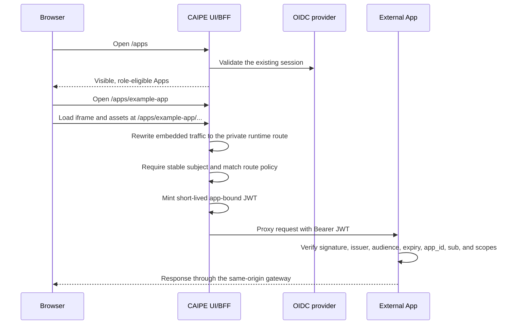
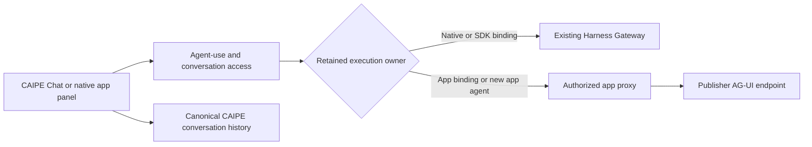

# External Apps

External Apps are independently deployed web applications that appear in the
CAIPE **Apps** hub. The host supplies navigation and authenticated access; the
application keeps ownership of its user experience, data, and domain-specific
authorization.

This integration is useful when a product should be discoverable from CAIPE
without rebuilding it as a CAIPE agent or merging its source into the UI.

## What users see

After an administrator registers and enables an app, users can:

1. Open **Apps** in CAIPE.
2. Select an app they are allowed to use.
3. Work in the app inside the CAIPE shell while the host supplies the signed-in
   identity for approved requests.

The app remains responsible for its own screens, data, and business rules.
Users do not need a second CAIPE login, but they still need the roles and scopes
required by that app.

## When to use External Apps

Choose External Apps for a complete web experience with its own UI and domain
model. Choose Agent Builder when the experience is primarily a conversation;
choose an MCP server when an agent needs a tool or service operation without a
separate web interface.

## Request flow



The browser never receives the runtime's private origin or the signing secret.
It also never performs a token exchange. The BFF mints a fresh token for each
proxied request after access and route policy checks succeed.

`/apps/<id>` is the single canonical browser and application base URL. A
top-level document reaches the hosted shell. The Apps hub uses a normal document
navigation for launches; iframe, asset, and fetch requests then use the same URL
prefix and are internally rewritten to `/api/agentic-apps/runtime/<id>`. This
lets a bundled application use one stable base path while the private runtime
route remains an implementation detail.

Routes outside `/apps` remain unframeable. The Apps surface and private runtime
route permit only same-origin framing so registered applications can render in
the host shell without allowing cross-origin embedding.

## Authentication modes

The manifest selects one of two server-side Bearer-token modes:

| Mode | Intended use | Upstream validation |
| --- | --- | --- |
| `app-scoped-token` | Default for independently operated or less-trusted apps | Verify CAIPE's short-lived app JWT, audience, app ID, and scopes. |
| `forward-user-access-token` | Trusted first-party apps that need the user's existing OIDC/OpenFGA identity | Verify the original access token with the OIDC issuer's JWKS, issuer, audience, and expiry checks. |

The default is `app-scoped-token` when `auth` is omitted. Direct forwarding is
an explicit trust decision: the runtime receives the same access token held by
CAIPE's server-side session, including all permissions granted to that token.
Use it only for a first-party runtime on a private origin. The token is never
returned to the extension's browser code.

In both modes the gateway discards any browser-supplied `Authorization`,
cookies, and `X-CAIPE-*` values. It creates the upstream `Authorization` header
from the authenticated server session and identifies the selected contract in
the host-controlled `X-CAIPE-Auth-Mode` header. Applications must validate the
Bearer token; the routing headers are not standalone proof of identity.

## App-scoped token trust boundary

The app-scoped JWT is the authoritative identity contract:

| Claim | Meaning |
| --- | --- |
| `sub` | Stable subject from the authenticated OIDC session. Required. |
| `aud` | `agentic-app:<app-id>`. Prevents accidental cross-app replay when verifiers enforce it. A holder of the shared signing secret can still forge another app's token. |
| `app_id` | Registered destination application. |
| `iss` | Host issuer, `caipe-agentic-apps` unless configured otherwise. |
| `scp` / `scope` | Scopes granted by the matched route policy. |
| `name`, `email` | Optional display metadata. Never authorization keys. |
| `decision_id`, `correlation_id`, `jti` | Per-request tracing identifiers. |
| `iat`, `exp` | Five-minute token lifetime by default. |

The gateway strips browser cookies, `Authorization`, conventional proxy
identity headers, all `X-CAIPE-*` headers, and destination-specific identity
headers before adding its own values. `X-CAIPE-*` response/request hints are
useful for logs, but an app must authorize only after verifying the Bearer JWT.

The app-scoped signing key is symmetric in this first contract. Set a dedicated
`AGENTIC_APP_TOKEN_SECRET` of at least 32 random bytes in both the CAIPE UI and
each app using `app-scoped-token`. Do not reuse `NEXTAUTH_SECRET`. Because this first slice
uses one verifier secret, every registered runtime that receives it is inside
the same token-signing trust boundary. Per-app keys or host-only asymmetric
signing with JWKS are required before treating runtimes as mutually untrusted.

## Configure the host

Enable the feature and mount one YAML file into the UI container:

```text
AGENTIC_APPS_INSTALL_ENABLED=true
AGENTIC_APPS_CONFIG_PATH=/etc/caipe-ui/agentic-apps.yaml
AGENTIC_APP_TOKEN_SECRET=<dedicated-shared-secret>
AGENTIC_APP_TOKEN_ISSUER=caipe-agentic-apps
```

The catalog is deployment-owned. It is not written to MongoDB and contains no
built-in or vendor-specific registrations.

`proxied-next-zone` is retained as the compatible manifest identifier from the
previously accepted contract; it does not by itself promise support for an
embedded Next.js App Router transport.

```yaml
agentic_apps:
  packages:
    - package_id: example-app
      source: helm
      manifest:
        id: example-app
        displayName: Example App
        description: Example independently deployed application.
        apiVersion: "1.0"
        auth:
          # Optional; this is the default and preserves least privilege.
          mode: app-scoped-token
        runtime:
          kind: proxied-next-zone
          origin: http://example-app.example.svc.cluster.local
          mountPath: /apps/example-app
          preserveMountPath: false
          chrome: iframe
          # Optional per-app limit. The default is 10 MiB; the maximum is 64 MiB.
          maxRequestBodyBytes: 67108864
        surfaces:
          showInHub: true
          navOrder: 50
        access:
          requiredRoles: [user]
          tokenScopes: [example-app:read, example-app:run]
          policyActions:
            - action: proxy:GET
              defaultEffect: allow
              requiredScopes: [example-app:read]
            - action: create-report
              method: POST
              path: /api/reports
              defaultEffect: allow
              requiredScopes: [example-app:run]
        health:
          endpoint: /health
        catalog:
          categories: [example]
          capabilities: [reports]
  installations:
    - app_id: example-app
      package_id: example-app
      installed: true
      enabled: true
      visible: true
      runtime_mount_path: /apps/example-app
      runtime_origin_override: http://example-app.example.svc.cluster.local
```

The UI validates the whole catalog at startup. Invalid IDs, non-HTTP origins,
missing packages, duplicate mounts, unsupported runtime kinds, and malformed
policy declarations stop startup instead of silently exposing a partial
catalog. ConfigMap volume updates are read on subsequent requests.

## Try the Weather example

The repository includes an opt-in
[Weather reference runtime](https://github.com/caipe-io/ai-platform-engineering/tree/main/ui/examples/external-apps/weather)
that exercises this contract end to end:

- a standalone Node.js application, separate from the CAIPE UI;
- live forecast and air-quality data from Open-Meteo, with no provider key;
- browser assets and API calls rooted beneath `/apps/weather/`;
- independent verification of the app-scoped JWT; and
- separate read and write scopes, including an exact mutation route.

It is a hosting example, not the CAIPE Weather agent. Merging or building the
repository does not start, register, or expose it.

To try it with a locally running CAIPE UI, generate one secret of at least 32
bytes and provide the same value to both processes. Start the example from the
`ui` directory:

```bash
AGENTIC_APP_TOKEN_SECRET='paste-the-same-generated-secret-here' \
  node examples/external-apps/weather/server.mjs
```

Then start the UI with the committed opt-in catalog:

```bash
AGENTIC_APPS_INSTALL_ENABLED=true \
AGENTIC_APPS_CONFIG_PATH="$PWD/examples/external-apps/weather/agentic-apps.yaml" \
AGENTIC_APP_TOKEN_SECRET='paste-the-same-generated-secret-here' \
  npm run dev
```

After signing in, open `/apps` and select **Weather**. The example README also
documents its container build, routes, and trust boundary.

## Route policies

Routes fail closed. A request is proxied only when one of these rules matches:

- An exact `method` and `path` policy. `:parameter` matches one path segment.
- A compatibility action named `proxy:<METHOD>` when no route-specific policy
  exists for that method.

Use exact route rules for mutations and assign only the scopes needed by that
operation. Method-wide rules are convenient during an initial integration but
grant every declared app scope when `requiredScopes` is omitted.

## Application requirements

An application using `app-scoped-token` must:

1. Be reachable from the CAIPE UI pod at the configured private HTTP(S) origin.
2. Serve browser traffic beneath the same-origin gateway prefix supplied in
   `X-Forwarded-Prefix`. For example, a Vite build for `example-app` uses
   `base: "/apps/example-app/"`. Root-relative `/assets` or `/api` URLs escape
   the app's canonical prefix and will not work.
3. Verify HS256 with the dedicated signing secret.
4. Verify `iss`, `aud`, `app_id`, `exp`, and a non-empty `sub` before trusting
   `name`, `email`, or scopes.
5. Require the appropriate `scp` value for every operation.
6. Avoid session cookies; the gateway deliberately removes them.
7. Keep its own resource model and fine-grained domain authorization.

An application using `forward-user-access-token` replaces steps 3–5 with
standard OIDC access-token validation against the configured issuer. It should
use the validated `sub` as its stable OpenFGA subject and keep the access token
server-side for any downstream user-delegated authorization call.

This first runtime contract is tested for base-path-capable SPAs and ordinary
HTTP assets/fetches. Host launch links use full document navigation. An embedded
Next.js App Router application's RSC/client-navigation transport is not part of
the supported contract yet and requires a dedicated end-to-end fixture before
it can be claimed.

The host treats configured origins as trusted first-party applications. It
removes upstream framing restrictions so the response can render inside the
same-origin Apps shell. The iframe is intentionally unsandboxed: its JavaScript
can access the parent DOM and browser storage and can make same-origin CAIPE
requests with the user's session. The gateway also replaces the runtime's
framing/CSP response headers with host policy, which is report-only in this
initial slice. `SAMEORIGIN` prevents cross-origin framing; it does not isolate a
registered app from CAIPE. Do not register arbitrary or less-trusted websites.
Use a separate-origin or sandbox/message-channel design before widening the
publisher trust boundary.

### External MCP clients

- Declare `api.mcp` to expose an app-owned MCP authentication boundary:

  ```json
  {
    "path": "/api/example/mcp",
    "metadataPath": "/.well-known/oauth-protected-resource/api/example/mcp",
    "apiKeyHeader": "x-example-token"
  }
  ```

- Declare allowed POST protocol and GET metadata policies. Installed/enabled state, method policy, private origin binding, and body limits still apply.
- The app validates external bearer/API credentials and enforces resource authorization. External MCP access is independent of the host's browser-session/UI-role policy; enable it only when the app owns that complete authorization boundary.
- The gateway forwards external credentials only to the exact declared protocol path. It strips host cookies and identity headers, preserves OAuth challenges, and never substitutes a browser identity for an invalid external credential.
- GET/HEAD requests to metadata and the protocol's `openapi.json` document bypass host-session authentication only when an applicable allow policy exists. Declare each desired method/path policy or a `proxy:GET`/`proxy:HEAD` fallback.
- Manifest validation requires POST protocol and GET metadata policies; it does not automatically allow `openapi.json` or HEAD requests.
- No credentials are forwarded to metadata or schema routes. Other runtime paths retain host-session admission.
- The iframe resource URL is `/apps/<app-id>/api/example/mcp`; compiled native API mounts retain their declared public URL. The app's metadata must advertise that exact resource URL and a public authorization server.
- Path-derived RFC 9728 discovery is available at `/.well-known/oauth-protected-resource` followed by the resource path. Disabled, unknown, or ambiguous resources fail closed.

#### Preserve saved external MCP connections

- The declared root `api.mcp.path` and its `openapi.json` schema remain available when an app moves to an iframe installation. CAIPE proxies these exact routes through the existing app gateway without redirecting clients or rewriting saved connections.
- Root discovery remains available at `/.well-known/oauth-protected-resource` followed by `api.mcp.path`. A root MCP claim cannot overlap another app's MCP path or API mount.
- For root protocol, metadata, and schema requests, CAIPE supplies `x-caipe-mcp-resource-path` with the declared root MCP path. Caller-supplied values are stripped. This selects a public resource URL; it does not authenticate a caller or supply host identity.
- The app must recognize that fixed root selector, advertise the matching root `resource` and metadata URL, and validate tokens against that resource. Hosted requests continue using the hosted resource. Apps that ignore the selector may accept existing credentials but still fail OAuth rediscovery.
- Retain the OAuth issuer, client registrations, refresh grants, and authorization-server resource registrations for both URLs. With resource indicators enabled, removing the old permitted resource can cause token issuance or refresh to fail even when routing works. Revoked grants still require sign-in.
- For secondary OIDC, retain both public URL keys in the host's `CAIPE_SECONDARY_AUTH_RESOURCES` bindings. Restoring routing does not grant an undeclared resource access to a secondary trust anchor.
- Deploy matching host and app changes before asking users to reconnect. Check an existing token, a refresh, and a fresh authorization against the saved root URL. No client configuration or CAIPE database migration is required.

### Host keyboard shortcuts

- A connected iframe can receive `hostShortcuts: ["search"]` in its bridge capabilities.
- The SDK forwards Cmd+K/Ctrl+K as a search intent. It does not transmit typed text or arbitrary key events.
- The host accepts the intent only from the active app frame with the expected origin, app ID, and bridge version. The existing search component owns result authorization.
- Without the advertised capability, the SDK leaves the key event untouched. Already handled events, repeats, composition, and alternate modifiers are not forwarded.

## Current authorization scope

### Hosted presentation context

The iframe host sends `caipe.microfrontend.initialize.v1` messages on document
load and live theme changes. The envelope has `version: "1.0"`, `appId`, and a
`context` containing the host pathname, resolved light/dark theme, locale,
timezone, `surface: "hosted"`, and an empty preferences object. This existing
presentation-message version is independent of manifest API 2.0.

A child can request initialization after hydration with
`{ type: "caipe.microfrontend.ready.v1", version: "1.0", appId }`. Both sides
must validate the exact origin, window source, app ID, and message version.
The host replies at most once per document load to avoid acknowledgement
loops. Children that do not implement this protocol keep their own styling.

This channel carries no JWT, session cookie, credential, user identity, or
permission grant. Authentication and authorization stay in the server-side
gateway. Theme synchronization does not sandbox a same-origin iframe or make
its code less privileged.

New declarations use [AgenticAppManifest 2.0](./agentic-app-manifest.md), shared
with native UI packages. Existing hosted v1.0 manifests are normalized through
a compatibility adapter. Installation visibility controls catalog/navigation;
authorized hidden apps can now launch through direct lookup. Role and request
policy checks remain enforced. Permission requests and capability references
are metadata; they do not create CAS grants or provision agents/tools.

This first forward-port provides deployment flags, OIDC identity continuity,
role launch gates, per-route policy, app-bound tokens, and the protected
runtime proxy. It does not create `agentic_app` objects in OpenFGA and does not
call an external capability authorization service. A later authorization
adapter can add that outer launch/discovery decision without changing the
external application's token-verification contract.

The parser accepts existing `health.blockLaunchWhen` and installation
`health_policy` metadata for catalog compatibility, but this first slice does
not run active health probes or use health state as an admission decision.
Runtime connection failures return `502 upstream_unavailable`. Health-based
launch admission is a separate follow-up.

The runtime currently buffers request bodies before forwarding them. Requests
default to a 10 MiB per-app limit and receive `413 request_body_too_large` when
they exceed it. Set `runtime.maxRequestBodyBytes` when an application needs a
larger upload/import contract, up to the per-app ceiling of 64 MiB. The host
keeps one additional MiB of transport headroom so an oversized request can be
rejected cleanly rather than forwarded as a truncated body.

Every reverse proxy or ingress in front of the UI must also admit the configured
per-app limit plus that transport headroom. For example, an app configured for
64 MiB requests needs an upstream allowance of at least 65 MiB; otherwise the
upstream proxy will reject the request before the app-specific limit is applied.

## App-owned chat agents

An installed app can expose several agents through the existing CAIPE agent picker
and shared Chat UI. The publisher declares the primary assistant in its manifest;
the operator can bind additional enabled registry agents through
`installation.bindings.agentStreams`. This does not provision agents or grant
agent-use permission. Catalog discovery and every turn retain the existing agent,
conversation and app authorization checks.

The primary assistant uses the app's catalog logo. Additional agents keep their
registered agent avatar in chat and sidebar badges while retaining the owning
app's provenance and access checks.



```yaml
agentic_apps:
  gateway_policies:
    example-app:
      browserContextPaths: [/api/example/research/start]
  installations:
    - app_id: example-app
      package_id: example-app
      installed: true
      enabled: true
      bindings:
        agentStreams:
          - id: research
            agentId: example-research-agent
            streamPath: /api/example/research/start
            cancelPath: /api/example/research/cancel
            statusPath: /api/example/research/status
            supportedClients: [webui]
```

Each bound operation must fall inside a publisher API mount and an allowed POST
policy. Routes are canonical API paths; duplicate claims and reserved platform
agent IDs are rejected. Additional agents default to the browser client and must
explicitly opt into Webex and group-space support. Missing operations return 501;
failed or disabled app operations never fall back to Dynamic Agents. Disabling
launch retains the declared routing identity so it cannot accidentally activate a
native agent under the same ID.

The normal chat panel uses the app's AG-UI stream without querying the native
runtime's file or approval APIs. App registration does not create durable
execution, replay or cancellation semantics: the publisher must implement its
declared lifecycle endpoints. CAIPE still owns its visible transcript.

On the first authorized app start/resume, the BFF atomically records a server-owned
`app_binding` on the canonical conversation before contacting the app. The binding
fences removed or reassigned app agents. Existing native/SDK gateway bindings and
legacy native checkpoints retain their execution owner before an app declaration
is considered. App display metadata is context only; a Managed/SDK overlay with
no app stream continues through its existing runtime. Neither client metadata nor
an app display label grants execution access.

Changing an execution owner requires a quiescent migration or a new conversation.
Unmarked legacy app histories and raw pre-gateway SDK sessions whose agent default
has since changed cannot reliably identify their former owner. Adopt those
sessions explicitly before changing declarations; this contract does not claim an
atomic migration between the app binding and provider journals.

## Browser-only delegated actions

An operator can enable `gateway_policies.<appId>.browserContextPaths` for complete app
API routes that need evidence of a current browser login. The gateway authenticates
its existing session, applies same-origin checks, and sends
`X-CAIPE-Browser-Context`, a signed assertion valid for at most 60 seconds. It binds
the app audience, authenticated subject, forwarded access token, HTTP method,
upstream path **including query**, and exact request body. An explicit Bearer
request or service account never receives browser provenance from a secondary
cookie. Incoming assertions are discarded before forwarding.

The app must independently validate its normal authentication and route scopes,
then validate this assertion before using browser-only credentials. The host reference helper
`verifyAgenticAppBrowserContext(request, appId, authenticatedSubject)` shows
the required verification and is covered by request-substitution tests. No CAIPE cookie is forwarded. Route templates such as `/api/projects/:projectId/research` match one canonical
segment per named parameter, allowing new project resources without catalog edits.
Wildcards, prefix rules, encoded separators and traversal are rejected. The signed
assertion always binds the concrete upstream path and query. Paths
without this operator policy keep their existing authentication behavior; a
requested assertion fails closed if signing is unavailable.

This uses the current CAIPE login mechanism. It does not introduce a durable
per-login session identifier, immediate assertion revocation, or a replacement
identity store. Stronger logout/revocation semantics require separate coordinated
identity work. Existing signed Webex client context remains a separate contract.

## Private personal context in shared chat

Before retrieving personal evidence, an app calls
`POST /api/chat/conversations/{id}/personal-context` with
`{"agent_id":"example-research-agent"}` and the caller's normal CAIPE credential.
The endpoint requires user identity, agent-use and conversation-write access,
then verifies the canonical owner and atomically reserves owner-only history.
A successful response sets the server-owned `personal_context: "private"` field.
There is no unmark operation and ordinary create/metadata requests cannot set it.

| Operation | Contract |
| --- | --- |
| Personal admission | Only an unshared browser conversation owned by the caller; idempotent for that owner. |
| Sharing or CAS grants | Reserve the same field as `shareable` before any grant side effect. Exactly one admission can win. |
| Reading | Owner or existing administrator audit access; service identities and previous shares do not grant personal-history access. |
| Idempotent creation, messages and trash | Apply the same personal-history boundary; alternate routes cannot reveal the transcript. |
| Publisher behavior | Wait for successful admission before retrieving or persisting personal evidence; keep project artifacts and their publication policy in the app. |

A chat previously reserved for sharing cannot later admit personal evidence, even
if its shares were removed. Use a separate private chat instead. The host guards
canonical conversation history; publishers remain responsible for their own
private evidence, drafts, logs and explicitly reviewed publication flows.

A trusted app server already sharing the canonical MongoDB can use the same
atomic reservation contract directly, as an explicit deployment integration.
It must validate its authenticated owner and turn capability, preserve the
owner/agent/client predicates, compete with sharing on the same top-level field,
and recheck the private reservation before releasing evidence. This is a trusted
server adapter, not authority granted by a manifest or a browser. The protected
HTTP endpoint is the integration path for apps without database access. Migrate
existing private-history markers before activating a host that enforces the new
field; do not dual-write independent privacy state.

## Query navigation in embedded apps

- An app connects with `caipe.agenticApp.bridge.connect.v1` (`version: "1.0"`,
  its `appId`). The host advertises `queryNavigation: true` in
  `caipe.agenticApp.bridge.capabilities.v1`.
- `caipe.agenticApp.navigate.v1` accepts a public `href` and optional
  `history: "push" | "replace"`. Only query/hash changes on the current app's
  exact path are allowed. Cross-app, API, and external routes are rejected.
- The host validates iframe source, same origin, app ID, and version. This
  capability works independently of assistant availability and grants no API access.
- The host owns browser history and publishes `caipe.agenticApp.navigation.v1`
  on navigation and Back/Forward. A connected frame keeps its original `src`;
  it restores local state and replaces its runtime query without adding a second
  history entry. Older apps retain their existing iframe behavior.
- Only display state belongs in query parameters. Credentials, approvals, and
  operations that change resources must never be restored from a URL.

### Recovering a completed shared-chat turn

An app's authenticated `statusPath` returns `{ running, turnId? }`. It may also
return `completedTurn: { turnId, content, completedAt }` when that exact turn has
successfully committed. The final content is limited to 12,000 characters;
`completedAt` is an ISO timestamp. Never return intermediate output, SDK session
IDs, grants or provider state. Recheck the caller's current resource and personal
evidence access before returning a retained result.

The shared composer sends its current `turn_id` to the existing status endpoint.
The host accepts a completion only for that requested turn, the canonical agent,
and the conversation owner. It fills the existing assistant history row, or
creates its deterministic replacement only if the user turn still exists. A
repeated poll cannot duplicate it; a delayed browser placeholder cannot overwrite
it. Retrying creates a new turn; editing rewinds the old turn before starting a
new one. Status recovery never invokes or resends a model/provider request.
