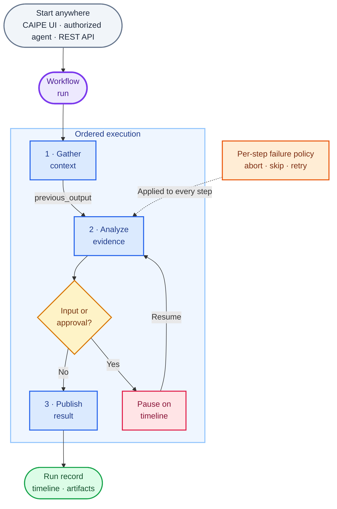

# Workflows

Use Workflows to compose agents into repeatable, inspectable processes. Each
workflow runs an ordered sequence of agent steps, passes context forward, applies
a failure policy to each step, and records the complete run timeline.

**Quick links**:
[CAIPE UI Helm chart](../installation/helm-charts/ai-platform-engineering/caipe-ui-chart) ·
[Workflow RBAC](../security/rbac/workflows)

## When to use a workflow

Use a workflow when a task has several predictable stages, needs a handoff
between agents, or should pause for a person before continuing. Examples
include gathering release evidence, reviewing it, and publishing a summary;
or collecting an approval before a change is made.

## Create and run a workflow

1. Open **Workflows** and choose **Create Workflow**.
2. Add the agents in the order they should run and give each step a focused
   prompt.
3. Decide what should happen when a step fails: stop, skip, or retry.
4. Add an approval or input step when a person must review the work.
5. Save the workflow, then run it from the UI or expose it to an agent with
   the `workflows` built-in tool.
6. Open the run timeline to review responses, tool calls, approvals, errors,
   and generated files.

Workflows coordinate existing agents; they do not copy their instructions or
permissions. The person or service starting the run must have access to both
the workflow and the agents or resources it uses.

## How it works



## Visual workflow builder

Build an ordered workflow in the CAIPE UI without writing orchestration code.

- Add or insert agent steps on the visual canvas.
- Assign a named agent and custom prompt to each step.
- Apply optional model, tool, or runtime configuration overrides to a step.
- Choose `abort`, `skip`, or `retry` when a step fails.
- Set the maximum attempt count for retrying steps.
- Import or export workflow definitions as YAML.

Workflow definitions are stored in MongoDB and can also be bootstrapped through `appConfig.workflow_configs` in the CAIPE UI Helm chart.

## Passing context between steps

Step prompts use Jinja-compatible templates. The available context includes:

| Variable | Purpose |
|----------|---------|
| `previous_output` | Output from the most recently completed step |
| `steps` | Named results and metadata from completed steps |
| `user_context` | Context supplied when the workflow run starts |

For example:

```jinja2
Review the release evidence below and identify blocking risks:

{{ previous_output }}
```

## Run history and timelines

Every execution creates a persistent workflow-run record.

- Status progression includes `pending`, `running`, `waiting_for_input`, `completed`, `failed`, and `cancelled`.
- The run timeline shows agent responses, tool calls, errors, human input events,
  and approvals.
- Files produced during a run are retained as artifacts.
- A running workflow can be cancelled.
- Runs are private by default. The owner can share a run with the workspace for
  collaborative review.

## Human input and approval

An agent step can pause the workflow when it needs structured input or approval
to use a protected tool.

1. The agent emits an interrupt containing a prompt and form fields.
2. The workflow enters `waiting_for_input`.
3. The run timeline presents the request to an authorized user.
4. The submitted data is validated and returned to the waiting step.
5. Execution resumes from that step and preserves the existing run history.

Interrupts raised by a subagent are propagated to the parent workflow run.

## Investigating incomplete steps

- A stream that ends without an explicit completion event fails the current
  step and follows its configured failure policy.
- Agents can inspect `/workflow-state/step-{N}--{agent-id}/` for the step prompt,
  tool-call log, and agent output. Treat these diagnostic files as read-only.
- Write files passed to later steps at absolute paths outside `/workflow-state/`.
  Each step should read back and validate its required outputs before reporting
  completion.
- Before retrying a failed step, inspect saved files and completed external
  actions to avoid creating duplicate resources or pull requests.

## Starting a workflow

Supported trigger paths are:

- **CAIPE UI** — start and inspect a run interactively.
- **Agent** — add the `workflows` built-in tool and grant the agent access to
  specific workflow definitions.
- **REST API** — create a run through `POST /api/workflow-runs` with a valid
  bearer token.
- **MCP** — call the [Workflows MCP server](#workflows-mcp-server) from an agent
  or any MCP client.

Workflow definitions do not currently contain cron schedules. For scheduled
automation, configure a scheduled or autonomous agent and grant that agent
access to the workflow.

## Access control

Workflow definitions and workflow runs use separate visibility models.

- Definition visibility can be `private`, `team`, or `global`.
- Run visibility can be `private`, `workspace`, or `admin`.
- Sharing a run creates workspace-readable access; it does not change the definition's team grants.
- OpenFGA relationships authorize access to definitions and runs on API requests.
- Admins can inspect runs for authorized troubleshooting.

UI controls help explain the current access state, but server-side authorization remains authoritative.

## Workflows MCP server

The CAIPE UI serves a Workflows MCP endpoint at `/api/mcp/workflows`, so agents and
MCP clients can define, run and monitor workflows without a separate container.
Every call runs as the caller: the endpoint relays the caller's bearer token to the
same workflow APIs, so the access control above applies unchanged.

Enable it with Workflows itself. Set `caipe-ui.config.WORKFLOWS_ENABLED: "true"`, then
register the server in `caipe-ui.appConfig.mcp_servers` so AgentGateway routes to it:

```yaml
- id: workflows
  name: Workflows
  transport: http
  enabled: true
  endpoint: http://<release>-agentgateway:4000/mcp/workflows
  source: agentgateway
  agentgateway_discovered: false
  agentgateway_endpoint: http://<release>-agentgateway:4000/mcp/workflows
  agentgateway_target_endpoint: http://<release>-caipe-ui:3000/api/mcp/workflows
```

The endpoint answers `404` while Workflows is off and requires a bearer token (a
browser session cookie is not accepted).

| Tool | What it does |
|---|---|
| `list_workflows`, `get_workflow` | Read definitions you can see |
| `create_workflow`, `update_workflow`, `delete_workflow` | Manage definitions you own |
| `check_workflow_agent_access` | Find agents the audience of a shared workflow cannot use |
| `start_workflow_run` | Start a run as the caller; returns `{run_id, status}` |
| `list_workflow_runs`, `get_workflow_run` | Read runs; events are omitted unless `include_events` is set |
| `cancel_workflow_run`, `resume_workflow_run` | Stop a run, or answer a paused human-input step |
| `share_workflow_run`, `delete_workflow_run` | Manage a run you own |

Tools carry read-only and destructive hints so clients can ask before running
destructive ones. `PUT /api/workflow-runs?id=` is deliberately not exposed: it writes
the request body straight into the run document.
