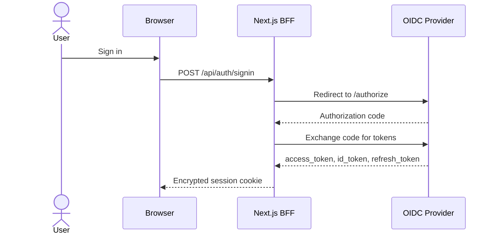
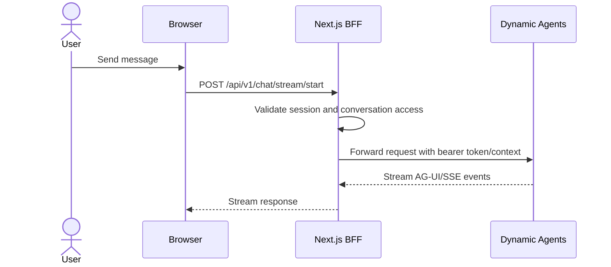

# Authentication Flow

The CAIPE UI uses NextAuth for browser sessions and forwards validated server
credentials from the BFF to backend services such as Dynamic Agents, RAG, and
AgentGateway.

## Components

- **Browser**: renders the React UI and calls Next.js API routes.
- **Next.js BFF**: owns session validation, RBAC checks, service-account flows,
  and backend proxying.
- **OIDC provider**: Keycloak, Okta, Azure AD, or another OpenID Connect IdP.
- **Dynamic Agents**: validates bearer tokens for direct service calls and
  receives BFF-forwarded chat requests.
- **OpenFGA / AgentGateway**: enforces tool and MCP-server access on the data
  path when RBAC runtime is enabled.

## Login



### Returning after sign-in

- The request proxy captures the original public path and query before rewrites.
  The server session guard includes this destination in the login `callbackUrl`.
- Login accepts relative paths and absolute URLs from the browser's own origin;
  external destinations and login loops fall back to `/`.
- Before SSO, the destination is saved in tab-local session storage for 15 minutes.
  An OAuth error return uses it only when the callback parameter is missing.
  Session expiry, session reset, and loop recovery start a new login without
  restoring a previous attempt. Successful application admission clears it.
- Client-side session expiry also preserves the page's query and fragment.
  Fragments remain in tab-local storage during OAuth and are restored on the
  client after sign-in; NextAuth receives a callback without the fragment.
  An OAuth retry may unwrap a `/login?callbackUrl=...` return only when its
  destination matches the tab's validated pending attempt.

## Chat Request



The browser does not need direct network access to Dynamic Agents. Set
`DYNAMIC_AGENTS_URL` on the UI server so the BFF can reach the runtime.

## Token Refresh

NextAuth refreshes access tokens before expiry when the provider issues refresh
tokens. If refresh fails, the session receives an error flag and the UI prompts
the user to sign in again.

## Required Environment

```bash
SSO_ENABLED=true
OIDC_ISSUER=https://idp.example.com/realms/caipe
OIDC_CLIENT_ID=caipe-ui
OIDC_CLIENT_SECRET=<secret>
NEXTAUTH_SECRET=<random-secret>
NEXTAUTH_URL=https://caipe.example.com
DYNAMIC_AGENTS_URL=http://dynamic-agents:8001
```

For local Docker Compose with bundled Keycloak, `.env.example` provides working
development defaults.
