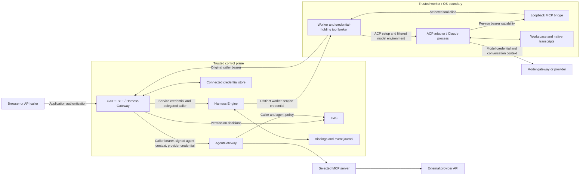
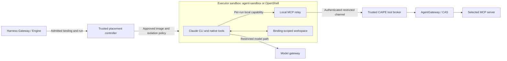

# Claude ACP threat model

This model covers the managed Claude Code CLI and SDK ACP workers, their
Harness Gateway/Engine control path, and caller-authorized MCP forwarding.
It describes the current implementation and its deployment assumptions;
it is not a claim of independent security certification.

**The worker is a trusted execution boundary. A per-run MCP capability limits
broker access; it does not sandbox the Claude process or isolate mutually
untrusted agents sharing a Unix user and workspace volume.**

Agent-sandbox/OpenShell isolation is the planned augmentation described below.
Its controls are not assumed to be present in the current worker deployment.

## Scope and security objectives

| Runtime | Covered behavior |
|---|---|
| `claude_code_cli_acp` | Native CLI launched by the CAIPE ACP adapter; one invocation per message, with a saved native session and workspace |
| `claude_code_acp` | SDK-backed upstream ACP process; shares the managed worker, tool bridge and authorization boundaries |
| Shared control plane | Agent publication, pinned bindings, run admission, cancellation, event replay, connected credentials and MCP routing |

CLI flags and native transcript details below apply to the CLI runtime.
The SDK ACP runtime supplies its corresponding options through ACP setup.
AgentCore, Deep Agents, app-owned runtimes, channel-specific bot identity
mapping and arbitrary external/BYO workers need their own runtime reviews.
Persistent bidirectional CLI processes and tmux attachment are not implemented
by this per-message CLI lifecycle.

Objectives:

- Execute only for an authorized caller, agent, conversation and pinned version.
- Expose only selected MCP tools and operator-approved native tools.
- Keep application and provider-tool credentials out of the Claude child process.
- Distinguish model-provider credentials from tool-provider credentials.
- Preserve one admitted producer across browser disconnects and repeated requests.
- Release a session only after execution and dispatched tools have drained.
- Authorize replay without allowing a shared reader to control execution.
- Make uncertainty visible without silently repeating external side effects.

## Actors and assets

| Actor | Assumed authority or attacker capability |
|---|---|
| Agent author | Can write instructions, select available profiles/tools and publish versions; may supply hostile instructions |
| Executing caller | Has a valid application identity; may enumerate identifiers, alter API inputs or attempt unauthorized tools/resources |
| Shared viewer/editor | Can access the permissions granted on a conversation; viewing is not execution-owner authority |
| External content source | Can supply prompt injection through repositories, documents, tool descriptions/results or workspace files |
| Claude/model output | Can request any available action; is not an authorization decision |
| Network attacker | May replay stolen bearer credentials or reach accidentally exposed internal services |
| Same-worker process | May inspect files, connect to loopback or exploit shared OS identity; not isolated by the per-run token |
| Operator/control-plane administrator | Trusted to configure endpoints, credentials, images, model access and worker isolation |
| Compromised worker, MCP server or dependency | Can act with that component's credentials and data access; requires containment outside prompt/tool selection |

Protected assets include caller identity, OAuth refresh/access tokens, worker
service credentials, the agent-context signing key, model credentials, MCP
capabilities, prompts, tool arguments/results, native transcripts, workspace
files, event journals, shared-chat history, external side effects and compute.

## Data flow and trust boundaries



- **Public boundary:** the BFF authenticates callers and authorizes operations.
  Clients do not choose trusted internal headers, worker URLs or executables.
- **Service boundary:** Engine and worker APIs trust authenticated service
  callers to assert the execution subject. Internal bearer credentials are
  high-authority secrets, not end-user tokens or workload attestation.
- **Process boundary:** the Claude child receives operator-approved model
  credentials and a limited local MCP capability. The original caller bearer
  remains in trusted worker memory.
- **Tool boundary:** the BFF checks the live run, pinned tools and current
  permissions; AgentGateway authenticates and authorizes routed calls before
  forwarding to a provider-backed MCP server.
- **Persistence boundary:** saved history outlives processes and browser
  subscriptions. Database and volume access are separate from HTTP permissions.

The private network ACP leg uses the application's HTTP/NDJSON transport and
Harness extension. It is not a claim of conformance to standardized ACP
Streamable HTTP. The CLI's provider subprocess uses stream-json; the worker's
local MCP bridge uses Streamable HTTP. These protocols confer no permission
without their surrounding authentication and authorization checks.

## Credentials and lifetimes

| Credential | Holder and purpose | Lifetime / limitation |
|---|---|---|
| Application session / OIDC bearer | BFF authentication; delegated bearer in Engine/worker memory for MCP authorization | Provider expiry and session policy apply. Logout does not recall already-issued tokens or undo dispatched work |
| BFF → Engine service credential | Trusted BFF and Engine; authenticates internal requests carrying a subject | Deployment-managed bearer; no per-request cryptographic binding of the asserted subject |
| Engine → worker service credential | Engine and its selected worker connection | Distinct operator secret; rotate through deployment configuration |
| Local MCP capability | Worker registry and Claude's temporary MCP configuration | Fresh 32-byte random secret per bound run; reusable during that run; no embedded expiry |
| Agent-context HMAC key | Trusted signers and gateway authorization bridge | Deployment secret. The BFF's dynamic context normally has a 300-second validity window; the signature is not single-use |
| Connected provider credential | BFF credential service and configured provider MCP path | Resolved for the execution caller; access/refresh lifetime and upstream scopes follow that connection |
| Model credential / supported workload identity | Worker and Claude child environment | Operator-managed authority for model access; not scoped by the local MCP capability or the caller's tool grants |

The local capability is created in `ClaudeACPToolBridge.bind`:

```python
token = secrets.token_urlsafe(32)
self._sessions[run_id] = ToolSession(token, manager)
```

Python's [secrets module](https://docs.python.org/3/library/secrets.html)
uses the OS cryptographic random source. The explicit argument supplies
32 random bytes, or 256 bits, encoded as URL-safe text.

Its handling is deliberately narrower than a general application token:

1. A registered run owns a server-side tool-alias map and Streamable HTTP manager.
2. The URL contains a run ID, not the secret. Authentication uses the bearer header.
3. The bridge requires an actual loopback peer (`127.0.0.1` or `::1`), a live
   registry entry and a matching header checked with `hmac.compare_digest`.
4. The CLI receives the header through a temporary `mcp.json` file, mode `0600`,
   inside a private temporary directory. Arguments contain the file path, not
   the bearer value. The file is removed during normal process cleanup.
5. The bridge removes the registry entry in `finally` when its binding exits.
   Already-dispatched calls can still drain afterward; their completion is
   required before the session reservation is released. A restarted worker
   does not recreate the old capability.

The token is opaque: it has no JWT claims, audience, signature, nonce or TTL.
Possession authenticates the request; it does not attest a PID or a human.
It can invoke the run's selected aliases repeatedly while registered. Reusing
it with another run ID fails the registry/secret check. Copying it from the same
worker can impersonate that run at the bridge, subject to downstream checks.

Normal cleanup is not secure erasure from memory, filesystem snapshots,
backups or crash dumps. The broker does not persist the capability in its
MongoDB records; no blanket claim is made about vendor debug output.

## Authorization invariants

| Operation | Required checks and boundary |
|---|---|
| Publish agent | BFF agent-write/ownership rules; validated harness/profile/options; immutable published version |
| Start / resume | Caller authentication, agent-use and conversation-write access; owner-scoped binding and atomic admission |
| Shared replay | Conversation-read authorization and an exact agent/conversation read scope; no run admission or mutation |
| Stop / clear | Execution-owner and write checks; a read scope cannot authorize mutation |
| List broker tools | Active Claude run, original executing caller, pinned blueprint, current enabled agent and current tool selection |
| Call broker tool | All broker checks plus selected tool ID, arguments object and MCP-server invoke permission |
| Route MCP call | Valid caller identity, signed dynamic agent context and agent/tool policy; caller tool-call permission when enabled |
| Provider operation | Connected credential ownership and upstream account/resource scopes; CAS grants do not expand upstream privileges |
| Native file/shell tool | Explicit operator tool list and worker OS/provider permissions; this path does not use MCP/CAS |

Agent selection and caller permission are separate: adding a tool to an agent
does not grant every user `call` on that tool. Tool grants also do not impose
repository-, document- or row-level restrictions on tool arguments; those
require provider scopes and any additional application policy.

The BFF signs the real agent context after checking the run. The context
identifies the agent and its time window; it is not itself bound to the run,
request body or caller. Caller and agent checks must remain separate. A signed
header can be replayed within its validity window if other credentials/checks
allow it. It is not a replacement for the per-run local capability.

Deployment gates matter:

- Configure matching `CAIPE_AGENT_CONTEXT_HMAC_SECRET` values on trusted signers
  and the gateway bridge. This broker rejects missing signing configuration.
- Enable `CAIPE_CALLER_TOOL_CHECK_ENABLED=true` and provision exact caller grants.
  The gateway bridge's compatibility default does not enable this check.
- Remove `OPENFGA_BYPASS_SUBS` entries for protected environments. Restrict
  direct MCP endpoints and require gateway authentication/enforcement.
- A signed `local` context has a different policy path and longer lifetime.
  The managed worker uses `dynamic` contexts; enabling local clients requires
  reviewing that path and its caller-tool enforcement independently.
- Authentication/authorization service failures must deny protected operations;
  validate the deployed gateway, caches and policy flags, not just application code.

## Threat analysis

Categories: **S**poofing, **T**ampering, **R**epudiation, **I**nformation disclosure,
**D**enial of service and **E**levation of privilege. Residual risks describe
remaining authority or missing controls, not demonstrated exploits.

| Threat / attacker action | Current control | Residual risk / deployment requirement |
|---|---|---|
| **S/E: Forge another caller, run or conversation** | Public BFF reconstructs trusted headers; service authentication, owner/context consistency and exact shared-read scope checks | A stolen internal service credential can assert subjects. Keep service endpoints private and credentials distinct; plaintext internal HTTP needs a trusted network or added transport protection |
| **S/E: Steal, guess or replay a local MCP token** | 256-bit random token, loopback peer check, run-specific registry, constant-time comparison and cleanup | Bearer is reusable until deregistration, with no hard TTL or PID binding. Same-worker file/process access can defeat secrecy |
| **E: Broaden the selected tool set** | Broker compares schemas with pinned bindings; unknown aliases/IDs are rejected; BFF also checks current agent tool policy | Allowed tools may have broad arguments or provider scopes. Schema exposure is not a business-operation authorization policy |
| **S/E: Forge agent context or bypass CAS through another route** | Signed real-agent context, caller identity and gateway policy checks | Signing-key compromise, bypass subjects, disabled caller-tool checks or reachable direct MCP endpoints weaken the boundary. HMAC alone does not identify the caller |
| **T/E: Inject CLI flags, executable paths or remote MCP URLs through a draft** | Operator-owned command/profile; argument-list subprocess execution; prompt via stdin; local bridge URL validation; explicit tool policy and no permission bypass | Operators and compromised configuration stores remain trusted. URL validation permits configured HTTP(S) hosts; it is not an independent network allowlist |
| **T/E: Prompt injection in tool results, descriptions, files or instructions** | Model output cannot change broker allowlists or caller grants; CLI uses strict MCP config and disabled settings/slash-command discovery | The model can misuse an already-authorized tool or disclose data through an allowed action/model request. Per-call approval is unsupported; MCP profiles require `approval_policy: never` |
| **I/E: Read another binding's workspace or capability file** | Binding-derived workspace path; directory/file modes; container runs non-root | Hashing and `0700`/`0600` do not isolate processes sharing the same UID. Shared worker volumes are not a boundary for hostile tenants or arbitrary native code |
| **T/I: Tamper with transcripts or native session markers** | Pinned binding/native UUID, assigned working directory and missing-session failure instead of a silent new conversation | Native transcript/marker files are not authenticated storage. Same-UID code or a volume administrator can alter them; markers prove local presence, not ownership or integrity |
| **I/E: Extract model, workload or control-plane credentials** | Delegated caller identity is excluded from persisted run context and child environment; only selected model-provider environment keys reach the child | Model keys/workload access intentionally reach Claude. Worker compromise exposes greater authority, including in-memory caller tokens. Native tool selection is not an OS credential sandbox |
| **I/E: Use native tools or dependency code for arbitrary network access** | Selected MCP calls use the controlled bridge; native tools default to an empty list | The overlay does not enforce complete egress isolation. Direct APIs, cloud metadata, telemetry or other reachable services need network/identity controls; MCP restrictions do not govern all process traffic |
| **I: Leak tool results through the model, UI, logs or shared history** | Access checks on replay; explicit HTTP denial paths suppress upstream error bodies; credential stores use their existing protection mechanisms | Normal tool arguments/results and native transcripts can contain secrets or personal data. No universal content redaction or model DLP guarantee; sharing a chat shares its authorized history |
| **S/T/I: Browser injection, forged browser actions or malicious rendered links** | Shared Markdown sanitization and application session/access controls; the session cookie is HTTP-only with SameSite handling | Review rich-content rendering and cookie-authenticated mutation routes for origin/CSRF protection. Sanitization does not prevent phishing or misuse of an authorized browser session; local capabilities must never enter rendered chat content |
| **E/T: Continue after grant revocation, logout or cancellation** | Broker/gateway checks on new calls; cancellation flag checked before broker dispatch; dispatched work drains before reuse | Checks race with revocation and external execution. Already-delivered data and committed side effects cannot be recalled. Existing streams/runs are not guaranteed to stop immediately on logout; account for decision caches |
| **T/D: Duplicate dispatch after a lost receipt or browser reconnect** | Stable request/run identity, input fingerprint, atomic producer admission and sequenced replay; worker retries retain admitted run identity | No global exactly-once guarantee for external effects. A repeated MCP request, new prompt/key or model-generated second tool call can be another operation; provider idempotency/reconciliation may still be needed |
| **D/T: Treat Stop or a broken connection as proof work ended** | ACP cancellation, child process-group cleanup, dispatched MCP drain and retained reservation on uncertainty | A remote tool may continue or commit after Stop. Lost confirmation can block the session until operator reconciliation; do not clear its fence solely to restore availability |
| **D: Exhaust memory, storage, provider budget or worker capacity** | Bounded agentic turn count and per-operation timeouts; one admitted producer per binding | These are not complete user/team quotas or total-run limits. Large payloads, many bindings, hung providers and disk growth need infrastructure limits and monitoring |
| **I/D: Expire or rotate credentials during a long run** | Each new broker request is authenticated; provider connection resolution follows credential-service renewal policy | The worker retains the delegated caller bearer for that run; browser renewal does not replace it. Expired authority may fail a later tool call. Model-key rotation may require new processes or a worker rollout |
| **T/I/D: Compromise an image, CLI/ACP package or MCP server** | Pinned runtime/package versions; separate worker profiles/volumes; CI builds and startup tests | Version pins do not prove artifact integrity or absence of vulnerabilities. Operators need artifact verification, patching, scans and least-privilege provider credentials; a trusted MCP server receives its configured credential |
| **R/T: Claim success without a confirmed tool/run result** | CLI requires a successful terminal result; tool failures carry errors; 401/403 are distinguished from uncertain transport failure; journals retain run/event identities | Model text can still make false claims. Journals/transcripts are not tamper-evident audit logs, and a completed response can describe a failed tool. Inspect tool outcomes and provider audit records |

## Execution, revocation and persistence

Drain means the owned process boundary and dispatched HTTP tasks have finished.
An HTTP error/timeout does not prove an external operation stopped or had no
side effect. A tool error can be recorded while the agent completes its response;
that alone does not leave an execution reservation held indefinitely. Retained
reservations protect unconfirmed producer/drain state. Ambiguous external
effects still require provider audit/idempotency or operator reconciliation.

- **Refresh / disconnect:** detaches a subscriber; it does not cancel the
  admitted producer. Replay is authorized separately from execution.
- **Stop:** requests cancellation of the turn. Native process termination and
  remote-tool completion are different events; drain before releasing the binding.
- **Lost confirmation / crash:** retain an uncertain producer reservation.
  Saved events/transcripts permit later inspection or session resume, not
  takeover of an in-flight process on a different worker.
- **New turn:** issue a fresh local capability. A newly allocated CLI UUID uses
  its first invocation until native persistence or inference/tool output confirms
  startup. Started and legacy UUIDs require resume; missing native state never
  triggers an automatic fresh inference. The outer execution fence still blocks
  reuse while process/tool drain is unconfirmed.
- **Sharing:** readers can see persisted content they are authorized to read,
  including tool results obtained under the executor's provider access. They do
  not inherit those credentials or authority to execute as that owner.
- **Revocation:** deny subsequent protected requests according to live policy,
  credential validity and cache behavior. Do not promise rollback of an upstream
  write, erasure from another viewer, or instantaneous stream termination.
  Harness event subscriptions recheck current read access every 15 seconds,
  including idle streams, and hold due chunks until that check succeeds.
  Revocation or authorization errors close that subscriber without cancelling
  the producer. Policy caches can delay observed revocation; app-owned streams
  retain their own authorization and lifecycle requirements.
- **Retention:** canonical events have configurable retention; messages, native
  transcripts, workspace files, logs and backups have separate lifecycles.
  Clearing a conversation or rotating its epoch is not proof of physical erasure.
- **Audit:** correlate caller, agent/version, binding, run, tool ID, event sequence
  and gateway reason code. Trace/request IDs are correlation data, not credentials
  or authorization evidence by themselves.

## Sandbox augmentation: agent-sandbox or OpenShell

The planned layer uses an execution sandbox such as
[agent-sandbox](https://github.com/kubernetes-sigs/agent-sandbox) or
[OpenShell](https://github.com/NVIDIA/OpenShell). It augments the current
authorization, broker and persistence design. This PR does not implement or
deploy either sandbox backend; their effective isolation depends on the chosen
runtime, policies, mounts, workload identity and controller configuration.



This is a target composition, not an assertion that a sandbox project supplies
each CAIPE integration automatically.

| Concern | Current baseline | Required augmentation |
|---|---|---|
| Identity and authorization | Caller, agent, run and tool checks in the control plane | Retain these checks; a sandbox identity must not substitute for the caller's authority |
| Native execution | Explicit tool list inside a shared worker OS boundary | Isolate executor processes, filesystem access and privileges by the chosen trust domain |
| MCP access | Run-local HTTP capability and in-process broker | Keep the credential-holding broker protected from executor code; authenticate the sandbox-to-broker channel |
| Credentials | User/tool-provider tokens stay outside the child; model credentials can enter it | Keep user OAuth, signing and service secrets outside the sandbox. Prefer narrowly scoped model-gateway access instead of a broadly reusable model key |
| Network | Operator-managed networking; no complete egress policy in the overlay | Enforce required destinations and metadata restrictions at the sandbox/network boundary |
| State and resources | Worker volume, native UUID and process-group drain | Bind isolated storage and sandbox identity to the conversation epoch; apply quotas and prove cleanup without discarding run fences |

Integration requirements:

- **Placement is controlled:** create/attach an executor after authorized run
  admission. Agent publication defines configuration; it must not authorize an
  arbitrary pod specification, host mount, image, executable or privileged runtime.
- **Broker separation is real:** placing the trusted broker beside executor code
  under the same UID with shared files/process access does not fix the current
  same-worker threat. Define and test the actual isolation boundary.
- **Loopback must be redesigned explicitly:** the current adapter accepts only a
  localhost MCP bridge. Moving the broker outside the sandbox requires a local
  relay or another authenticated transport with run/binding scoping. Do not fix
  connectivity by dropping peer checks or publishing the capability endpoint.
- **Authority remains per run:** bind relay access to the admitted caller,
  agent/version, binding epoch, run and executor. Deny new tool dispatch with no
  active run or after cancellation/revocation checks; do not cache another
  caller's OAuth authority in a persistent executor.
- **Storage is isolated:** authorize sandbox reuse and snapshot restore against
  the binding/trust domain. Mount only its workspace; verify stale epochs cannot
  load another conversation's native transcript or a prior capability file.
- **Lifecycle retains uncertainty:** destroying a sandbox does not prove a
  dispatched external MCP call stopped. Preserve broker drain and Engine
  reservations, even if the pod/process disappeared. Idle eviction can preserve
  saved chat state; it is not a reason to recreate or delete the conversation.
- **Escape and control-plane abuse remain threats:** restrict controller RBAC,
  workload identity, kernel/runtime exposure and image sources. Test cross-sandbox
  filesystem, loopback, credential, network and resource access adversarially.

The sandbox addresses process/filesystem/network containment. CAS and
AgentGateway still decide which external tools the caller and agent may use.
Provider scopes, model data policy, prompt-injection risks, shared history,
external side effects and audit retention remain separate responsibilities.

## Required deployment controls

These are operator requirements, not guarantees supplied by the optional overlay.

1. **Trust domain:** use the shared worker only within an accepted trust domain.
   Before serving mutually untrusted native-code tenants, provide per-session or
   per-tenant sandbox/OS isolation, credentials and storage boundaries. A pod or
   namespace alone is not the full design; review the runtime and storage model.
2. **Ingress and transport:** do not publish Engine/worker ports as unauthenticated
   public APIs. Restrict ingress to authorized services. Protect non-loopback
   credential-bearing traffic with TLS/mTLS or an explicitly trusted network.
3. **Egress and workload identity:** permit required BFF, database, model and tool
   paths; restrict arbitrary destinations and cloud metadata. Apply provider IAM
   and credential scopes that remain safe if the worker is compromised. Standard
   NetworkPolicy is not a per-process, same-pod loopback isolation mechanism.
4. **Secrets:** replace development credentials; use distinct high-entropy service
   and signing secrets. Restrict secret files, environment inspection, deployment
   permissions and backups. Rotate compromised credentials and terminate affected
   runs; capability randomness alone does not revoke downstream OAuth authority.
5. **Authorization:** require OIDC/gateway validation, CAS enforcement, signed
   dynamic contexts and caller-tool checks. Grant only required agent/server/tool
   access. Verify denials for a second caller and a shared read-only viewer.
6. **Native policy:** keep native tools empty or narrowly selected unless the
   workload boundary supports their authority. Do not enable permission bypass,
   arbitrary executables or settings discovery to resolve a tool-access error.
7. **Resource limits:** enforce CPU, memory, process, storage, concurrency,
   request-size and model-spend limits; bound orphaned work operationally. The
   current per-message process model has no configurable warm-session idle timer.
8. **Data lifecycle:** protect database/PV access, backups and restored copies;
   define retention/deletion for each store. Prevent unrelated tenants from
   mounting the same transcript volume. Treat tool content sent to the model as
   a data disclosure governed by the selected provider's policy.
9. **Container and supply chain:** use non-root execution, an init/reaper, minimal
   mounts, appropriate capabilities/seccomp and verified images. Avoid host
   sockets or unnecessary Kubernetes credentials. These controls reduce blast
   radius but do not turn a shared UID into tenant isolation.
10. **Incident recovery:** stop admitting affected work, contain the worker,
    preserve restricted audit evidence, rotate exposed secrets and reconcile
    upstream operations before releasing uncertain reservations. Do not log or
    publish raw tokens, credential files, environment dumps or sensitive tool results.
11. **Browser boundary:** retain secure cookie/session handling and output
    sanitization, review origin/CSRF controls for cookie-authenticated mutations,
    and treat model-generated links and rich content as untrusted. MCP permission
    enforcement does not protect against an attacker acting inside an authorized
    browser session.

Kubernetes describes the separate responsibilities of
[multi-tenant isolation](https://kubernetes.io/docs/concepts/security/multi-tenancy/)
and [NetworkPolicy enforcement](https://kubernetes.io/docs/concepts/services-networking/network-policies/).
This integration does not automatically provision all of those controls.

## Verification evidence and limits

| Property | Repository coverage / verification |
|---|---|
| Caller identity, selected aliases, loopback restriction and capability revocation | `test_claude_acp_tools.py` exercises missing/wrong capabilities, wrong-run URLs, non-loopback peers, unknown tools and downstream permission revocation |
| CLI configuration, native resume, cancellation and terminal success | `test_claude_cli_acp.py` covers private capability configuration, same-session resume, concurrent-prompt rejection, external MCP rejection and unconfirmed outcomes |
| Worker trust and idempotency | `test_claude_workers.py` covers inconsistent owner contexts, redacted worker settings, idempotent remote admission, lost receipts, cancellation/drain and classified errors without retries |
| Shared read / mutation separation | `test_shared_replay.py` and BFF Harness route tests cover conversation scopes, shared replay and denied write operations |
| Producer fencing | `test_run_admission.py`, `test_native_execution_lease.py` and `test_replay_consistency.py` cover admission, races, uncertain cancellation and replay consistency |
| BFF MCP checks and error reporting | Harness tool-route tests and `mcp-http-server-client.test.ts` cover selected tools/current policy, caller checks, 401/403 at handshake/call stages, sanitized errors and no automatic retry |
| Live integration smoke checks | Real CLI calls verified caller-owned provider reads, refresh during a real tool wait, Stop/drain, continuation on the same UUID, a repaired exact tool-call grant and continued SDK ACP operation |

The live checks establish those observed behaviors, not comprehensive penetration
testing. Scripted-provider CLI checks are distinguished from live-provider calls
in the PR validation record. No claim is made that this suite establishes
resistance to same-UID compromise, container escape, malicious dependency code,
complete egress control, content exfiltration or production-scale resource abuse.
Deployment-specific evidence and identities belong in restricted environment
records, not generic examples in this document.

## Source map and related documentation

Repository paths are relative to the repository root:

| Boundary | Source |
|---|---|
| Gateway/BFF read and execution authorization | `ui/src/lib/harness-gateway.ts`, `ui/src/lib/harness-engine-proxy.ts`, `ui/src/app/api/harness-engine/_run-authz.ts` |
| Per-run tool route and provider headers | `ui/src/app/api/harness-engine/runs/[runId]/tools/route.ts`, `ui/src/lib/mcp-http-server-client.ts`, `ui/src/lib/mcp-credential-headers.ts` |
| Admission, persisted identity exclusions and worker validation | `ai_platform_engineering/harness_engine/src/harness_engine/{coordinator,repository,models,claude_worker}.py` |
| Capability and delegated tool broker | `ai_platform_engineering/harness_engine/src/harness_engine/{claude_acp_tools,claude_tools}.py` |
| Child environment, process cleanup and CLI invocation | `ai_platform_engineering/harness_engine/src/harness_engine/adapters/claude_acp.py`, `ai_platform_engineering/harness_engine/src/harness_engine/{claude_acp_process,claude_cli_acp}.py` |
| Gateway policy flags and checks | `deploy/openfga/bridge/main.py` |
| Worker baseline | `deploy/harness-engine/compose.claude-cli-acp.yaml`, `ai_platform_engineering/harness_engine/build/Dockerfile.claude-cli-acp` |

- [Claude ACP architecture and configuration](../architecture/claude-acp.md)
- [Browser session storage and refresh](./browser-sessions.md)
- [Agent-context HMAC](./agent-context-hmac.md)
- [Access API](./rbac/access-api.md)
- [AgentGateway](../architecture/gateway.md)

Revisit this model when adding persistent CLI processes, native terminal/BYO
attachment, the sandbox augmentation, interactive approvals, new native tools, credential delegation,
different worker placement, cross-replica session execution or new sharing rules.
Each changes the authority, credential lifetime or isolation assumptions above.
