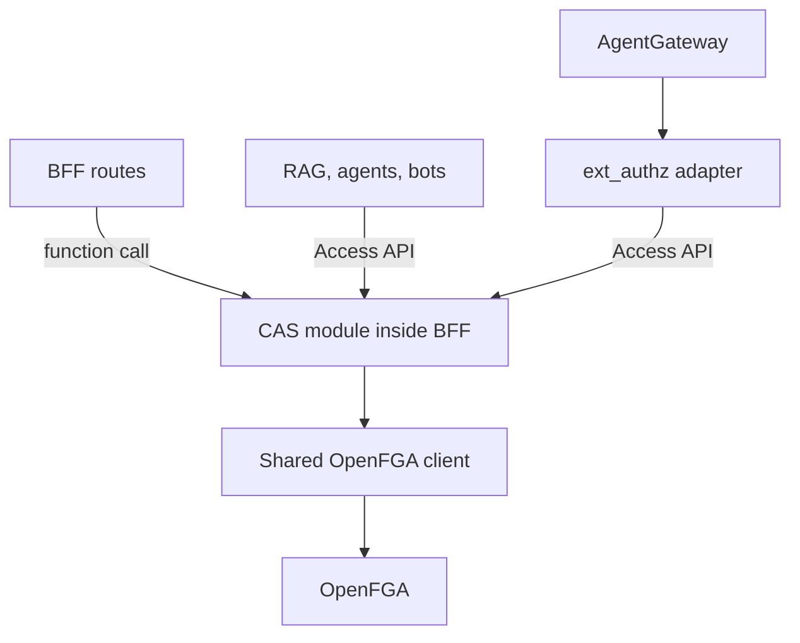
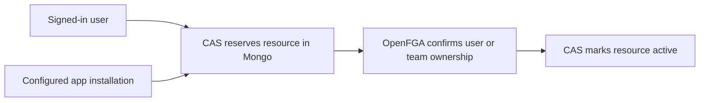

# Access API: one authorization boundary

**Status:** Access API foundation, BFF chat agent-use checks and opt-in gateway
authorization are implemented. Remaining consumers and production cutover are incomplete.

CAS answers permission questions. Each service still stops an operation when
the answer is no. CAS is a module inside the BFF, not another deployed service.

## Target architecture



This is the destination, not today's complete wiring. The `/api/access/*`
routes, shared BFF agent-use guard and opt-in gateway domain call CAS now.
Existing `/api/authz/v1/*` callers and direct service clients remain to migrate.
The [gateway cutover](./gateway-cas.md) is not a completed production rollout.
Migrating remaining callers is separate work, not a
commitment to maintain two public contracts permanently.

## The foundation

| Operation | Question |
| --- | --- |
| `POST /api/access/check` | May I perform this action on this resource? |
| `POST /api/access/query` | Which of these candidate resources may I access? |
| `POST /api/access/grants` | May I give this principal a capability? |
| `DELETE /api/access/grants` | May I remove this principal's capability? |

- The caller comes from existing bearer-token or session authentication.
  A service token evaluates the service's own access, not its owner's access.
- Requests cannot supply a subject, delegated identity or trusted context.
  Cookie requests require the same browser origin and JSON content.
- Checks return allow or deny. An unavailable decision returns an error;
  callers must not treat it as permission to proceed.
- Queries filter at most 200 supplied IDs using the same per-resource CAS
  policy as checks. Any unavailable result fails the whole query.
- Check, query and grant/revoke JSON bodies are capped at 1 MiB while reading,
  before authentication. Registration and delegation retain a 16 KiB limit.
- Grant/revoke uses the existing CAS rule: manage the resource, or manage
  the configured organization. Public-grant restrictions and auditing remain
  in place. Revoking a direct grant does not remove access inherited elsewhere.

The routes contain no OpenFGA calls or independent permission rules. The
shared HTTP boundary handles authentication, validation and error responses;
CAS owns the decisions and changes to relationships.

## What this does not solve yet

- Normalized identity and verified delegation across every ingress.
- Complete gateway cutover and migration of RAG, bots and older BFF paths.
- Registration of existing domain objects, unbounded discovery or a generic resource catalog.
- System-wide model pinning, bounded dependency calls and revocation freshness.
  Single agent-use checks are fresh; other decision and query caches still apply.
  HTTP `no-store` does not disable those caches.

New-service onboarding includes a strict signed service identity profile and a
job-scoped delegation API. It does not replace existing caller authentication.
See the [identity profile](./architecture.md#new-service-identity-foundation).
Ordinary self-checks do not authorize acting for someone else. The user approves
bounded work in a browser session; CAS stores the approval in MongoDB. The service
keeps its own identity, and CAS requires the approval **and** current user/service
permissions. Audit shows both identities and the approval, including denied uses.
See the [delegation architecture](./architecture.md#cas-job-delegation--new-service-api).
Existing background consumers are not migrated. Explicit authorization may outlive
browser logout, but not its expiry, revocation or loss of required permissions.

## Register resources for a new app service

Use the existing [App Contract](../../features/agentic-app-manifest.md), including
its service-only profile. Operators bind an installation to a service-account
client; the app ID supplies its resource namespace. Installation does not grant
the service access to users' resources.



- Reserve **before creating domain content**. Use the returned canonical resource
  handle as the authorization key; this is not an API for adopting existing records.
- The first supported kind is `resource`, backed by the reviewed `app_resource`
  model. An app cannot register agents, teams or arbitrary OpenFGA types.
- The signed-in user owns a personal resource. Team ownership requires current
  team membership. Namespace custody never makes the service an owner.
- Mongo stores identity, ownership and registration state; the app keeps its data.
  Failed or ambiguous saves remain pending and deny access until retried successfully.
  The same identity/intent returns the same handle; another creator/owner conflicts.
- Resource checks and candidate queries use fresh graph and registration-state
  checks. Grant/revoke and delegated checks share that state gate. Disabling the
  installation blocks subsequent protected operations without deleting resources.
- Background work uses the existing delegation API: explicitly grant the service
  its resource capability, then approve the exact job/resource/action and expiry.
  The service verifies and enforces CAS's decision at execution.
- Registration audit records the caller, app namespace, owner and pending/active
  outcome. Decision and delegation events retain their existing correlation chain.

This slice supports registration and inspection. Resource removal/cleanup,
ownership transfer, a delegation approval UI and existing-service migration are
separate work. No namespace CRUD API or namespace-owner role is introduced.

<details>
<summary>API and installation reference</summary>

- Publish the updated bundled OpenFGA model through the existing deployment
  process before enabling registration. No existing tuples or application data
  need migration for this additive type. An unavailable model leaves saves pending.
- Declare `host.access.resources` version `1.0` in `consumes.platformApis` and bind
  `bindings.serviceAccountClientId` in the operator-owned installation. The
  [service-only example](https://github.com/caipe-io/ai-platform-engineering/blob/main/ui/examples/agentic-apps/service-only/manifest.json)
  needs no UI package or proxy origin. Manifest permission requests remain metadata.
- `POST /api/access/resources` requires a canonical human browser session,
  matching Origin and JSON. Example body:
  `{"app_id":"example-service","kind":"resource","local_id":"example-record"}`.
  Optional `owner_team` selects an authorized team; callers cannot supply a user
  owner, namespace, subject or OpenFGA resource type.
- Success returns `resource: {type: "app_resource", id: "<opaque-id>"}` plus the
  namespace, local ID, owner, creator and registration state. Reuse the same
  registration after `503`; an unconfirmed save includes its opaque handle and
  last confirmed reservation state for inspection. Ownership conflicts return `409`.
- `GET /api/access/resources/<opaque-id>` permits current resource readers.
  The original creator can also inspect a pending reservation for recovery.
- Existing `/api/access/check`, `/query` and `/grants` accept the canonical handle.
  For `app_resource`, they use the strict new-service identity profile directly:
  verified primary issuer, `caipe-access` audience, canonical subject and signed
  principal type. A service must match an enabled installation's client binding.
  Host-to-app scoped tokens are not CAS credentials.
- Missing resource access is DENY; pending registration or unavailable dependencies
  return unavailable. Responses are `no-store`; no app-resource decision cache is used.

</details>

## BFF agent execution

```text
Chat routes → existing agent-use guard → CAS → OpenFGA
              validate + enforce       decide + audit
```

- Seven calls across six route files include interactive and scheduled-owner
  execution. Conversation checks and scheduled-owner token exchange are unchanged.
- Human and service-account checks use their canonical Keycloak IDs. The guard
  no longer retries with email or enumerates teams; OpenFGA follows team relations.
  Email-only grants no longer authorize this path. Existing tuples are untouched.
- Single CAS `agent/use` checks skip the BFF decision cache, request higher
  consistency, and have a five-second dependency budget including discovery.
  A definitive answer has `ttl_seconds: 0`. Dependency failures return unavailable,
  not allow; the legacy unsafe bypass is not honored.
- CAS records the decision. The guard preserves its 401/400/403/503 envelopes
  and passes tracing metadata without emitting a second legacy decision event.

Agent lifecycle/default-selection writes now use CAS. The picker no longer
creates or removes grants: public access is maintained by configuration changes
and the existing startup reconciliation. A global agent retains public access
when it stops being the default. Failed configuration saves trigger best-effort
restrictive cleanup: remove attempted new grants, never restore revoked access
on an uncertain database result. Guarded saves reject stale snapshots; failures
include a support reference and may require admin repair. This is not a
cross-database transaction. See the [CAS README](https://github.com/caipe-io/ai-platform-engineering/blob/main/ui/src/lib/authz/README.md#agent-grant-lifecycle) for configuration and recovery limits.

Picker filtering/caching, membership writes, seed identity cleanup and other
services remain separate migrations. Fresh checks cannot repair a missing
relationship write or cancel a run that has already started.

Moving remote consumers onto CAS makes BFF latency and availability part of
their authorization path. Prove that behavior before migrating them. Enforcement
must remain in each service, including when clients bypass the browser.

## Implementation and next step

The contract, examples and failure semantics are in
[`ui/src/lib/authz/README.md`](https://github.com/caipe-io/ai-platform-engineering/blob/main/ui/src/lib/authz/README.md).
Request/response types live in `ui/src/lib/authz/access-contract.ts`.

Next, prove one [new-service onboarding journey](https://github.com/caipe-io/ai-platform-engineering/issues/3031),
including trusted background delegation, resources, checks, queries and grant/revoke
operations. Dynamic Agents migration is deferred while its runtime changes; it
does not block the shared contract. Existing consumer retirement remains required.

Before the combined CAS integration goes to main, resolve
[#2854](https://github.com/caipe-io/ai-platform-engineering/issues/2854): interrupted
cross-store mutations need durable, bounded recovery. A process can die after
publishing a grant but before saving configuration or running cleanup. Startup
reconciliation and manual repair do not by themselves close that gap.
