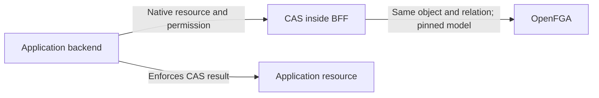

# Service-defined resources

**Implementation revision — 28 October 2026.**
[PR #3092](https://github.com/caipe-io/ai-platform-engineering/pull/3092) replaces
the generic-resource contract. Deployment validation and existing-consumer
migration are tracked separately.

## Recommended direction

Services define native OpenFGA types and permissions. One identity, such as
`example_agent_sandbox:sandbox-123`, travels through CAS, delegation and audit.
There is no mandatory hash or intermediate `app_resource` type.

The App Contract installation references an operator-approved model module and
tests. One deployment-owned publisher combines it with CAIPE's core model using
OpenFGA's [modular model tooling](https://openfga.dev/docs/modeling/modular-models).

CAS stays inside the BFF: authenticated callers, installed-type validation,
controlled writes, delegation and audit. Services enforce decisions and store
their business data. App developers author OpenFGA policy, but receive no direct
OpenFGA credentials.

MongoDB retains lifecycle/retry state and delegation approvals. Permission rules
remain in OpenFGA.

## Benefits and pitfalls

| Concern | Previous generic design | Native service types |
| --- | --- | --- |
| Domain permissions | Fixed read/use/write/manage profile | Express `can_exec`, `can_terminate` and service-specific relationships directly |
| Resource identity | Hash plus registry lookup identifies the app/local resource | Native type and stable local ID remain visible throughout the system; IDs must be treated as a durable contract |
| Adding a service | Configuration reuses the fixed profile | A reviewed module is published; adding a service must not require editing CAS TypeScript unions |
| Shared model | New apps rarely change the schema | Composition must reject collisions and unauthorized changes to core types; modules are not isolation boundaries |
| Model rollout | Mostly a bundled-model update | Publisher provenance, model-ID pinning, tuple compatibility and rollback become prerequisites |
| Relationship writes | Central rules map generic capabilities to tuples | CAS still needs an explicit write-authority contract; a valid model does not make every tuple write acceptable |

Native types better match an extensible platform. The tradeoff is more deliberate
deployment governance, not a free removal of all integration work.

## Boundaries that remain explicit

- **Custody and ownership:** the installation grants custody of approved type
  namespaces, not data access. Initial ownership requires a verified user and
  current team authority; resource operations still require model permission.
- **Checks and writes:** checking `can_exec` and granting `executor` are different
  operations. Grant authority is separate per relationship. Write-authority convention:
  a grant of `executor` requires the model's
  `can_grant_executor` permission. Missing write authority denies the operation.
  Ownership and parent links use controlled lifecycle commands. Organization-admin
  fallbacks must not silently override the app's model.
- **Delegation:** approval continues to bind the exact native resource,
  permission, service, job and expiry. Both current user and service permission
  checks must pass. Audit records that chain and the evaluated model version.

OpenFGA models are immutable: publish a new version, pin CAS and its validation
to that model ID, and plan any tuple migration. See OpenFGA's
[model-version guidance](https://openfga.dev/docs/getting-started/immutable-models).
Runtime services do not publish shared models themselves.

## Deployment sequence

1. **Publish the approved model.** Compile/test modules with OpenFGA tooling.
   The deployment publisher rejects changes to host-owned types, rejects
   unapproved modules, reuses identical models and records a model ID and hash.
   Changes to existing app policy require an explicit migration receipt.
2. **Pin and activate.** Configure the BFF's store/model IDs and the installation's
   module/client binding. Enabled native modules must exist in the selected model.
   The shared BFF transport pins all model-dependent calls; native resources cannot
   use an implicitly latest model.
3. **Register and authorize.** CAS preserves the native type and ID through
   registration, per-relationship grants, delegation, audit and Admin inventory.
   Lifecycle gates and fresh graph checks deny access to pending resources or
   disabled installations. Services enforce the returned decision.
4. **Migrate deliberately.** If an environment used the unreleased generic draft,
   inventory its records, tuples and approvals first. A service-provided mapping
   must identify each native type and ID; hashes cannot safely supply that meaning.
   Ownership transfer and structural-link commands need their own lifecycle design.

## Follow-on design index

Detailed contracts and rollout references:

- [#2953: composed model publication and upgrades](https://github.com/caipe-io/ai-platform-engineering/issues/2953) — publisher, version pinning, namespace rules and rollback.
- [#3031: new-service onboarding](https://github.com/caipe-io/ai-platform-engineering/issues/3031) — native registration, ownership, safe relationship management and the reference service.
- [#2945: app-to-platform APIs](https://github.com/caipe-io/ai-platform-engineering/issues/2945) and the [App Contract discussion](https://github.com/orgs/caipe-io/discussions/2853) — installation metadata and public request contracts.
- [Service integration reference](https://github.com/caipe-io/ai-platform-engineering/tree/main/ui/examples/agentic-apps/service-only) — native requests, model publication and deployment pins.
- Original code audit: the [CAS contracts and adapters](https://github.com/caipe-io/ai-platform-engineering/tree/2fd3d1c713bd44472164fcb4ff6a8baa61de559a/ui/src/lib/authz), [closed resource/action definitions](https://github.com/caipe-io/ai-platform-engineering/blob/2fd3d1c713bd44472164fcb4ff6a8baa61de559a/ui/src/types/rbac-universal.ts) and [model publisher](https://github.com/caipe-io/ai-platform-engineering/blob/2fd3d1c713bd44472164fcb4ff6a8baa61de559a/charts/ai-platform-engineering/charts/openfga/templates/configmap-model.yaml) are the main change points.
