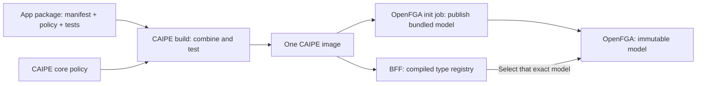
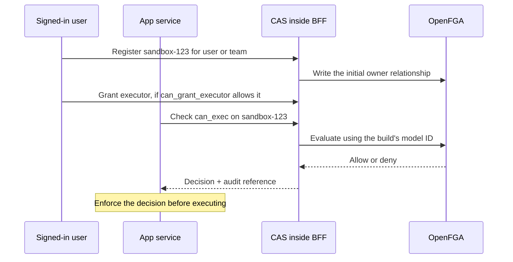

# Service-defined resources

Apps can define their own OpenFGA types, such as
`example_agent_sandbox:sandbox-123`, with permissions such as `can_exec`.
Users or teams own each resource. The service's installation gives it responsibility
for its types, not permission to use every resource.

**New policy comes from a trusted package built into CAIPE.** A separately
installed iframe app cannot upload or activate a model at runtime. It can use
resource types already included in the host. A bundled policy package may have
a native UI, an iframe UI, or no UI; application services remain separately deployed.

## Who does what

| Person | Responsibility |
| --- | --- |
| App developer | Publish a versioned package containing the App Contract manifest, OpenFGA module and permission tests. Keep the app's code in its own repository. |
| CAIPE build maintainer | Review and pin that dependency using the existing native-extension build. The host compiles and tests the combined policy automatically. Adding a type needs no CAS TypeScript changes. |
| CAIPE operator | Deploy that CAIPE image and configure the app's service identity and any runtime origin. No policy source files are copied into deployment configuration. |

The image contains both the model artifact and the registry associating each
module with its app. The chart's `global.caipeUiImage` selects the same image for
the BFF and the initializer's artifact export. The operator does not assemble a
modular project or set up a second build pipeline.

## At runtime

MongoDB records registration/retry state and delegation approvals. OpenFGA stores
relationships and evaluates policy. Services hold business data and enforce the
answer; they receive no OpenFGA credentials.

- Register while a user is present, before creating business data. The service
  cannot nominate an owner. Pending registration blocks resource access.
- Grant authority is separate per relationship: `executor` requires
  `can_grant_executor`; `terminator` requires `can_grant_terminator`. Ownership,
  computed permissions and structural links are not ordinary grants.
- Background delegation still requires active approval **and** current user
  permission **and** current service permission. Audit preserves the actor/user
  chain, native resource, permission and evaluated model ID.
- Disabled installations cannot operate on their resources. Runtime enablement
  does not install code or policy.

## Deployment safety

CAS resolves the published model by comparing it to its compiled artifact. It
never follows an unrelated latest model. An optional explicit model-ID pin must
match the same artifact. Before publication completes, protected requests fail
closed; the BFF can start so the chart's post-install job can run.

The publisher preserves core policy, reuses unchanged model versions and rejects
unapproved modules. Changing or removing existing app policy, including rollback,
requires a reviewed migration receipt and any necessary tuple migration. That
release process remains separate from adding an extension for the first time.

## References and remaining work

- [Integration example](https://github.com/caipe-io/ai-platform-engineering/tree/main/ui/examples/agentic-apps/service-only): package, build, deployment and API commands.
- [#3031](https://github.com/caipe-io/ai-platform-engineering/issues/3031): new-service registration, ownership, relationship grants and delegation.
- [#2953](https://github.com/caipe-io/ai-platform-engineering/issues/2953): existing-policy upgrades, migration and rollback.
- [App Contract](../../features/agentic-app-manifest.md): shared manifest and deployment-owned installations.
- [OpenFGA modular models](https://openfga.dev/docs/modeling/modular-models) and [immutable models](https://openfga.dev/docs/getting-started/immutable-models).

Existing-service migrations and explicit ownership/parent-link lifecycle commands
remain follow-on work. An environment that used the unreleased generic
`app_resource` draft needs a service-supplied native mapping; CAS cannot infer
the domain identity from its hash.
