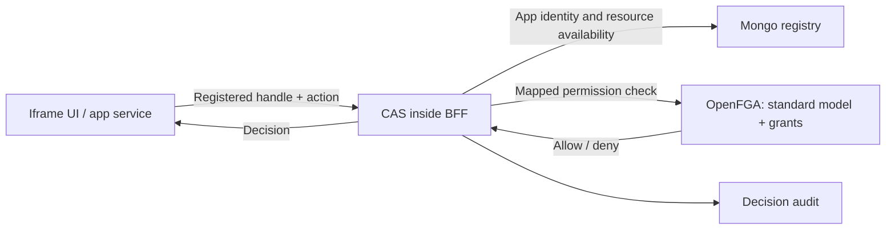
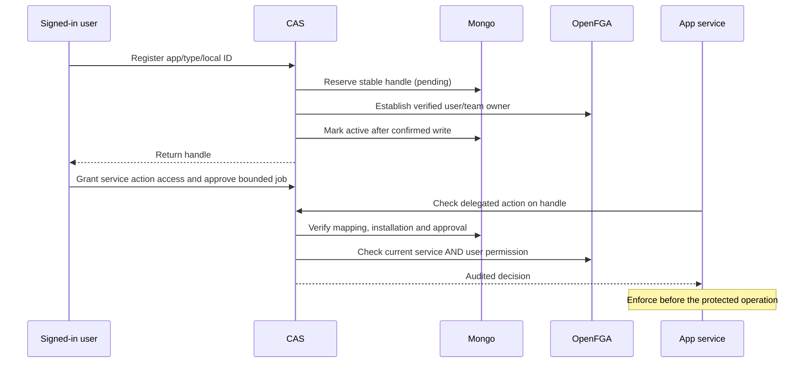

# App resources through CAS

An iframe app declares its resource types and action names in the App Contract.
The operator installs the app and binds its service identity. Adding an app
changes configuration and data; it requires no CAIPE rebuild or app-specific
OpenFGA model.

## Who owns what

| Component | Responsibility |
| --- | --- |
| App | Business data, local resource IDs, and enforcement of CAS decisions |
| Mongo registry | Maps app + resource type + local ID to an immutable CAS handle; records registration state |
| OpenFGA | User/team ownership, action grants and grant authority under CAIPE's standard rules |
| CAS in the BFF | Verified caller, mapping validation, fresh permission checks, delegation and audit |

Users or teams own resources. Installing an app grants its service no resource
permissions. The app developer publishes a manifest and separately deployed
service; the operator configures its origin and service-account client. CAIPE
maintains the shared model/API, with no per-app type or policy code changes.

## One resource, separate actions

An app can declare `agent-sandbox` with `execute` and `terminate` actions.
Mongo maps that business resource to `app_resource:<R>`, where `R` is a generated
UUID. It is a stable handle, not a hash of the business identity.

The host model has two fixed types:

- **`app_resource`:** user/team ownership.
- **`app_permission`:** one object per resource/action, such as
  `app_permission:<R>/execute`, with separate use and grant authority.

An execution grant does not imply termination permission. An execution grantor
can grant/revoke execution access but cannot grant termination access or assign
new grantors. Only the resource owner can assign/revoke grant authority. Owners
inherit use/grant permission for all actions declared for their resource type.
There is no organization-admin override of these app permissions.

CAS supplies the permission-to-resource link as an OpenFGA contextual tuple,
derived from the verified registry mapping. Ownership and grants stay stored in
OpenFGA. Browser/service requests cannot supply that link. A check does not write
relationships or repair permissions.

## Registration and background work

A retry preserves the original handle, creator and owner. An ambiguous owner
write leaves registration pending and returns a retriable 503. Pending resources
cannot be used. Logout alone does not cancel approved background work; approval
expiry/revocation and current user/service permissions still apply.

Checks revalidate installation/action availability and registration state.
Disabling an app blocks its resources. Actions are stable identifiers: adding a
new action grants only the existing owners inherited authority; explicit grants
remain scoped to their named actions. Removing an action blocks its use but does
not delete historical grants. Reusing a name for a different operation requires
an explicit grant/data migration.

## Boundaries and follow-on work

- Apps declare resource/action names, not arbitrary OpenFGA types, relationships
  or policy expressions. Broader business-policy language remains separate work.
- Ownership transfer, resource retirement/cleanup and existing-service adoption
  remain explicit lifecycle/migration work.
- If an environment tested an earlier unreleased registration contract, inventory
  its records, tuples and delegation scopes before deploying this revision.
  No compatibility aliases or automatic data conversion are retained.

[API reference](./access-api.md) · [Concrete app example](https://github.com/caipe-io/ai-platform-engineering/tree/main/ui/examples/agentic-apps/service-only)
· [#3031: new-service integration](https://github.com/caipe-io/ai-platform-engineering/issues/3031)
· [#2953: model upgrades and migration](https://github.com/caipe-io/ai-platform-engineering/issues/2953).
