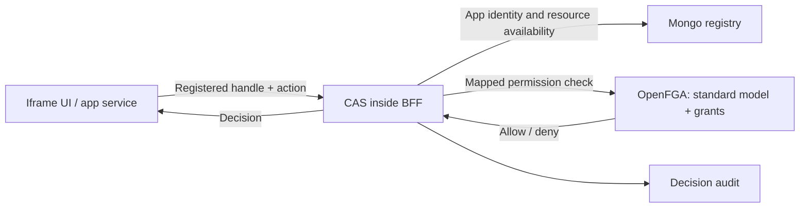
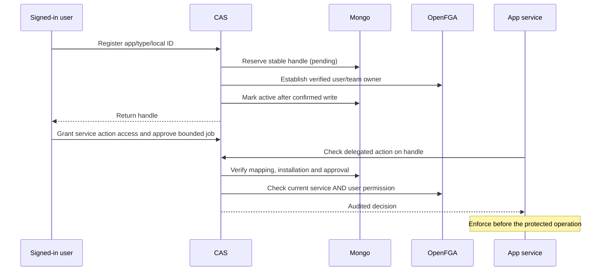
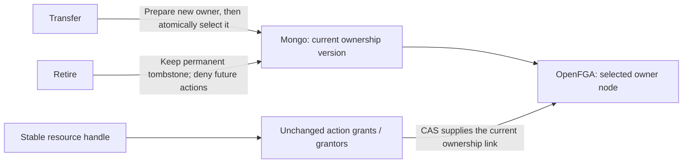

# App resources through CAS

An iframe app declares its resource types and action names in the App Contract.
The operator installs the app and binds its service identity. Adding an app
changes configuration and data; it requires no CAIPE rebuild or app-specific
OpenFGA model.

## Who owns what

| Component | Responsibility |
| --- | --- |
| App | Business data, local resource IDs, and enforcement of CAS decisions |
| Mongo registry | Maps app + resource type + local ID to an immutable CAS handle; records registration state |
| OpenFGA | User/team ownership, action grants and grant authority under CAIPE's standard rules |
| CAS in the BFF | Verified caller, mapping validation, fresh permission checks, delegation and audit |

Users or teams own resources. Installing an app grants its service no resource
permissions. The app developer publishes a manifest and separately deployed
service; the operator configures its origin and service-account client. CAIPE
maintains the shared model/API, with no per-app type or policy code changes.

## One resource, separate actions

An app can declare `agent-sandbox` with `execute` and `terminate` actions.
Mongo maps that business resource to `app_resource:<R>`, where `R` is a generated
UUID. It is a stable handle, not a hash of the business identity.

The host model has two fixed types:

- **`app_resource`:** user/team ownership.
- **`app_permission`:** one object per resource/action, such as
  `app_permission:<R>/execute`, with separate use and grant authority.

An execution grant does not imply termination permission. An execution grantor
can grant/revoke execution access but cannot grant termination access or assign
new grantors. Only the resource owner can assign/revoke grant authority. Owners
inherit use/grant permission for all actions declared for their resource type.
There is no organization-admin override of these app permissions.

CAS supplies the permission-to-resource link as an OpenFGA contextual tuple,
derived from the verified registry mapping. Ownership and grants stay stored in
OpenFGA. Browser/service requests cannot supply that link. A check does not write
relationships or repair permissions.

## Registration and background work

A retry preserves the original handle, creator and owner. An ambiguous owner
write leaves registration pending and returns a retriable 503. Pending resources
cannot be used. Logout alone does not cancel approved background work; approval
expiry/revocation and current user/service permissions still apply.

Checks revalidate installation/action availability and registration state.
Disabling an app blocks its resources. Actions are stable identifiers: adding a
new action grants only the existing owners inherited authority; explicit grants
remain scoped to their named actions. Removing an action blocks its use but does
not delete historical grants. Reusing a name for a different operation requires
an explicit grant/data migration.

## Ownership transfer and retirement

Only an interactive current owner can transfer or retire a resource. A transfer
to a user requires an enabled human Keycloak account; a transfer to a team
requires the caller's current membership in that team. Organization admins and
action grantors have no additional ownership authority.

- **Transfer:** CAS first writes an isolated ownership node in OpenFGA, then
  publishes it with one compare-and-swap Mongo update. The resource handle and
  action objects stay unchanged. Existing explicit use grants, grant authority
  and delegation approvals are preserved. The former owner loses inherited
  authority; a job continues only if both its user and service still have access.
- **Failure/concurrency:** preparation alone grants no live resource access. A
  crash before publication leaves the old owner active; a crash after publication
  leaves the new owner active. Competing updates require the current
  `owner_version`; a check spanning a transfer returns unavailable for retry.
  An unconfirmed response requires inspecting the current resource before retry.
- **Retirement:** one Mongo update permanently blocks checks, grants, queries and
  delegated use of this handle. Old graph grants cannot reactivate it. The last
  owners may inspect/retry the retirement receipt; the normal `owner` action
  remains denied. The app must separately delete or retain its business data.

Retirement does not stop an operation already authorized and in progress, delete
immutable job approvals, or cancel unrelated resources in a multi-resource job.
The app/type/local-ID mapping cannot be reused, and there is no restore endpoint.
Unselected ownership nodes and retired action tuples are inert and retained;
bounded physical graph cleanup is separate follow-on work, never required for
denial. The current ownership node is retained for receipt authorization.

Deploy the lifecycle-aware BFF to **all replicas before using transfer**. Older
BFFs do not understand ownership versions and must not serve these resources
after a transfer. Rolling back to that code requires an explicit ownership/data
migration; there is no automatic compatibility path. Existing initial
registrations require no rewrite. If a transfer response is lost, the former
owner may receive 403 on inspection; the new owner can confirm the current state.

## Boundaries and follow-on work

- Apps declare resource/action names, not arbitrary OpenFGA types, relationships
  or policy expressions. Broader business-policy language remains separate work.
- Physical graph cleanup and existing-service adoption remain explicit
  lifecycle/migration work. Dev deployment acceptance is still required.
- If an environment tested an earlier unreleased registration contract, inventory
  its records, tuples and delegation scopes before deploying this revision.
  No compatibility aliases or automatic data conversion are retained.

[API reference](./access-api.md) · [Concrete app example](https://github.com/caipe-io/ai-platform-engineering/tree/main/ui/examples/agentic-apps/service-only)
· [#3031: new-service integration](https://github.com/caipe-io/ai-platform-engineering/issues/3031)
· [#2953: model upgrades and migration](https://github.com/caipe-io/ai-platform-engineering/issues/2953).
