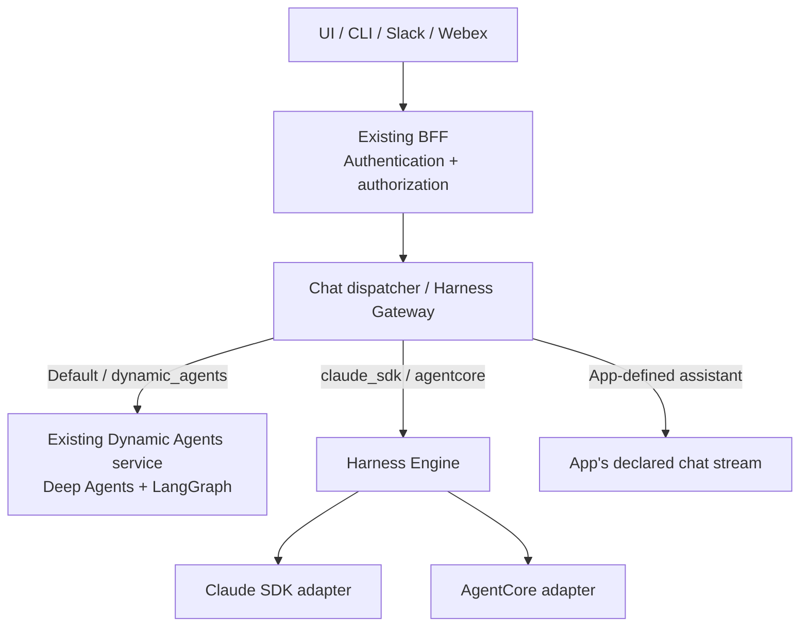
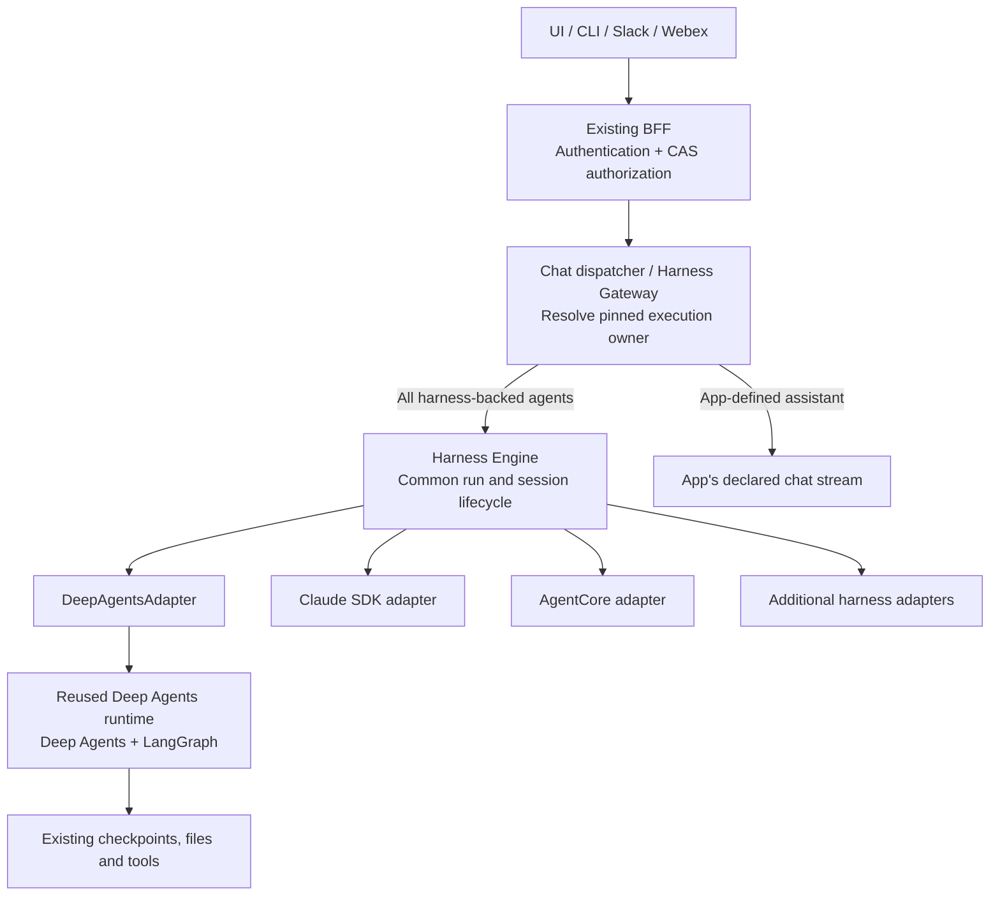

# Pending: Deep Agents Adapter and Pluggable Agent Builder

- **Status:** Proposal / pending work. No runtime or UI implementation is included.
- **Date:** 2026-10-21.
- **Code baseline:** PR 2401, `f882ad9babeab2a5d5e0bfa690cd8f43c3a88266`.
- **Scope:** Integrate the existing Deep Agents runtime into Harness Engine without rewriting its graph, tool, skill, or middleware behavior; make builder features conditional on adapter capabilities.
- **Relationship:** Extends [Portable abstractions](portable-abstractions.md) and [Agent creation UI](agent-creation-ui.md). Their independent-service slice remains the implemented behavior. This proposal refines the future migration work in [Tasks](tasks.md); its interfaces are illustrative, not existing APIs.
- **Delivery placement:** [Phase 2](delivery-phases.md) owns Deep Agents integration and the pluggable builder. External worker implementation is Phase 3; cross-harness delegation is Phase 4. PR 2401 remains Phase 1, with current-path correctness and review gates still open.

## 1. Current and future architecture

### Current architecture — now



Deep Agents executes through its existing service. The separate Harness Engine executes the other harnesses, while app-defined assistants use their declared streams.

### Phase 2 architecture — proposed integration



The future diagram shows the common execution path after Phase 2 migration. During rollout, existing compatibility routes and the engine adapter reuse one Deep Agents implementation; unmigrated conversations continue through their existing service. It does not imply isolated workers or cross-harness delegation are already present. The [Phase 3–4 target diagram](delivery-phases.md#target-architecture-after-all-four-phases) adds those boundaries.

- Each conversation epoch has **one execution authority**; the two paths never execute the same turn.
- Engine integration and retirement of the separate service are separate milestones.
- `SandboxManager` can remain in the engine container while an external backend provisions workers in Phase 3. Phase 2 may retain the explicit in-process compatibility mode; production full-harness isolation requires Phase 3 evidence.
- App-defined assistants keep their declared stream contract and pinned execution owner.

| Owner | Responsibility |
|---|---|
| BFF / CAS | Authentication, agent and conversation permissions, delegated identity admission |
| Harness Engine | Binding/version ownership, admission, idempotency, cancellation intent, durable events and replay |
| `DeepAgentsAdapter` | Configuration translation, runtime invocation, canonical event mapping, capability declaration |
| Reusable runtime | LangGraph execution/checkpoints, existing tools, middleware, skills, subagents and files |
| Existing management services | Authoritative agent identity/access metadata and referenced resource configuration |

## 2. Current gaps to close

| Current code | Pending change |
|---|---|
| Adapter contract has `evaluate`, `session_manager`, `stream` | Add explicit start/resume commands, execution outcomes and cancellation signaling |
| Coordinator treats normal stream exhaustion as completion | Distinguish completed, paused, failed and cancelled execution |
| Engine has no human-input resume API; gateway rejects attachments | Add authorized resume and attachment-reference contracts |
| Runtime emits SSE strings through encoders | Extract typed runtime events; reuse existing parsing and encoders |
| Gateway drops some namespace/subagent information | Carry correlation through persistence, replay and both wire formats |
| Runtime captures caller credentials when constructed | Make caller identity and credential lifetime explicit for each execution |
| Phase 1 builder shows Deep Agents controls only for Deep Agents, gates tools on the descriptor, and places SDK options under Advanced | Extend the compatibility branch into declared features, bounded schemas and a host-owned panel registry |
| Engine and Dynamic Agents have separate dependency sets | Resolve Python, package pins, startup, cleanup and image compatibility |

See the existing [adapter contract](../../../../ai_platform_engineering/harness_engine/src/harness_engine/adapters/base.py), [coordinator](../../../../ai_platform_engineering/harness_engine/src/harness_engine/coordinator.py), [runtime](../../../../ai_platform_engineering/dynamic_agents/src/dynamic_agents/services/agent_runtime.py), and [builder](../../../../ui/src/components/dynamic-agents/DynamicAgentEditor.tsx).

## 3. Proposed execution interfaces

Evolve the existing contracts in place as contract version 2. The following Python is interface pseudocode; referenced service types and methods are proposed facades. Keep version 1 adapters usable through an explicit compatibility shim. Stream exhaustion may imply completion only for a version 1 adapter that cannot pause.

```python
from collections.abc import AsyncIterator, Mapping
from dataclasses import dataclass
from typing import Literal, Protocol

from harness_engine.models import (
    AdapterEvaluation, AgentBlueprint, CanonicalEventDraft, HarnessDescriptor,
)
from harness_engine.sessions import ProviderSessionManager

@dataclass(frozen=True)
class Principal:
    kind: Literal["user", "service_account"]
    subject: str

@dataclass(frozen=True)
class ExecutionIdentity:
    actor: Principal
    effective_subject: Principal
    tenant_id: str
    delegation_ref: str | None  # Server-issued, authorized delegation only.

@dataclass(frozen=True)
class AttachmentRef:
    id: str  # Server-owned reference, not a browser-supplied path or URL.

@dataclass(frozen=True)
class StartTurn:
    message: str
    attachments: tuple[AttachmentRef, ...] = ()

@dataclass(frozen=True)
class ResumeTurn:
    interrupt_id: str
    response: Mapping[str, object]  # Validated form/approval discriminated union.
    resumes_run_id: str

TurnCommand = StartTurn | ResumeTurn

@dataclass(frozen=True)
class PendingInterrupt:
    id: str
    kind: Literal["form_input", "tool_approval"]
    payload: Mapping[str, object]

@dataclass(frozen=True)
class TurnOutcome:
    status: Literal["completed", "paused", "cancelled"]
    interrupts: tuple[PendingInterrupt, ...] = ()

class CancellationSignal(Protocol):
    async def requested(self) -> bool: ...

@dataclass(frozen=True)
class ExecutionContext:
    run_id: str
    binding_id: str
    native_thread_id: str
    epoch: int
    agent_version: int
    blueprint: AgentBlueprint
    identity: ExecutionIdentity
    cancellation: CancellationSignal
    traceparent: str | None
    # Validated rendered prompt/context and resolved policy are also supplied.

AdapterOutput = CanonicalEventDraft | TurnOutcome

class HarnessAdapterV2(Protocol):
    @property
    def descriptor(self) -> HarnessDescriptor: ...
    @property
    def session_manager(self) -> ProviderSessionManager: ...
    def evaluate(self, blueprint: AgentBlueprint) -> AdapterEvaluation: ...
    def execute(
        self, context: ExecutionContext, command: TurnCommand,
    ) -> AsyncIterator[AdapterOutput]: ...
```

### Identity and service rules

- The browser cannot construct `ExecutionIdentity`; ingress verifies actor, effective subject, tenant and delegation.
- Engine admission and tool calls use existing CAS adapters. Add no direct OpenFGA checks inside the adapter.
- A credential broker supplies short-lived, audience-bound caller credentials for CAS, MCP, RAG and remote-agent calls. Scope resolution to the binding/run and recheck current access.
- Keep bearer tokens and credential leases out of blueprints, run/event documents, replay and logs. For detached work, reacquire or refresh through authorized delegation; expiration fails closed.
- Preserve signed active-team context, service-account classification and scheduled on-behalf-of rules. The engine's internal service credential is not the caller's tool credential.
- Retain existing credential exchange, tool restrictions, skill scanning and trace scrubbing behind injected services. Their reuse does not imply those services already work across every harness.

### Deep Agents adapter sketch

```python
class DeepAgentsAdapter:
    def __init__(
        self, runtime_factory: "DeepAgentsRuntimeFactory",
        config_mapper: "DeepAgentsConfigMapper",
        services: "RuntimeServices",
        provider_sessions: ProviderSessionManager,
        descriptor: HarnessDescriptor,
    ) -> None:
        self.runtime_factory = runtime_factory
        self.config_mapper = config_mapper
        self.services = services
        self.session_manager = provider_sessions
        self.descriptor = descriptor  # Gate availability on proven integration.

    def evaluate(self, blueprint: AgentBlueprint) -> AdapterEvaluation:
        return self.config_mapper.validate_and_normalize(blueprint)

    async def execute(
        self, context: ExecutionContext, command: TurnCommand,
    ) -> AsyncIterator[AdapterOutput]:
        await self.services.authorization.require_execution(context, command)
        config = await self.config_mapper.resolve(context)
        # Resolve references under current permissions; preserve pinned policy.
        async with self.runtime_factory.acquire(context, config) as runtime:
            async for output in runtime.execute(context, command):
                if isinstance(output, TurnOutcome):
                    yield output  # Exactly one outcome, after native state flush.
                else:
                    yield to_canonical_event(output)  # Proposed typed mapper.
```

- `runtime.execute` is the extracted start/resume implementation, not another graph implementation.
- Extract typed events before wire encoding; do not parse SSE back into engine events. Retain `LangGraphStreamHelper` behavior and existing encoder compatibility.
- Include message/tool IDs, namespace, parent invocation, reasoning, warnings, usage, files/todos and subagent lifecycle. Extend the canonical event schema and gateway together where needed.
- The engine emits public `run.started` and terminal events once. Internal LangGraph IDs remain correlation metadata.
- A cancellation request is persisted; the producing replica signals the local execution. Release admission only after graph/tool execution has stopped or drained. Do not report immediate cancellation when it is only requested.
- Audit the existing cache key (`agent + session`) before reuse: credentials are captured on runtime construction. Use caller/delegation and pinned-config scope, refresh credentials, and isolate cancellation per execution. Cache eviction must retain existing TTL/LRU/capacity and active-run protections.

## 4. Pause/resume and persistence pseudocode

**Proposed choice:** a paused run finishes its execution attempt. Resume creates a new run linked by `resumes_run_id`, using the same binding, agent version and native checkpoint. The binding stores pending interrupts and blocks unrelated new starts until resume or clear.

```text
START or RESUME
  authenticate; authorize agent use and conversation write through CAS
  resolve pinned execution owner BEFORE checking current app/harness defaults
  validate exact command, attachment ownership and effective capabilities
  atomically admit one execution for this binding
    START: reject if a pending interrupt exists
    RESUME: verify interrupt/run/binding/epoch; reserve response once
    RETRY: same idempotency key + payload returns the existing run
  dispatch adapter with the admitted public run ID

FOR EACH ADAPTER OUTPUT
  fence against closed epoch; persist ordered nonterminal events
  on PAUSED:
    require native interrupt checkpoint persisted
    commit paused status + pending interrupts + interrupt event durably
    release execution reservation; retain conversation wait state
  on COMPLETED or CANCELLED:
    commit one terminal event/status after native state flush or stop
    release execution reservation
  on ERROR or missing/duplicate outcome:
    persist sanitized failure; retain recoverable checkpoint/interrupt state

RESUME FAILURE
  never consume approval merely because HTTP admission succeeded
  record reserved/dispatching/consumed states and the resume idempotency key
  before dispatch: failed reservation may be released safely
  after ambiguous dispatch: fence and reconcile native state; do not auto-retry tools
```

- Add `paused` to the execution-status model and replay rules; the gateway emits input-required and closes the stream without emitting successful completion.
- Reauthorize edited tool arguments and constrain approval decisions against the saved interrupt. One approval cannot authorize another pending action or epoch.
- Resolve attachments through authorized blob references and retain model/size validation. Resume must retain the original attachment/checkpoint context.
- Keep current checkpoint collections, collection overrides, TTLs, native thread IDs and GridFS namespaces. Persist an explicit binding-to-native-thread mapping; never replace legacy IDs with a hash without migration.
- Adoption is lazy, authorized and atomic: reuse existing native state, record a consistent agent/config snapshot, and reject conflicting engine/native ownership. Historical pre-edit configuration cannot be reconstructed unless it was retained; surface that limit.
- Clear closes/fences the binding and rotates to a new native context. It does not purge old checkpoints. Keep explicit authorized purge, rewind, file APIs and scheduled/workflow execution semantics separate.
- If the optional engine is unavailable, unmigrated Deep Agents conversations remain usable. A migrated binding returns an explicit error; never automatically run its turn on a second backend.

## 5. Plug-and-play builder contract

The builder consumes **capabilities + bounded schemas + trusted renderer IDs**. It must not accumulate `if (harnessId === ...)` branches.

### Portable feature versus harness implementation

| Feature | Common contract | Provider-specific part |
|---|---|---|
| Subagents | Delegation references, depth/parallel limits, authorized targets | Graph task implementation, nesting and mixed-harness support |
| Middleware | Portable outcomes where defined: limits, retries, approval policy | Ordered Deep Agents middleware stack and implementation-specific parameters |
| Human input | Interrupt, approval decision and resume | Native checkpoint/hook mechanics |
| Tools, skills and knowledge | Authorized bindings and scope | Materialization, model compatibility and invocation |

- Subagents are currently implemented by Deep Agents, but delegation is not inherently exclusive to it. Another adapter can reuse the panel only when it implements the same semantics.
- Keep the existing ordered middleware stack under Deep Agents Advanced options. An SDK hook is not automatically equivalent middleware.
- Do not label a feature `emulated` unless its common implementation is connected and passes conformance checks.

### Descriptor extension (TypeScript interface pseudocode)

Reuse `HarnessDescriptor.capabilities`, `options_schema` and `ui_schema`. Compute effective support for the selected profile, deployment and caller. The catalog carries no credentials, arbitrary endpoints or executable UI code.

```typescript
type BuilderStep = "basic" | "instructions" | "tools" | "knowledge"
  | "skills" | "advanced";
type RendererId = "agent-delegation" | "deep-agents-middleware" | "schema-form";

interface BuilderSection {
  id: string;
  title: string;
  step: BuilderStep;
  requires: string[];       // Versioned catalog capability IDs; ALL must be supported.
  renderer: RendererId;     // Host allowlist, never an import/URL from an adapter.
  valuePath: string;        // Host-validated JSON Pointer within permitted fields.
  schema: BoundedJsonSchema;
}

interface BuilderUiSchemaV1 {
  version: 1;
  sections: BuilderSection[];
}

// Proposed refinement of the existing descriptor, not a second catalog.
interface HarnessDescriptorV2 extends Omit<HarnessDescriptor, "ui_schema" | "options_schema"> {
  contract_version: 2;
  options_schema: BoundedJsonSchema;
  ui_schema: BuilderUiSchemaV1;
}
```

`BoundedJsonSchema` means a host-supported subset with bounded object/array depth, item count, strings and enums. No remote `$ref`, executable expressions, HTML, secrets or operator-owned infrastructure identifiers. Authorized agent/tool references remain valid data selected through domain pickers. The current primitive-only `HarnessOptionsForm` must be extended before claiming nested middleware or delegation schemas can render generically.

### Example Deep Agents descriptor fragment (proposed, not advertised today)

```json
{
  "id": "dynamic_agents",
  "contract_version": 2,
  "capabilities": {
    "multi_agent.delegation": {
      "level": "native",
      "explanation": "Delegation through the existing runtime",
      "constraints": {"max_depth": 1, "mixed_harness": false}
    },
    "deep_agents.middleware": {
      "level": "native",
      "explanation": "Ordered Deep Agents middleware",
      "constraints": {"ordered": true}
    }
  },
  "ui_schema": {
    "version": 1,
    "sections": [
      {
        "id": "delegation", "title": "Subagents", "step": "advanced",
        "requires": ["multi_agent.delegation"], "renderer": "agent-delegation",
        "valuePath": "/delegation", "schema": {"type": "object"}
      },
      {
        "id": "middleware", "title": "Middleware", "step": "advanced",
        "requires": ["deep_agents.middleware"], "renderer": "deep-agents-middleware",
        "valuePath": "/harness/options/middleware", "schema": {"type": "array", "maxItems": 32}
      }
    ]
  }
}
```

The fragment omits normal descriptor fields and detailed schemas. Server schemas define allowed middleware types/parameters and delegation structure; server authorization and validation constrain actual delegation targets and limits. Keep common policy in common blueprint fields; preserve Deep Agents-specific execution settings in its validated options, excluding ownership and secrets.

### Trusted panel registry and generic renderer

```tsx
// Interface pseudocode. These wrappers adapt existing pickers to blueprint paths.
const panels = {
  "agent-delegation": DelegationPanel,          // Reuse SubagentPicker.
  "deep-agents-middleware": MiddlewarePanel,   // Reuse MiddlewarePicker.
  "schema-form": SafeSchemaForm,               // Extend HarnessOptionsForm.
} satisfies Record<RendererId, React.ComponentType<FeaturePanelProps>>;

function FeatureSection({ section, descriptor, draft, update }: SectionProps) {
  const support = resolveEffectiveCapabilities(descriptor, section.requires);
  const value = readPermittedPath(draft, section.valuePath);
  if (!support.enabled) {
    // Unknown/missing capability fails closed. Preserve stored values for review.
    return <UnavailableFeature title={section.title} reason={support.reason}
      hasStoredValue={hasConfiguredValue(value)} />;
  }
  const Panel = panels[section.renderer];
  if (!Panel) return <UnsupportedEditor section={section} blocksSave />;
  return <Panel value={value} schema={section.schema} constraints={support.constraints}
    onChange={(next) => update(section.valuePath, next)} />;
}

// Render step sections from the validated descriptor, without harness-ID checks.
descriptor.ui_schema.sections
  .filter((section) => section.step === activeStep)
  .map((section) => <FeatureSection key={section.id} section={section}
    descriptor={descriptor} draft={draft} update={updateDraft} />);
```

- Core identity, instructions and access controls remain host-owned; descriptors cannot hide mandatory security fields or write arbitrary draft paths.
- Model, tool, knowledge and skill controls also follow effective capabilities. A profile-owned model is shown as read-only; never save an ignored global model choice as if it controlled that adapter.
- Native/emulated features are enabled within constraints. Unsupported/unavailable features are absent for empty drafts or shown disabled with a reason; configured values stay visible and block incompatible saves.
- New scalar options need only a schema. New adapters can reuse known complex panels. A novel complex interaction requires one reviewed host renderer and a versioned feature contract; schemas alone cannot create arbitrary behavior.
- An adapter may enable approved sections only for its own supported semantics. A descriptor cannot grant resource access; entity loaders and execution recheck authorization.
- Preserve existing wizard/deep-link IDs. Use shared `Select`/domain pickers as required by [Selection controls](../../ui/selection-controls.md).
- Namespace settings in per-harness draft buffers. Switching away and back restores edits without copying them into the other adapter's submitted configuration.

### Exact-payload validation and harness switching

```text
ON HARNESS OR PROFILE CHANGE
  retain the current draft; load and validate the effective descriptor
  compute compatibility for common settings and the destination draft buffer
  show preserved, incompatible and explicitly removable settings
  require user action for lossy changes; do not silently delete or coerce values
  explain that saved changes affect new bindings, not existing pinned conversations

ON SAVE
  serialize common fields + selected harness's supported options only
  server authenticates; CAS authorizes agent management and referenced resources
  server checks catalog revision + supported renderer/contract versions
  validate full schema, capability constraints and adapter evaluation
  check dependency cycles, child-agent use and permitted delegation combinations
  return field-path errors and normalized-payload fingerprint before mutation
  atomically publish catalog pointer + immutable execution version
    use a transaction or staged version/publication protocol with one commit point
  on stale catalog/version or partial preparation: publish nothing executable

ON START OR RESUME
  load pinned version; recheck current access, profile and referenced resources
  reject revoked/unavailable capabilities even if browser validation previously passed
```

No unsupported middleware/subagent setting may be accepted merely because a caller bypassed the UI. Unknown stored harnesses or catalog outages preserve configuration and show an actionable error; never silently replace them with Deep Agents.

## 6. Implementation sequence and acceptance gates

All items below are pending. They describe validation to implement later; no runtime or UI tests were run for this documentation-only proposal.

- [ ] **Freeze compatibility:** inventory start/invoke/resume/cancel/restart, interrupt inspection, rewind/clear, files, scheduled/workflow runs, error shapes and both SSE formats. Capture fixtures with neutral data.
- [ ] **Extract runtime interfaces:** retain graph/tool/skill behavior and current callers; separate typed events, execution identity, credential acquisition and cleanup from HTTP framing.
- [ ] **Extend engine contracts:** version negotiation, attachments, pause/resume, outcomes, correlated events and distributed cancellation. Existing adapters retain explicit unsupported responses.
- [ ] **Implement adapter and mapping:** validated configuration translation, native session adoption, credential-aware cache and registered descriptor; retain `dynamic_agents` as the compatibility ID.
- [ ] **Build capability-driven UI:** descriptor projection, trusted panels, bounded schema renderer, profile changes, draft preservation, exact-payload validation and atomic publication.
- [ ] **Prove parity:** unchanged compatibility assertions, CAS denials with zero execution, credential-refresh/cross-caller isolation, attachment ownership, subagent event attribution, approval replay rejection, Stop and duplicate admission.
- [ ] **Prove migration:** legacy checkpoints and custom collections survive, stale epochs cannot publish, engine outage does not block unmigrated agents, and rollback resumes from compatible native state. Rollback must reconcile pending engine interrupts and native checkpoints first.
- [ ] **Resolve packaging:** choose a compatible Python/runtime dependency set (current images use 3.14 and 3.13), keep optional SDK dependencies isolated where practical, and initialize metrics/tracing/cache/cleanup once.
- [ ] **Roll out opt-in:** selected new bindings, then authorized adoption of old ones. No shadow execution against live tools and no automatic failover after side effects. Benchmark latency, event overhead and memory before changing the default.
- [ ] **Consolidate service if desired:** relocate remaining management/file/health/probe routes and operational configuration before removing the separate deployment. Follow the first-install Compose skill for deployment-file changes.

### Likely code touchpoints

| Existing location | Pending work |
|---|---|
| `harness_engine/src/harness_engine/adapters/` | New `deep_agents.py`; versioned adapter contract |
| `harness_engine/src/harness_engine/{models,coordinator,sessions,repository,main}.py` | Outcomes, pause/resume, adoption, admission and API changes |
| `harness_engine/src/harness_engine/{registry,brokers}.py` | Effective capabilities, policy/schema checks and injected services |
| `dynamic_agents/src/dynamic_agents/services/{agent_runtime,runtime_cache}.py` | Reusable execution and caller-safe cache lifecycle |
| `dynamic_agents/src/dynamic_agents/services/stream_encoders/` | Shared typed event normalization with existing wire encoders |
| `dynamic_agents/src/dynamic_agents/{routes,auth}/` | Compatibility wrappers and existing CAS/identity boundary |
| `ui/src/lib/harness-gateway.ts` and chat dispatcher | Resume/attachments, preserved correlation and binding-first routing |
| `ui/src/components/{dynamic-agents,harness-engine}/` | Generic feature sections wrapping existing controls |
| `ui/src/types/harness-engine.ts` and engine/BFF validators | Versioned descriptor/UI schema and shared validation fixtures |

Paths in the table are relative to `ai_platform_engineering/` for Python and repository root for UI. Prefer a narrow runtime package within the current module first; do not import `dynamic_agents.main` into the engine or create a second copy of its services.

## 7. Completion definition

- Existing Deep Agents conversations and features pass compatibility and authorization checks through the engine path.
- The builder exposes only implemented capabilities and can add another adapter's known features without editing `DynamicAgentEditor` for its harness ID.
- All required typed panels and server schemas agree; unavailable functionality remains explicit.
- Each binding has one execution owner, one admitted producer and recoverable native state.
- Operator rollout, data compatibility, engine outage behavior and rollback are demonstrated before changing defaults.
