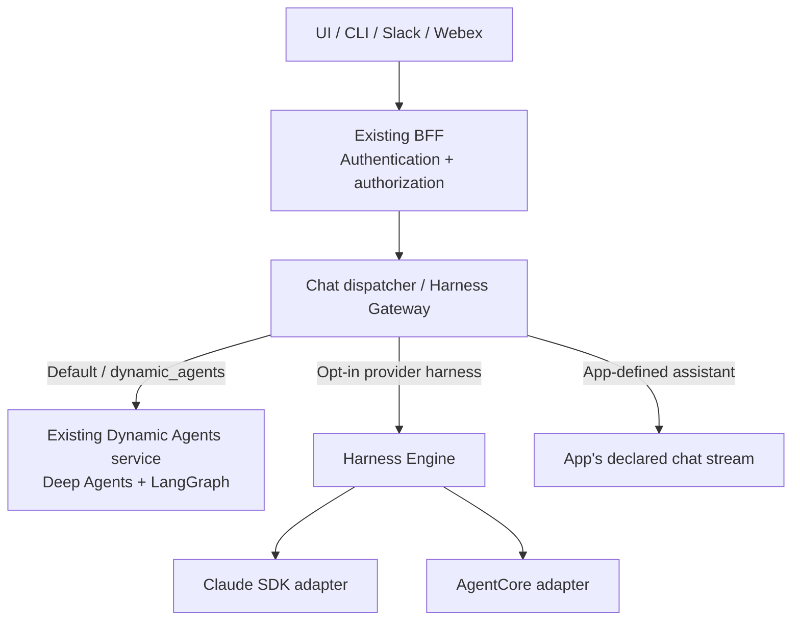
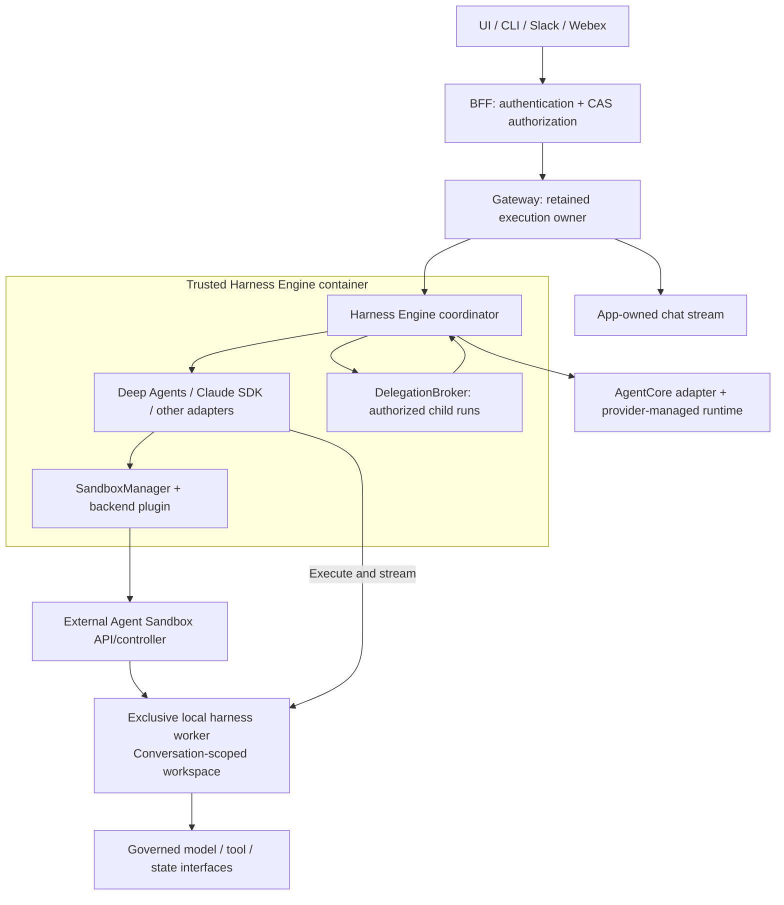

# Harness Engine Delivery Phases

- **Updated:** 2026-10-21.
- **Status:** Proposed delivery scope for review; this document does not record reviewer approval or certify pending capabilities.
- **Purpose:** One delivery sequence for PR 2401, Discussion 2405, and the Spec Kit package.
- **Precedence:** These delivery phases supersede the original replacement-first ordering in the plan. Numbered task workstreams retain their task IDs and describe technical work, not release order. Spec Kit's own research/design workflow stages are separate.

## Phase overview

| Delivery phase | Scope | Status / exit gate |
|---|---|---|
| **1 — Independent engine and gateway** | PR 2401: opt-in AgentCore and Claude SDK adapters; unchanged Dynamic Agents default; durable engine sessions/runs/replay; current chat and app-stream contracts; honest capability-driven controls | Foundation implemented. Current-path correctness, compatibility, UI capability gating, CI and review agreement remain merge gates. |
| **2 — Deep Agents integration and pluggable builder** | Extract/reuse the existing runtime behind `DeepAgentsAdapter`; preserve native behavior and state; add required engine lifecycle contracts; introduce reusable capability-driven editor panels | Pending, separately reviewed work. Exit requires compatibility, CAS/credential isolation, pause/resume, attachment, cancellation and migration evidence. |
| **3 — External sandbox execution** | Keep `SandboxManager` inside the engine container; add a pluggable external backend such as Kubernetes Agent Sandbox; run local harness workers in isolated conversation-scoped environments | Pending. Exit requires lease/fencing, state recovery, worker identity, secret-free execution and isolation evidence. |
| **4 — Cross-harness agent composition** | Add `DelegationBroker` to invoke authorized child agents through their own adapters and execution contexts; correlate child output, approvals and cancellation | Pending. Exit requires caller/child authorization, depth/cycle/concurrency controls, session/workspace isolation and end-to-end delegation evidence. |

Phase 1 is an experimental additional-harness foundation. Later phases add capabilities without retrospectively making them part of its implementation claim. Each phase still needs its own approved scope and release checks.

## Phase 1 — Current PR boundary

- Missing/default harness markers use the existing Dynamic Agents service. PR 2401 does not refactor that Python runtime or migrate its checkpoints.
- AgentCore and Claude SDK opt into the independent engine. App-defined assistants keep their declared streams and session lifecycle.
- The BFF preserves authentication, CAS authorization, conversation permissions and wire compatibility before dispatch.
- Saved execution ownership must win over a later app declaration or harness default. Provider failure cannot silently switch execution backends.
- An optional engine outage must not block unmigrated Deep Agents conversations.
- Expose supported provider profiles/options. Disable or hide unsupported Deep Agents-specific controls for other harnesses; explain settings owned by an operator profile. Preserve incompatible saved values for review.
- Platform administrators can connect an existing AgentCore Harness or Runtime by ARN as an immutable shared operator profile, then use the existing Builder for instructions, ownership and access. Registration does not import AWS configuration, IAM/tool permissions or history; the external deployment remains unmanaged by CAIPE.
- Experimental SDK adapters do not claim portable tools, full HITL/attachments, sandbox isolation or cross-harness delegation before those features are implemented and qualified.
- Resolve current-path review findings and obtain scope agreement. A phase label is not a resolution of a correctness finding.

## Phase 2 — Separate Deep Agents integration

- Reuse the current graph/tool/middleware/skill implementation through a narrow runtime interface; do not create another implementation.
- Add typed events, explicit completed/paused/cancelled outcomes, authorized resume and attachment references to the engine contract.
- Preserve checkpoint IDs/collections, files, approval state, scheduled/workflow behavior, cache limits, delegated identity and current CAS/tool checks.
- Keep `dynamic_agents` as the compatible harness ID. Adopt native contexts lazily with one execution authority per binding; retain a reconciled rollback path.
- Keep agent identity/access metadata authoritative in its current owner; publish immutable execution versions coherently.
- Render editor sections from effective capabilities, bounded schemas and host-owned panel IDs. Reuse existing controls; Deep Agents middleware remains a specific Advanced extension.
- Preserve existing Deep Agents subagents. Cross-harness delegation belongs to Phase 4.
- Integrating execution and removing the old deployment are different cutovers. Retire a service only after its remaining APIs and operational responsibilities have a replacement.

Detailed proposed interfaces and migration pseudocode: [Deep Agents integration](deep-agents-integration-pending.md).

## Phase 3 — Manager in the engine, workers outside

- `SandboxManager` is trusted control-plane code inside Harness Engine; it can call an external sandbox backend without becoming a separate service.
- The initial Kubernetes backend acquires claims from operator-owned templates/warm pools and records a binding-scoped lease, native state mapping and fencing generation.
- The isolation unit is a conversation/binding epoch, not a permanent container for every agent definition. AgentCore remains provider-managed and needs no redundant local sandbox.
- The production target runs the full local harness/SDK loop in the external worker. Sandboxing only shell/file operations may be an explicitly narrower intermediate mode; it does not prove full harness isolation.
- Workers use governed tool/model/state interfaces and scoped workload capabilities, without raw user, cloud, database or Kubernetes credentials.
- Keep durable state outside disposable workers; validate readiness, reuse, restore, expiration, cancellation, stale-worker rejection and cleanup.

## Phase 4 — Governed agent composition

- A parent invokes a child through common admission, authorization and lifecycle contracts, even when their harnesses differ.
- A child receives its own authorized execution context; registering it as a subagent grants no additional resource access.
- Track parent/child run IDs, identity, activity, output, approvals and cancellation in canonical events.
- Enforce declared compatibility, cycles, maximum depth, concurrency and budgets. Share workspace or memory only through explicit authorized contracts.
- Enable the common delegation panel only when the selected adapter/deployment implements those semantics. Existing native subagents remain distinct from cross-harness delegation.

### Target architecture after all four phases

## Scope and backlog mapping

| Artifact / workstream | Delivery placement |
|---|---|
| Independent slice, gateway, portable-contract and provider-lifecycle task groups | Phase 1; historical completed tasks are implementation records, not blanket release approval |
| Runtime compatibility, event normalization, lifecycle and full builder workstreams | Phase 2, retaining existing state and authorization semantics |
| Worker protocol, claim/lease lifecycle, external state and sandbox hardening | Phase 3 |
| Cross-harness delegation, child-run visibility and coordinated approvals/Stop | Phase 4 |
| Memory, additional harnesses, process-failure takeover and ACP integration | Separately scoped extensions; qualify their capabilities before advertising support |

- [Plan](plan.md) owns the delivery summary and implementation approach.
- [Tasks](tasks.md) retains stable task IDs and technical dependency notes. Old task checkboxes are not revalidated by this documentation update.
- [Architecture](architecture.md) and [portable abstractions](portable-abstractions.md) distinguish implemented paths from target execution/broker boundaries.
- [Agent creation UI](agent-creation-ui.md) separates Phase 1 capability truthfulness from Phase 2 reusable feature panels.
- [Discussion 2405](https://github.com/orgs/caipe-io/discussions/2405) and [PR 2401](https://github.com/caipe-io/ai-platform-engineering/pull/2401) publish the same phase names and boundaries.
