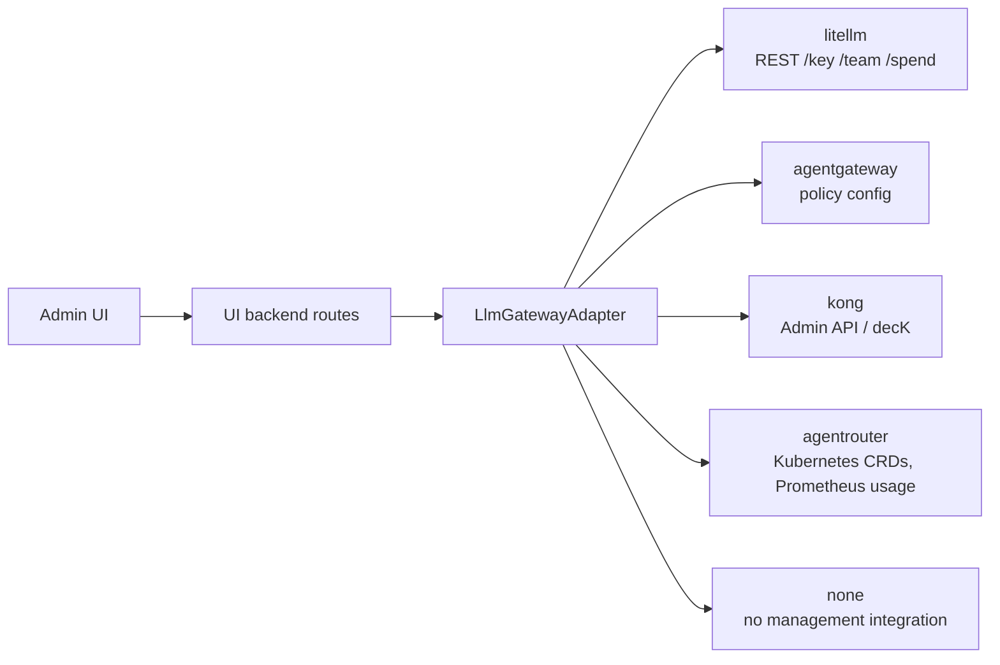

# Contract ⑤: Gateway Adapter (control plane)

The UI backend manages the gateway only through this interface. The UI renders only what `capabilities()` declares.

- `LLM_GATEWAY_ADAPTER` selects CAIPE's management integration for the configured gateway. Named adapters translate supported operations into that gateway's APIs or configuration mechanisms.
- `LLM_GATEWAY_ENABLED` controls inference routing separately. Selecting `none` does not bypass the gateway.

| Behavior | Named adapter | `none` |
|---|---|---|
| Gateway inference when enabled | Configured gateway endpoint | Configured gateway endpoint |
| Model catalogue sync | Available with `models.list` | Unavailable; use configuration or the LLM Models UI |
| Gateway principal/key provisioning | Automated where supported | Operator-managed |
| Gateway budget configuration | Available through supported limit capabilities | Operator-managed |
| Gateway usage display in CAIPE | Available with `usage.read` | Unavailable through the adapter |

| Operation | Input | Output | Used by |
|---|---|---|---|
| `capabilities()` | — | capability set ([data-model.md §6](../data-model.md)) | UI |
| `list_models()` | — | models served by the gateway | `llm_models` sync |
| `ensure_principal(p)` | user, agent or team | idempotent | agent create, default team at startup, first call |
| `set_limit(p, limit)` | principal + `{limit_type, amount, window}` | applied limit | admin, quota approval |
| `get_usage(p, window)` | principal + window | spend / tokens / remaining | admin, end-user budget display |

## Rules

- **Idempotent**: every write can be retried safely.
- **Cache lifetime**: limits and usage remain gateway-owned. CAIPE MAY use a short-lived in-memory cache; entries MUST expire and MUST NOT be persisted in MongoDB.
- **Cache isolation**: cache limits and usage by gateway/configuration identity, operation, principal type, principal ID and reporting window where applicable. Changing gateway configuration MUST invalidate affected entries or use a separate cache namespace.
- **Unsupported → `NotSupported`**: the UI hides the control. It never fails silently.
- **Credentials**: the adapter's admin credential is held only by the UI backend, through the existing secret strategies.
- **Management transport**: for production, use HTTPS with certificate and hostname verification, or service-mesh mTLS configured to authenticate the destination and prevent plaintext fallback. Plain HTTP is supported for local development and isolated testing. Without transport encryption, management credentials and request contents are exposed to anyone able to observe the traffic. Transport policy remains operator-controlled; CAIPE does not require TLS to enable the adapter.
- **Authorization**: every adapter route is gated by OpenFGA (org or team admin for writes; self, team or agent viewers for reads).
- **Authorization on every read**: authorize the caller for the requested principal before returning data, including cache hits. A cached result MUST NOT be treated as evidence of permission.
- **`none` adapter**: `capabilities()` is empty; management operations return `NotSupported`. CAIPE hides adapter-backed sync, provisioning, limits and usage controls. Existing model catalogue management remains available. Operators configure required gateway identities, credentials and limits externally. Data-plane contracts ①–④ still apply with either auth mode. Key auth uses keys provisioned in the gateway by the operator and saved in CAIPE's credentials store; `keys.issue` is not required.
- **Budget-signal rule**: named adapters ship documented rules that distinguish gateway limits from provider errors; adapter `none` requires operator configuration. Rules are used by the data plane ([openai-endpoint.md](./openai-endpoint.md)).
