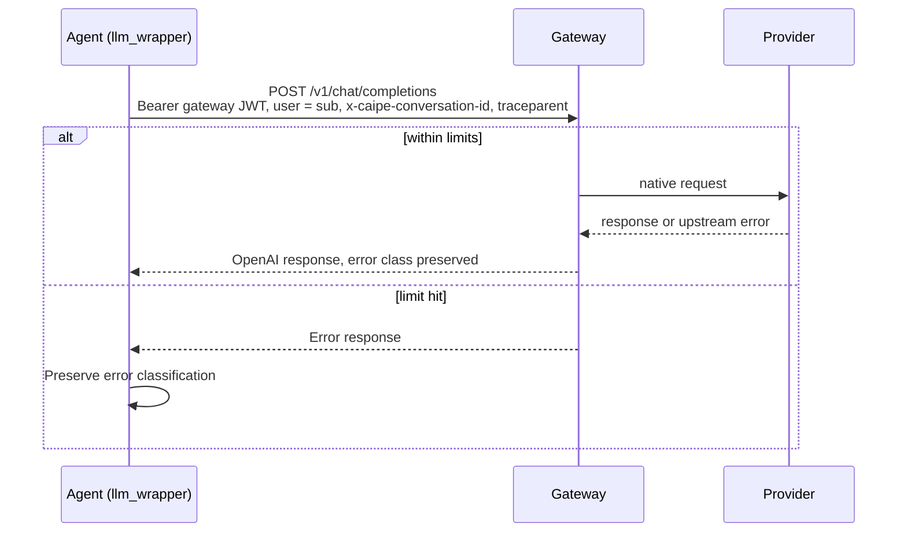

# Contract ①③④: Agent ↔ Gateway (data plane)

What every agent sends and what every gateway must honour. Agents reach the gateway through the `openai-compatible` provider in `ai_platform_engineering/llm_wrapper/` pointed at `LLM_GATEWAY_BASE_URL` when the switch is on (FR-020).

## Request

- **Transport**: for production, use HTTPS with certificate and hostname verification, or service-mesh mTLS configured to authenticate the destination and prevent plaintext fallback. Plain HTTP is supported for local development and isolated testing. Without transport encryption, bearer credentials, prompts and responses are exposed to anyone able to observe the traffic. Network policy restricts connectivity but does not encrypt traffic. Transport policy remains operator-controlled; CAIPE does not require TLS to enable gateway routing.
- **Paths**: `POST /v1/chat/completions` (streaming SSE, tool calls), `GET /v1/models`, `POST /v1/embeddings`.
- **Auth ②**: `Authorization: Bearer <gateway JWT>` (`LLM_GATEWAY_AUTH=jwt`), or `Bearer <per-agent gateway key>` (`LLM_GATEWAY_AUTH=key`). See [routing-backend-contract.md](./routing-backend-contract.md).
- **Body**: OpenAI chat-completions schema. `model` = `llm_models.model_id`.
- **Attribution ③**:

| Field | Value |
|---|---|
| body `user` | token `sub` |
| `x-caipe-conversation-id` | conversation id |
| `traceparent` | W3C trace context |

- With JWT auth, identity is trusted **only** from the token, never from headers.

## Response

- **Success**: OpenAI schema, translated from the real upstream.
- **Upstream error**: class preserved (429 stays 429, 5xx stays 5xx). No retry by CAIPE.
- **Rejected request ④**: preserve the response status and existing error classification. Do not infer gateway-versus-provider origin, budget scope, reset time or budget-increase advice. No gateway-specific parser or dedicated budget exception is required.
- **Gateway unreachable**: fail closed and name the gateway. No direct-provider fallback.

## Invariants

- No agent source change. Swapping gateways = changing the endpoint and adapter.
- Behaviour matches a direct call apart from the hop. Latency is measured, not bounded.
