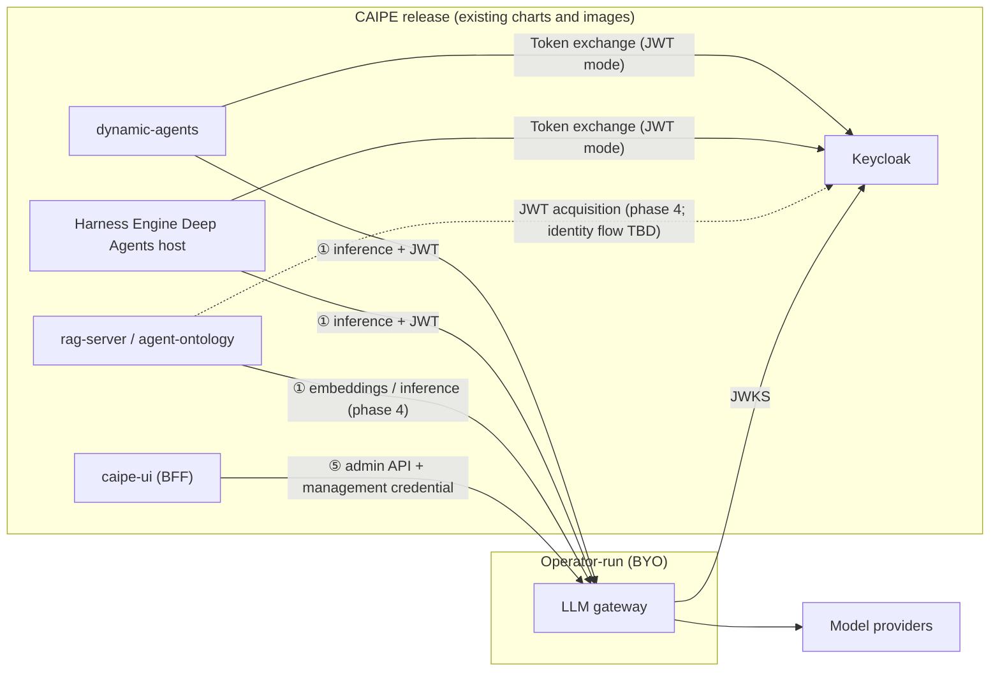
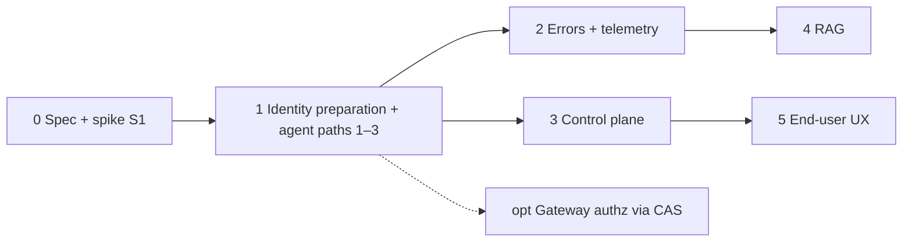

# Plan: Centralise LLM Routing, Quotas and Budgets

**Spec**: [spec.md](./spec.md)

**Issue**: #2874

**Epic**: #2537

This PR delivers the **spec/ADR only**. Implementation lands as separate PRs under Epic #2537 (see [tasks.md](./tasks.md)).

## Summary

- Agents use any OpenAI-compatible gateway through the `openai-compatible` provider (`llm_wrapper`).
- Every call carries a short-lived JWT naming the user, agent and owning team. The gateway enforces limits and meters usage.
- The UI backend manages models, limits and usage through a capability-flagged adapter.
- No bundled gateway. One global switch, `LLM_GATEWAY_ENABLED`, is off by default.

## Technical context

| Plane | Language | Where | Why |
|---|---|---|---|
| Data plane ①–④ | Python 3.14 | `llm_wrapper`, `dynamic_agents`, RAG | `build_chat_model` is the one choke point for paths 1–3 (FR-003), including Harness Engine Deep Agents; experimental Harness Engine runtimes are out of scope; RAG already uses Python |
| Control plane ⑤, identity lifecycle | TypeScript (Next.js BFF) | `ui/src/app/api/`, `ui/src/lib/` | The BFF already owns Keycloak admin, the credentials store, CAS and admin routes |

- No new language, framework or service. New dependencies: none expected; a gateway SDK only if an adapter cannot use plain HTTP.
- Rejected: a separate gateway-management microservice. It adds an image, a chart and a second auth surface for five operations.

## Deployment



- CAIPE changes ship in the existing `dynamic-agents`, Harness Engine Deep Agents, `caipe-ui`, `rag-server` and `agent-ontology` images. No new image, chart or Compose service.
- The gateway is deployed and run by the operator (any namespace, cluster or SaaS) and reached by `LLM_GATEWAY_BASE_URL`.
- Network: CAIPE pods need egress to the gateway; the gateway needs egress to Keycloak's JWKS (JWT mode) and to providers.
- In K2 JWT mode, Dynamic Agents and the separate Harness Engine Deep Agents host also need egress to Keycloak's token endpoint to acquire and renew gateway tokens. Allow this connection in restrictive network policies; blocked exchange fails closed on a cache miss or when a cached token expires. Key mode does not require this token-exchange connection.
- Phase 4 must provide RAG/ontology access to Keycloak for JWT acquisition and refresh before enabling JWT routing. T401/T402 must first define the query and background identities and acquisition flow; an interactive user token cannot be assumed. Validate the required network access with that flow.
- The BFF authenticates gateway management calls with the adapter's management credential, not an inference JWT. These calls do not require the runtime token-exchange flow.
- Dev/demo only: `setup-caipe.sh --litellm` stays an example gateway (T801). The default Compose path is unchanged.
- Rollout per environment: deploy the gateway → prepare identities (phase 1) → set values → flip `LLM_GATEWAY_ENABLED`. Rollback: set it off through the deployment configuration, restore direct-provider secret references and wait for the resulting pod rollout.

### Helm and Compose

Existing charts accept manually supplied environment variables through their `config`/`env` values. The proposed `global.llmGateway` block requires new template wiring to translate global settings into those variables; adding values alone does not inject them into pods.

| Chart | Non-secret env | Secret env |
|---|---|---|
| `dynamic-agents` | `config:` map → ConfigMap (`templates/configmap.yaml`) | `llmSecret`, `existingSecret`, `externalSecrets` |
| `caipe-ui` | `config:` map → ConfigMap | existing secret strategies |
| `rag-server`, `agent-ontology` | `env:` map | `llmSecrets` |
| Compose | `.env` via `env_file` | `.env` |

Gap: the same five settings would be copied into two to four subcharts, so dynamic agents and the BFF can drift (FR-002). Proposal:

```yaml
global:
  llmGateway:
    enabled: false          # LLM_GATEWAY_ENABLED
    baseUrl: ""             # LLM_GATEWAY_BASE_URL
    auth: jwt               # LLM_GATEWAY_AUTH
    audience: llm-gateway   # LLM_GATEWAY_AUDIENCE
    adapter: none           # LLM_GATEWAY_ADAPTER (BFF only)
    defaultTeam: platform   # LLM_GATEWAY_DEFAULT_TEAM
    adminCredential:        # BFF only; existing secret strategies
      existingSecret: ""
```

- Implement a shared Helm helper and invoke it from the consuming chart templates: `dynamic-agents` and `caipe-ui` in phase 1, then RAG charts in phase 4. Render environment values as strings. A key explicitly set in a subchart's `config`/`env` wins over the global value.
- Phase 1 also configures the separate Harness Engine process hosting Deep Agents, including its existing image build and deployment manifests. Propagate the same routing settings and exchange credentials, enforce provider-credential isolation, and roll that workload on mode changes. Reusing the Dynamic Agents library does not inherit the Dynamic Agents service's environment. Do not assume a dedicated Harness Engine Helm subchart exists; cover its supported deployment path explicitly.
- Render `LLM_GATEWAY_ADAPTER` and the admin credential secret reference only for the BFF. Inference services receive routing and identity settings, not management credentials.
- `helm template` tests cover default-disabled output (nothing new), enabled settings per chart, explicit subchart overrides, and BFF-only management settings and secret references.
- `.env.example` gets the same keys, commented out. The minimal first-install profile is unchanged.

### Credential isolation and mode transitions

- Keep direct-provider credentials in the existing secret store. In gateway-enabled workloads, omit their `env`, `envFrom`, secret-volume and other credential injection paths. Split mixed secrets or project only the required non-provider keys. Explicit subchart overrides must not bypass credential isolation.
- Change mode through Helm/GitOps: reconcile the routing setting and credential references in the same pod-template update. The pod-template change triggers replacement; new pods load the selected secrets at startup. Do not treat an in-place ConfigMap edit as a complete mode change.
- Enabling routing removes provider credential references. Disabling routing restores them from the configured secret source. Ensure required Secrets are synchronized before rollout; missing credentials must prevent successful direct-mode activation.
- Wait for replacement pods to become ready and old pods to terminate before reporting success. Rolling updates can temporarily contain both modes; switching is not instantaneous and does not revoke credentials already loaded by old pods.
- Changes to Secrets consumed by a workload require a rolling restart so replacement pods load the new credentials. Use pod-template checksums for chart-managed configuration and Secrets. For externally managed Secrets, the operator or deployment pipeline must wait for synchronization, trigger a rolling restart and verify rollout completion; changing a Secret alone does not restart pods.
- Compose must likewise select mode-specific credential injection and recreate affected containers. A shared `.env` containing provider keys must not be passed wholesale to gateway-enabled inference containers. Preserve the default-disabled first-install path.

## Phases

Phases describe delivery order. One global switch controls gateway routing across all migrated paths: `LLM_GATEWAY_ENABLED=false` uses direct-provider configuration and bypasses the gateway even when configured and reachable. Direct-provider configuration and credentials remain in deployment configuration and secret storage, not in gateway-enabled inference pods. Mode changes reconcile credential references and replace affected pods before the transition is considered complete. With the switch on, gateway failures fail closed without automatic direct-provider fallback. Rolling back an individual phase requires reverting the relevant deployment or code changes while respecting phase dependencies.



| Phase | Delivers | Main code | Gate |
|---|---|---|---|
| 0 | Spec/ADR (this PR) + spike S1 | `docs/`, Keycloak spike | approval |
| 1 | Identity setup and lifecycle for existing/new agents, default team; routing and authorization for agent paths 1–3 | `llm_wrapper/src/llm_wrapper/build.py`, `dynamic_agents/services/{llm_clients,llm}.py`, `dynamic_agents/auth/authz.py`, `ui/src/lib/rbac/keycloak-admin.ts`, agent lifecycle routes | S1 selected [K2](./research.md#identity-option-legend); T102 must validate chained exchange of a scheduler-minted owner token for autonomous runs; identity readiness before routing. Not gated on #1753 (see [tasks](./tasks.md#phase-1-identity-preparation-and-agent-data-plane)) |
| 2 | Error propagation ④ + attribution ③ + metrics, logs, traces | `llm_wrapper`, `dynamic_agents` | phase 1 |
| 3 | Control plane: adapter, automated gateway principal provisioning, `llm_models` sync, admin limits/usage UI | `ui/src/app/api/`, `ui/src/lib/`, `ui/src/lib/rbac/keycloak-admin.ts` | phase 1 |
| 4 | RAG paths 4–5 (same embedding model id only), with explicit runtime identity and credential preparation | `knowledge_bases/rag/` | phases 1–2; T401/T402 identity design and provisioning before gateway activation |
| 5 | End-user UX: remaining budget, quota requests | `ui/`; bots keep existing failure reporting (T503) | phase 3 |
| opt | Gateways with ext_authz ask the BFF CAS adapter for the decision and verified identity headers | `ui/src/lib/authz/` (#2909) | phase 1 |

**Implementation completion gate (SC-007):** the [required conformance task T601](./tasks.md#required-validation) must pass all applicable checks for every in-scope path against at least two different gateways, with versions, authentication modes and results recorded. This gate applies to the implemented feature; it does not block merging this spec/ADR.

## Constitution check

| Principle | Assessment |
|---|---|
| Worse is Better / YAGNI | No bundled gateway, no in-process router, no CAIPE copy of limits. |
| Composition over Inheritance | Gateways sit behind fixed contracts plus an adapter. |
| Security by Default | Per-call verifiable identity, no provider keys in gateway-enabled inference pods, admin keys BFF-only, fail closed. |
| Single source of truth | Gateway for limits and usage; OpenFGA for access; Mongo for catalogue and requests. |
| Docker Compose first install | Default profile unchanged; the switch is off by default. |

## Risks

| Risk | Mitigation |
|---|---|
| Keycloak can't emit per-agent scope claims at scale | Spike S1; fall back to [C1](./research.md#identity-option-legend) (dynamic agents sign) |
| Gateway licence tiers lack JWT or budgets | `LLM_GATEWAY_AUTH=key`; adapter `none` |
| Shared agents drain the owning team's budget | Per-user limit on top (T1) |
| Embedding model drift invalidates indexes | Phase 4 only moves if the model id is identical |
| Gateway outage stops all LLM traffic | Fail closed with a clear error; the switch restores direct calls |
| Signer change resets budgets | Budget keys use `org` + principal, never `iss` |
| ACP runtime refactor (#2883) moves call sites | The hook lives in `llm_wrapper`, below the runtime |
| Per-user metric labels explode Prometheus cardinality | Users only in traces, logs and gateway usage (FR-009) |
| Gateway settings drift between subcharts | One `global.llmGateway` block ([Helm and Compose](#helm-and-compose)) |
