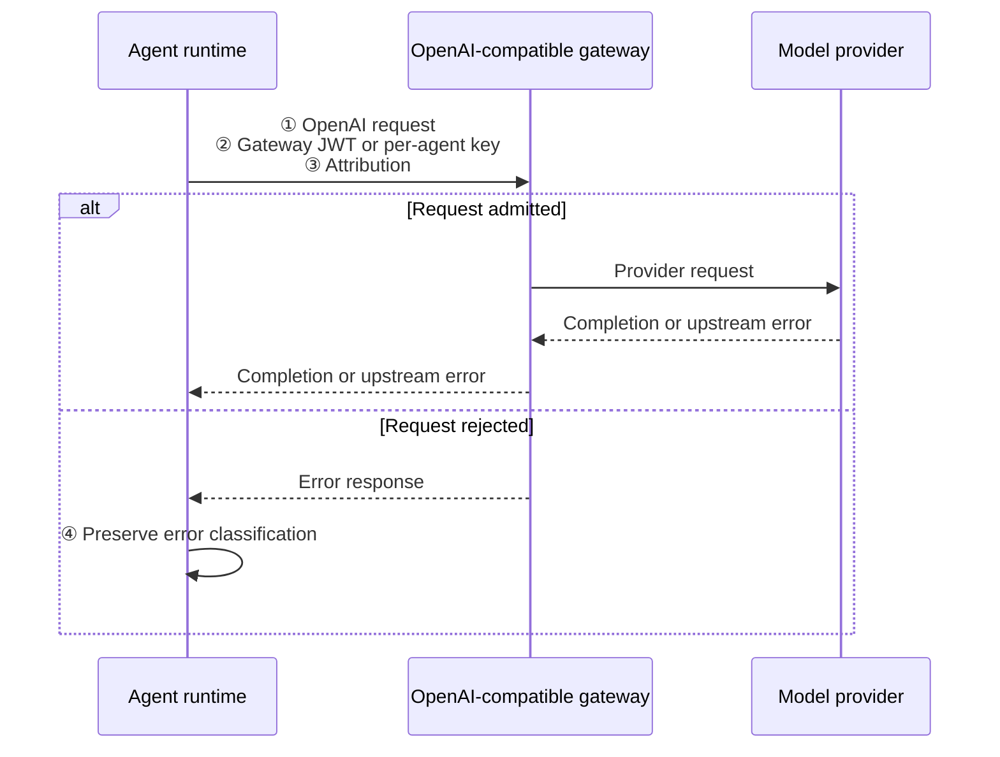
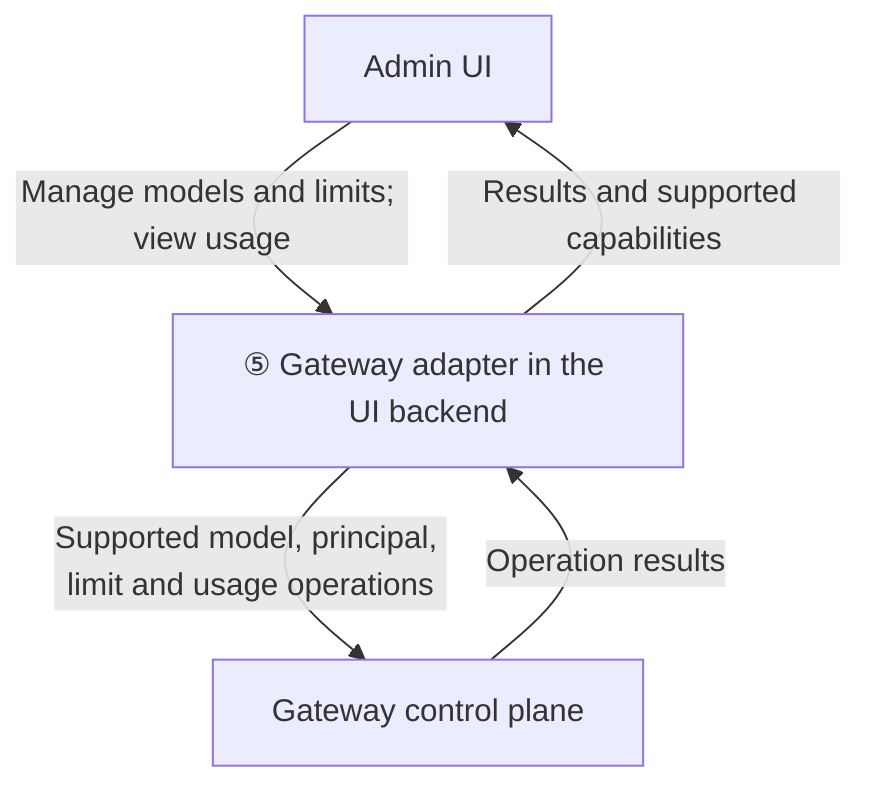
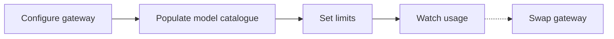
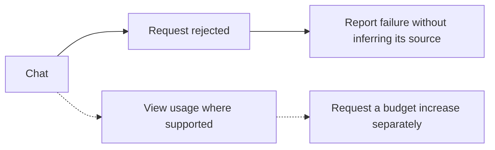
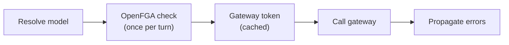

# Feature Specification: Centralise LLM Routing, Quotas and Budgets via a Bring-Your-Own Gateway

**Created**: 2026-10-10

**Status**: Draft (ADR)

**Issue**: #2874 (Epic #2537)

**Input**: "Centralise LLM routing for all CAIPE agents so a gateway can route, enforce quotas and budgets per user, agent and team — plug-and-play with any gateway."

## Overview

- **Problem**: agents call model providers directly. CAIPE cannot route requests, enforce quotas or budgets, or attribute cost to a user, agent or team.
- **Goal**: one gateway-neutral contract. Agents talk to *any* OpenAI-compatible gateway, and the gateway routes, enforces and meters.
- **Non-goal**: CAIPE does not ship or operate a gateway. Operators bring their own: LiteLLM OSS, AgentGateway, AgentRouter, optional Kong AI Gateway or another.
- **Delivery order**: LiteLLM OSS per-agent key validation first, followed by JWT validation on AgentGateway and AgentRouter. All three are required; Kong integration is optional.
- **Builds on**: the `openai-compatible` provider in `ai_platform_engineering/llm_wrapper/` (#2820).

### Runtime path

### Administration path

| # | Contract | Owner |
|---|---|---|
| ① | Wire: OpenAI `/v1/chat/completions`, `/v1/models`, `/v1/embeddings` | gateway |
| ② | Identity: `LLM_GATEWAY_AUTH=jwt` (default) uses a short-lived JWT `{sub, azp, agent_id, team_id, org}`; `key` uses a per-agent gateway key with verified agent/team bindings, unverified user attribution and best-effort per-user limits | CAIPE issues JWTs or supplies provisioned gateway keys; gateway verifies credentials |
| ③ | Attribution: OpenAI `user` field, `x-caipe-*` context headers, OTel GenAI | CAIPE sends |
| ④ | Errors: preserve status and existing classification | CAIPE propagates |
| ⑤ | Control plane: capability-flagged adapter (models, limits, usage) | CAIPE UI backend |

Details: [data plane](./contracts/openai-endpoint.md), [gateway conformance](./contracts/routing-backend-contract.md), [adapter](./contracts/gateway-adapter.md), [research.md](./research.md), [data-model.md](./data-model.md).

### What CAIPE builds

No new service, image or language. Each piece lands in an existing component (deployment and technology: [plan.md](./plan.md#technical-context)).

| Piece | Component | Language | Phase |
|---|---|---|---|
| Switch, provider override, auth hook, error propagation ④ | `llm_wrapper` (library) | Python | 1–2 |
| Gateway token acquisition and cache, `llm_model#can_read` check, attribution ③, telemetry | `dynamic_agents` | Python | 1–2 |
| Agent identity lifecycle (Keycloak scopes or keys), default team | UI backend (BFF) | TypeScript | 1 |
| Adapter ⑤, model sync, limits and usage routes, admin UI | UI backend + UI | TypeScript | 3 |
| Embeddings and ontology agent through `llm_wrapper` | RAG server, ontology agent | Python | 4 |
| Remaining budget, quota requests; bots keep existing failure reporting | UI, Slack and Webex bots | TypeScript, Python | 5 |
| Helm values and `.env.example` entries | `charts/`, Compose | YAML | 1, 3, 4 |

## Clarifications

### Session 2026-10-05

- Q: Ship a gateway or BYO? → **BYO only.** CAIPE defines contracts ①–⑤.
- Q: Where do models come from? → **`llm_models` stays the catalogue.** Entries come from configuration, the LLM Models UI, or gateway sync where the adapter supports `models.list`. Existing `model_id` values keep working.
- Q: Which budget dimensions? → **User, agent and team.**
- Q: Which team pays when a user is in several teams? → **The agent's owning team** (`owner_team_slug`). A per-user limit applies on top.
- Q: How does the gateway trust who is calling? → **A short-lived JWT.**
  - Keycloak signs it via a token exchange with one client scope per agent.
  - Fallback: dynamic agents sign it (see Open Decisions).
  - For gateways that can't validate JWTs: per-agent gateway keys.
- Q: Who governs model access? → **OpenFGA through CAS**, checked by dynamic agents. Gateways with ext_authz can also ask CAS.
- Q: Where do limits and usage live? → **In the gateway only.** Usage is read live; CAIPE keeps no copy.
- Q: Tenancy? → **One tenant per deployment** (one realm, one OpenFGA store, one `organization`).
- Q: Rollout? → **Phased build behind one global switch** (`LLM_GATEWAY_ENABLED`, default off).
- Q: Must the gateway be highly available? → HA is the gateway operator's concern. CAIPE fails closed.
- Q: Latency target? → No hard SLO; measure and document.

### Session 2026-10-09

- Q: Which identity contract does the gateway token follow? → **CAIPE's canonical identity contract** (#2885): platform `iss`/`sub` is the effective principal; the acting service is named separately.
- Q: How do autonomous runs prove the task owner? → **A trusted run binding** (#2891), not an owner ID or unsigned header. The exchange mechanism follows #2890; no new dependency on `requested_subject` impersonation.
- Q: Optional gateway-side authorization? → **The BFF CAS adapter** (#2892, #2909), the same path AgentGateway uses for MCP, instead of the OpenFGA bridge.

### Session 2026-10-14

- Q: What exactly are we building? → **Integration code in existing CAIPE components, not a gateway or a new service.** See [What CAIPE builds](#what-caipe-builds).
- Q: How is it deployed? → **Inside the existing images and charts.** The gateway is operator-run and reached by URL; CAIPE ships no gateway chart or Compose service. See [plan.md](./plan.md#deployment).
- Q: Does the Helm chart need changes to inject the environment variables? → **Values and template wiring are required for `global.llmGateway`.** Subcharts already support manually supplied `config`/`env` keys, but do not automatically translate the new global block into environment variables. Add a shared helper and invoke it from the consuming chart templates (FR-002, FR-020). See [plan.md](./plan.md#helm-and-compose).
- Q: Which language, and why? → **Python for the data plane, TypeScript for the control plane.** Each lands where its choke point already lives: `llm_wrapper.build_chat_model` (FR-003) and the BFF that owns Keycloak admin, credentials and CAS. See [plan.md](./plan.md#technical-context).
- Q: Metrics, logs and traces? → **All three, on top of existing telemetry** (FR-009, FR-021, FR-022). Unbounded user IDs go to traces and logs, never metric labels.

### Session 2026-11-07

- Q: How does the gateway token name the sending service? → **`azp`, set by Keycloak.** No custom `act` mapper: #2890 did not adopt actor-bearing tokens, and CAS rejects them.
- Q: Are autonomous runs in phase 1? → **Yes.** A run reaches dynamic agents with an owner token, which is exchanged like a chat token. How the scheduler obtains that token (impersonation today; #2891 run binding or CAS approval #3034 later) follows #2890 and does not change the exchange. Supersedes the 2026-10-09 answer.
- Q: Which CAS API does the model check use? → **The decision API dynamic agents already calls**, moving to `/api/access` when #2889 resumes.
- Q: Which Keycloak client exchanges? → **A new exchange-only `caipe-dynamic-agents` client.** Not `caipe-platform`: it is the BFF's Keycloak admin client (`manage-users`) and would make `azp` meaningless.
- Q: Harness Engine? → **Deep Agents is in scope** (it reuses paths 1–2). **Experimental Harness Engine runtimes are out of scope**: they call providers without `llm_wrapper`. CAIPE warns operators instead.

## User Journeys *(mandatory)*

### J1 — Platform admin: connect, govern, swap (P1)

1. Sets the gateway endpoint, auth mode and adapter type (`litellm` · `agentgateway` · `agentrouter` · `kong` · `none`). The credential comes through the existing secret strategies.
2. Syncs gateway models into `llm_models` when the adapter declares `models.list`; otherwise maintains model entries through application configuration or the LLM Models UI. Model IDs must match gateway aliases; retaining existing IDs avoids agent edits.
3. Sets default and per-team, per-agent and per-user limits in the Admin UI. Controls the adapter can't support are hidden.
4. Views usage and spend, read live from the gateway where the adapter declares `usage.read`.
5. Approves or rejects quota-increase requests.
6. Swaps gateways by changing the endpoint and adapter. Agents are untouched.
7. With adapter `none`, manages gateway identities, credentials and limits externally and maintains CAIPE's model catalogue through configuration or the LLM Models UI. Gateway routing remains enabled by `LLM_GATEWAY_ENABLED`; CAIPE still sends attribution and propagates errors. See the [adapter contract](./contracts/gateway-adapter.md).

**Acceptance**:
- Given a configured gateway, when the admin turns on `LLM_GATEWAY_ENABLED`, every migrated call path routes through the gateway with no agent edits.
- Given a team limit, when the team's agents exceed it, further calls are rejected; the admin sees spend in CAIPE where `usage.read` is supported, otherwise in the gateway.

### J2 — Agent author: pick a model, request a budget (P2)

1. Picks a model from the OpenFGA-filtered `llm_models` catalogue (unchanged UI).
2. The agent's owning team is charged. There is nothing to configure.
3. Optionally requests an agent-specific budget, within the team's limit.

**Acceptance**:
- Given a new agent, when it is saved, CAIPE provisions its gateway identity (the Keycloak client scope, and `ensure_principal` if the adapter needs it). The first call succeeds.

### J3 — End user: chat, see budget, recover (P1)

1. Chats normally in the UI, Slack or Webex. No new step.
2. Sees remaining budget where the adapter supports it.
3. When a request is rejected, sees the failure through existing error handling, without inferred origin, budget scope or reset time.
4. Can separately submit a quota-increase request for a selected principal through the phase 5 UI. The request is routed to the admin queue; it is not inferred from an error response.

**Acceptance**:
- Given an exhausted agent budget, when the gateway rejects the request, CAIPE reports the failure without direct-provider fallback or inferred budget-specific advice.

### J4 — Agent runtime: call the gateway (P1)

1. Resolves the model from `llm_models`.
2. Checks with OpenFGA that the caller may use this agent and this model, once per turn.
3. Gets a gateway token for (user, agent). Autonomous runs act as the task owner.
4. Calls the gateway with ①②③. Holds no provider keys.
5. Preserves error status and existing classification (④). Fallback and retries are the gateway's job.

**Acceptance**:
- Given an autonomous run, when it calls the gateway, usage is attributed to the task owner, the agent and the owning team, not to a shared service account.

### Edge cases

- **AI-assist without an executing agent**: `/assistant/suggest` uses a stable, provisioned system agent identity dedicated to AI-assist. The authenticated caller remains `sub`; `agent_id` identifies the AI-assist system agent; `team_id` is its owning team, defaulting to `LLM_GATEWAY_DEFAULT_TEAM`. User, system-agent and team limits apply according to the configured authentication mode (FR-004, FR-005). This identity does not depend on the agent being drafted or edited. Before calling the gateway, the runtime checks access to the system agent and selected model through CAS. AI-assist usage charges the system agent's owning team, regardless of the caller's team memberships.
- **Gateway unreachable**: fail closed with an error naming the gateway. Never fall back to a direct provider.
- **Token service unavailable** (Keycloak or signer): fail closed. Cached tokens are used until they expire.
- **Agent without an owning team** (legacy or system agents): charged to `LLM_GATEWAY_DEFAULT_TEAM` (`platform`). The UI backend provisions that team in CAIPE at startup. Before phase 3, operators prepare its gateway principal where required; phase 3 adapters automate gateway provisioning where supported (see [phase 1 tasks](./tasks.md#phase-1-identity-preparation-and-agent-data-plane)). The per-user limit still applies.
- **Owning team changed**:
  - MongoDB is the source of truth for agent ownership. Ownership changes and credential-binding updates MUST be recoverable after partial failure.
  - CAIPE MUST prevent new gateway calls while an ownership transfer is unresolved, including calls using cached credentials. It MUST NOT use or cache credentials whose agent or team binding differs from committed ownership.
  - Successful transfers MUST invalidate CAIPE's cached credentials for the previous owner. Calls already admitted may complete against the previous team's budget.
  - These requirements apply to Keycloak scopes, CAIPE-issued JWTs and per-agent gateway keys as applicable. Gateway JWT validation remains local; no gateway lookup of MongoDB is required.
- **User loses access to the agent**: the next turn's OpenFGA check denies, even if a token is cached.
- **Switch off**: every migrated path uses its direct-provider configuration and bypasses the gateway, even when the gateway endpoint is configured and reachable. The deployment update restores direct-provider secret references and replaces affected pods; new pods load the credentials at startup. The transition is complete only after the rollout succeeds. Missing credentials prevent successful activation of direct mode.
- **Embeddings**: they move only if the gateway serves the *same* embedding model, so vector indexes stay valid.

## Requirements *(mandatory)*

### Wire ①
- **FR-001**: Agents MUST reach the gateway via the OpenAI chat-completions protocol (`openai-compatible` provider), including streaming and tool calls.
- **FR-002**: The gateway endpoint MUST be one deployment-wide setting. Swapping gateways MUST NOT require agent changes.
- **FR-020**: The gateway endpoint MUST use its own setting, `LLM_GATEWAY_BASE_URL`, separate from `OPENAI_COMPATIBLE_BASE_URL`, so a direct `openai-compatible` provider (for example a self-hosted model server) keeps working with the switch off (FR-018).
- **FR-003**: With the switch on, every in-scope path MUST send `llm_models.model_id` to the gateway regardless of the stored or requested provider. This is enforced inside `llm_wrapper.build_chat_model`, not by each caller. In-scope paths include the Harness Engine Deep Agents runtime; experimental Harness Engine runtimes are not (see [Out of Scope](#out-of-scope)).

### Identity ②
- **FR-004**: With `LLM_GATEWAY_AUTH=jwt` (default), every gateway call MUST carry a short-lived JWT (TTL ≤ 5 min) with `sub` (effective principal), `azp` (sending client, `caipe-dynamic-agents`), `agent_id`, `team_id` and `org`, verifiable by the gateway. Identity claims follow CAIPE's canonical identity contract (#2885). Each token carries exactly one agent binding; the runtime verifies the returned `agent_id` and `team_id` before use or caching. Gateway expiry validation MAY allow documented clock leeway of at most 60 seconds; the maximum acceptance window is the issued TTL plus that leeway (at most 6 minutes). The runtime MUST NOT send tokens at or after `exp`, including cached tokens; refresh before expiry where possible.
- **FR-005**: With `LLM_GATEWAY_AUTH=key` (gateways that can't validate JWTs), calls MUST carry a per-agent gateway key from CAIPE's credentials store. Agent and team are verified; the user is attributed through the `user` field only, so per-user limits are best-effort.
- **FR-006**: In gateway-enabled mode, migrated inference workloads MUST NOT receive direct-provider credentials through environment variables or mounted secrets, nor an ambient cloud identity (for example IRSA, EKS Pod Identity or Azure workload identity) that can invoke models directly. Migrated workloads per phase: the Dynamic Agents service and the separate Harness Engine host running Deep Agents from phase 1; RAG server and ontology agent from phase 4, which keep their provider credentials until then. Gateway admin credentials remain BFF-only in every mode. Direct-provider credentials remain in the deployment secret store and are injected only into direct-mode workloads. Shared secrets containing both provider and required service credentials MUST be split or projected by key.
- **FR-007**: Autonomous and scheduled runs MUST be attributed to the task owner, not to a shared service account or an unsigned owner header. Dynamic agents exchange the owner token the run carries; how that token is proven (#2891, #3034) follows #2890.

### Attribution ③
- **FR-008**: Calls MUST set the OpenAI `user` field to `sub`, and send `x-caipe-conversation-id` and W3C `traceparent`.
- **FR-009**: CAIPE MUST emit LLM call metrics (count, latency, tokens, failed requests, gateway connection failures, token-cache hits) labelled with agent, team, model, caller kind and outcome. Metric labels MUST NOT include user IDs (unbounded cardinality); per-user usage comes from the gateway (`usage.read`), traces and logs. Metrics extend the existing dynamic-agents Prometheus metrics (`da_llm_*`) and use OTel GenAI semantic-convention names where they exist.

- **FR-021**: Each gateway call, rejected request, fail-closed error and token-mint failure MUST produce one structured log line with conversation ID, trace ID, agent, team, model, auth mode, status and latency. Logs MUST NOT contain gateway tokens, keys, prompts or completions; the user is logged only as `sub`.
- **FR-022**: Traces MUST add a gateway-call span (OTel GenAI attributes, including `gen_ai.request.model` and token usage, plus `caipe.agent_id`, `caipe.team_id`, `caipe.auth_mode`) and a token-acquisition span (cache hit or miss) under the existing turn trace. The `traceparent` sent in FR-008 MUST be the gateway-call span's context, so gateway traces join CAIPE traces. Tracing stays best-effort and never blocks a call.

### Authorization
- **FR-010**: Dynamic agents MUST check the OpenFGA relations `agent#can_use` and `llm_model#can_read` through CAS (agent action `use`) once per turn per (user, agent, model), before the first LLM call. A gateway with ext_authz MAY also ask the BFF CAS adapter (#2909). The check uses the CAS decision API dynamic agents already calls and moves to the `/api/access` contract with #2889.
- **FR-023**: With the switch on, CAIPE MUST log a startup warning for each configured experimental Harness Engine runtime, stating that its LLM usage bypasses the gateway and is not budgeted.

### Errors ④
- **FR-011**: Upstream provider errors MUST pass through with their class preserved.
- **FR-012**: Rejected requests MUST preserve their response status and existing error classification. CAIPE MUST NOT infer gateway-versus-provider origin, budget scope, reset time or budget-increase advice. Gateway-specific error recognition and a dedicated budget exception are deferred; no runtime error-profile or budget-signal configuration is required.
- **FR-013**: An unreachable or misconfigured gateway MUST fail closed with a clear error. No silent fallback.

### Control plane ⑤
- **FR-014**: The UI backend MUST perform gateway management operations through an adapter exposing `capabilities`, `list_models`, `ensure_principal`, `set_limit` and `get_usage`. The UI MUST hide what the adapter doesn't support.
- **FR-015**: Limits and usage MUST remain gateway-owned. CAIPE MUST NOT persist a copy; a short-lived in-memory cache is permitted under the [adapter cache rules](./contracts/gateway-adapter.md#rules).
  - Cached gateway limits and usage MUST remain isolated by gateway configuration and principal. Every read, including cache hits, MUST pass authorization for the requested principal.
- **FR-016**: Quota-increase requests MUST be stored in CAIPE (Mongo `llm_quota_requests`) and approved through the admin UI.

### Rollout
- **FR-017**: Adopting the gateway MUST NOT require agent source changes.
- **FR-018**: Gateway routing MUST be off by default. With `LLM_GATEWAY_ENABLED=false`, every migrated path MUST use its direct-provider configuration and bypass the gateway even when its endpoint is configured and reachable. With the switch on, gateway failures MUST fail closed without automatic direct-provider fallback.
- **FR-019**: A routing-mode change MUST update the workload configuration and selected credential references together and trigger pod replacement. A ConfigMap-only edit is not a supported mode transition. Gateway-enabled replacement pods MUST exclude provider credentials; direct-mode replacement pods MUST load them before serving inference. Delivery MUST be phased. The global switch disables gateway routing across all migrated paths. Rolling back an individual phase requires reverting the relevant deployment or code changes while respecting phase dependencies (see [plan.md](./plan.md)).

## Key Entities

- **Gateway**: an operator-run, OpenAI-compatible LLM gateway.
- **Gateway token**: a short-lived JWT identifying user, agent, owning team and organization.
- **Agent scope**: one Keycloak client scope per agent carrying `agent_id` and `team_id`.
- **LLM model** (`llm_models`): the persisted catalogue entry an agent selects; populated through configuration, the LLM Models UI, or gateway sync with `models.list`.
- **Limit**: a budget or quota for one principal (user, agent or team), stored in the gateway.
- **Quota request**: a user or author request for more budget, stored in CAIPE.
- **Adapter**: the per-gateway control-plane implementation with declared capabilities.

## Success Criteria

- **SC-001**: Swapping gateways requires zero agent changes.
- **SC-002**: With JWT auth, every LLM call path in scope is attributed to user, agent and team (100% of sampled calls).
- **SC-003**: Gateway limit rejections and forwarded provider failures remain failures with their status and existing error classification preserved, without inferred budget-specific advice or direct-provider fallback.
- **SC-004**: With a gateway configured and reachable and `LLM_GATEWAY_ENABLED=false`, automated tests MUST verify successful direct-provider calls and zero inference requests to the gateway for every migrated path.
- **SC-005**: Forged identities are rejected with no leeway exception. For JWT auth, the gateway rejects tokens at or after `exp + L`, where its documented expiry leeway `L` is between 0 and 60 seconds. Conformance tests record `L` and verify the expiry boundary; runtime tests verify no token is sent at or after `exp`.
- **SC-006**: The added latency (cached token) is measured and documented.
- **SC-007**: LiteLLM OSS (key mode), AgentGateway (JWT) and AgentRouter (JWT) each pass all applicable checks in [the conformance contract](./contracts/routing-backend-contract.md).

## Assumptions

- "OpenAI" names the wire protocol, not the provider.
- Keycloak 26.3 standard token exchange emits per-agent scope claims; confirmed by spike S1 up to 10,000 agents with a sized realm cache ([S1 results](./research.md#s1-results)).
- The gateway can reach the token issuer's JWKS.
- JWT-mode inference workloads can reach Keycloak for token acquisition and refresh: Dynamic Agents and the separate Harness Engine Deep Agents host in phase 1, then RAG/ontology once T401/T402 define their identity and acquisition flow in phase 4. Deployment network policies must permit these connections (see [deployment guidance](./plan.md#deployment)).
- The gateway token is minted only from the validated bearer token, never from `X-User-Context`. Keycloak re-verifies it during exchange, so phase 1 does not wait for #1753.
- Autonomous runs reach dynamic agents with an owner token. #2890 may change how the scheduler obtains it, not the gateway exchange.
- The OpenAI wire format loses some provider-native features, such as prompt caching and thinking parameters. Native providers in `llm_wrapper` remain available while the switch is off.
- Related work is listed in [research.md](./research.md#related-work).

## Open Decisions

- ~~**OD-1 Signer**~~ Closed 2026-10-14 by spike S1 (#2938): **Keycloak per-agent scope ([K2](./research.md#identity-option-legend))**. [C1](./research.md#identity-option-legend) stays the fallback; claims and budget keys are identical either way. Autonomous runs reuse the chat exchange (2026-11-07); a chained-exchange test gates the phase 1 JWT milestone (T118). See [S1 results](./research.md#s1-results).

## Out of Scope

- Gateway-specific error recognition and automatic budget-specific guidance; reconsider in a future iteration or on user request.
- Shipping, operating or scaling a gateway.
- Experimental Harness Engine runtimes. They call providers without `llm_wrapper`, so their usage is not budgeted (FR-023). Routing them through the gateway is a follow-up.
- An in-process routing library (consistent with `2026-09-24-remove-cnoe-agent-utils` FR-024).
- Gateway-side fallback and retry policy (the gateway's job).
- Multi-tenant deployments sharing one CAIPE instance.
- Implementation. It is tracked under Epic #2537; see [tasks.md](./tasks.md).
