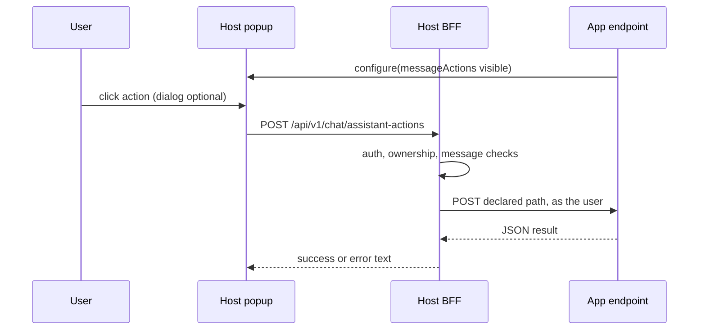

# Message actions

An installed app can add buttons to finished assistant answers in the host
assistant popup. The host renders them; the app owns what they do.

- Needs `ui.assistant.overlay: "host"` (not `"app"`).
- Needs SDK `2.0.0-rc.2` and a host release that includes this feature.
  Older hosts reject a manifest that declares `messageActions`.
- Web UI only. Webex clients never show actions.

## How it works



## 1. Declare

In `ui.assistant.hostOptions.messageActions`, at most 4:

```json
{
  "ui": {
    "assistant": {
      "agentId": "example-agent",
      "overlay": "host",
      "streamPath": "/api/assistant/stream",
      "hostOptions": {
        "version": "1.0",
        "requireConfiguration": true,
        "messageActions": [
          {
            "id": "flag-answer",
            "label": "Flag answer",
            "icon": "flag",
            "path": "/api/assistant/actions/flag",
            "dialog": {
              "title": "Flag this answer",
              "description": "Edit the text to give a corrected answer.",
              "submitLabel": "Submit",
              "field": { "label": "Corrected answer", "prefill": "message", "optional": true, "maxLength": 60000 }
            }
          }
        ]
      }
    }
  }
}
```

| Field | Rule |
|---|---|
| `id` | Lowercase id, unique in the app |
| `label` | 1 to 24 characters, plain text |
| `icon` | `flag`, `bookmark`, `check`, `star`, `clipboard`, `send` |
| `path` | Same rules as `streamPath`: under `/api/`, runtime declared, allowed `POST` policy |
| `dialog` | Optional. Without it the action runs on click. |
| `dialog.field.prefill` | `message` (the answer text) or `empty` |
| `dialog.field.optional` | `false` blocks an empty submit |
| `dialog.field.maxLength` | 1 to 60000. Longer text is blocked in the dialog and by the server. |

## 2. Check support and enable per user

Visibility is per user and starts hidden. It resets when the app unmounts or the
account changes, and it is never stored.

```ts
// Native
if (chat.assistant?.extensions?.includes("messageActions.v1")) {
  chat.assistant.configure({
    version: "1.0",
    visible: true,
    messageActions: { "flag-answer": { visible: userIsReviewer } },
  });
}

// Iframe
if (bridge.getCapabilities()?.composerExtensions?.includes("messageActions.v1")) {
  bridge.configureAssistant({ version: "1.0", visible: true, messageActions: { "flag-answer": { visible: userIsReviewer } } });
}
```

- Ids you did not declare are rejected.
- Visibility is cosmetic. It never grants access.

## 3. Handle the call

The host calls your declared path as the signed-in user, with the same auth mode
as your assistant stream.

Request:

```json
{
  "conversation_id": "string",
  "message_id": "string",
  "turn_id": "string",
  "action_id": "flag-answer",
  "text": "string"
}
```

- `text` is present only for actions with a dialog.
- `turn_id` comes from the stored message, not from the browser.
- The body is JSON. Redirects are not followed. The call stops after about 30 s.

Response:

| Result | Return |
|---|---|
| Success | Any `2xx` with `Content-Type: application/json`. An optional `message` string is shown to the user. |
| Failure | A `4xx` with JSON `{ "error": "<safe text>", "code": "<STABLE_CODE>" }`. `error` is cut at 300 characters. |

- A `401` or `5xx` from your app reaches the user as a generic failure.
- A non-JSON or redirect response is a failure.

## App obligations

- Re-check the caller on every call. The host does not know your roles.
- Treat `text` as untrusted input.
- Be safe to run twice for the same answer. The host does not dedupe.
- Do not put secrets or internal detail in `error`.

## What the host checks

- Signed-in person, not a service account.
- Agent use and conversation write access.
- The action is declared by the app bound to that agent.
- The target is a stored assistant message in that conversation.
- Text length and required field.
- Body size, timeout, JSON-only response.

Each call writes an audit event with the app, action and outcome. The text is never logged.
