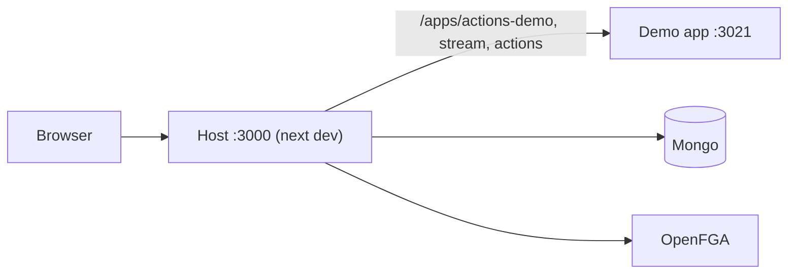
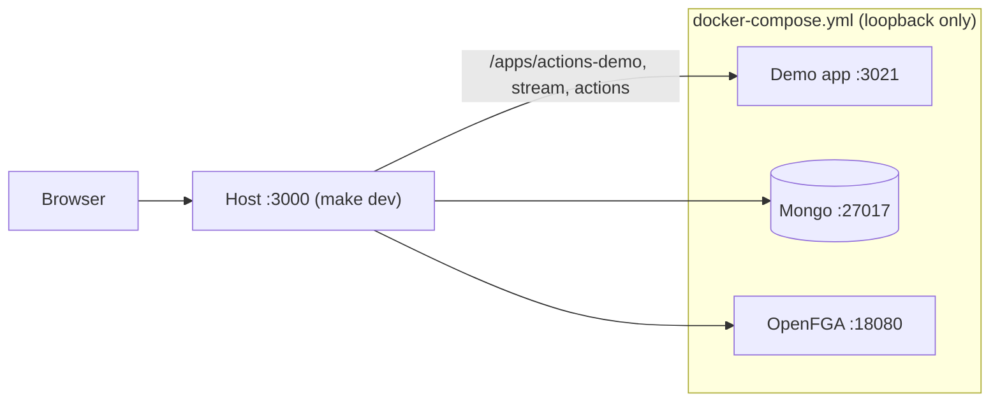

# Actions Demo

Test app for [message actions](../../../../docs/docs/ui/message-actions.md) in the host assistant.

- Serves a page in the host shell and answers the assistant with a fixed reply.
- Declares two actions on finished answers: **Flag answer** (dialog) and **Mark answer** (no dialog).
- Records every action call so you can see what the host sent.
- Local development only. It needs dev auth bypasses that must never run in production.



## Run it

Needs Docker (with Compose), Node 24, `openssl` and `make`.

1. **Everything except the host UI:**

   ```bash
   make setup
   ```

   - Writes `.env` and `ui/.env.local` with fresh local secrets. It never overwrites an existing file.
   - Installs the `ui/` dependencies if they are missing.
   - Starts Mongo, OpenFGA and the demo app with `docker-compose.yml`, loads the OpenFGA model, and seeds the placeholder agent.
   - Safe to run again.

2. **The host UI.** In a second terminal:

   ```bash
   make dev
   ```

   - Next.js allows one dev server per project. If one is already running for `ui/`, skip this step. It picks up `ui/.env.local` on its own.

3. **Sign in.** With SSO off the host has no login, so create a session cookie:

   ```bash
   make session
   ```

   - In the browser, open `http://localhost:3000`, then DevTools > Application > Cookies.
   - Add a cookie named `next-auth.session-token` with that value, path `/`.
   - For another user: `NEXTAUTH_SECRET=<value in .env> node mint-session.mjs secondary-user secondary@example.test`.

4. Open `http://localhost:3000/apps/actions-demo`.



### Make targets

| Target | What it does |
|---|---|
| `make setup` | `env`, `deps`, `up`, `seed` |
| `make env` | Writes `.env` and `ui/.env.local`. Skips a `ui/.env.local` it did not write. |
| `make up` | Starts the containers, then loads the OpenFGA model |
| `make seed` | Creates the placeholder agent in Mongo |
| `make dev` | Runs the host UI on port 3000 |
| `make session` | Prints a session cookie |
| `make check` | Runs the automated UI check |
| `make test` | Runs the demo app's unit tests |
| `make logs`, `make ps` | Follow logs, list containers |
| `make down` | Removes the containers, keeps your config |
| `make clean` | `down`, then deletes `.env` and the `ui/.env.local` it wrote |

### Without make

```bash
# .env needs AGENTIC_APP_TOKEN_SECRET and NEXTAUTH_SECRET (32+ bytes each);
# ui/.env.local is env.local.example with the same two values.
docker compose up -d --wait mongo openfga actions-demo
docker compose run --rm --no-deps openfga-init
node seed-agent.mjs
```

- `docker compose up --wait` reports the finished `openfga-init` container as a failure, so name the services as above.
- The host asks OpenFGA for a user's teams when it lists agents. The dev bypass does not cover that call, so OpenFGA needs its model loaded. The store is in memory and `make up` loads it each time.

## Automated UI check

With everything above running (Google Chrome installed):

```bash
make check
```

- Drives the real UI headless and exits non-zero on any failure.
- Set `SCREENSHOT_DIR=./shots` to keep screenshots: `make check SCREENSHOT_DIR=./shots`.
- Covers: launcher gating, streamed answer, both actions, dialog prefill and focus, error text, length limit, Escape, per-user show and hide, and actions on a reloaded conversation.

## Manual checks

Follow the [quickstart](../../../../docs/docs/specs/2026-11-15-host-message-actions/quickstart.md), then try each error path by typing these words into the **Flag answer** dialog:

| Text contains | The app answers | The user should see |
|---|---|---|
| anything else | 200 `{"message":"Recorded"}` | Success toast "Recorded" |
| `fail` | 422 `{"error":"Demo failure","code":"DEMO_FAILURE"}` | "Demo failure" in the dialog |
| `expired` | 401 with an error | The app's text, as a failure, never as an expired host session |
| `html` | 200 `text/html` | "The app returned an invalid response" |
| `redirect` | 302 | "The app returned an invalid response". The redirect is not followed. |
| `slow` | answers after 35 s | "The app did not respond in time" after about 30 s |

Also check by eye, since the script cannot judge them:

- Dialog and toast look right in the host theme.
- Keyboard and screen reader use of the action buttons and dialog.
- Safari and Firefox: focus returns to the action after the dialog closes.
- A second signed-in user: untick an action on the demo page and confirm it disappears for that user only.

The demo page lists every call the app received, newest first: the signed-in user, the stored `message_id` and `turn_id`, and the submitted text.

## What dev mode cannot check

- With `CAIPE_UNSAFE_RBAC_BYPASS` on, a request with no session runs as an anonymous admin, and any user can act on any conversation.
- So the 401, service-account and non-owner refusals are covered by unit tests, not by this demo.

## Troubleshooting

| Symptom | Cause |
|---|---|
| Page spinner, or a "No Auth" badge | No session cookie. Do step 3. |
| Console shows `[RAG] Error checking health` and a 502 on `/api/rag/healthz` | The demo runs no RAG server. Set `RAG_ENABLED=false` in `ui/.env.local`. Files from `make env` include it. |
| `/api/dynamic-agents/available` returns `OPENFGA_HTTP is not set` | `ui/.env.local` is missing or lacks `OPENFGA_HTTP`. Run `make env`. A running dev server reloads it. |
| The agent list is empty, or errors about OpenFGA | The OpenFGA store is empty, for example after the container restarted. Run `make up`. |
| No "Ask Demo" launcher | The agent is not seeded (`make seed`), or the page has not called `configure`. The page shows the bridge status. |
| Launcher shows but no action buttons | The page's checkboxes are unticked, or the answer has not been saved yet. Wait a second and retry. |
| Agent list looks stale after seeding | It is cached for 10 seconds. |
| `make dev` says port 3000 is in use | Another dev server holds it. Use that one, or stop it first. |
| `make up` says a port is already allocated | Something else uses 27017, 18080 or 3021. The ports are fixed because `ui/.env.local` and the catalog point at them. |
| `make setup` fails on `AGENTIC_APP_TOKEN_SECRET` | `.env` is missing. Run `make env`. |

## Clean up

```bash
make clean
```

- Removes the containers and their data, `.env`, and a `ui/.env.local` that `make env` wrote.
- A `ui/.env.local` you wrote yourself is never deleted.
- `make down` removes only the containers.

## Files

| File | Purpose |
|---|---|
| `Makefile` | Automates setup, run, check and clean |
| `docker-compose.yml` | Mongo, OpenFGA, the OpenFGA model load and the demo app |
| `setup-openfga.mjs` | Creates the OpenFGA store and loads the model (idempotent) |
| `server.mjs`, `auth.mjs` | The demo app and its app-token check |
| `public/` | The page shown in the host |
| `agentic-apps.yaml` | Catalog entry with the declared actions |
| `seed-agent.mjs` | Placeholder agent |
| `mint-session.mjs` | Dev session cookie |
| `check-ui.mjs` | Automated UI check |
| `env.local.example` | Host settings for local development |
| `test/` | `npm test` unit tests for the app |
