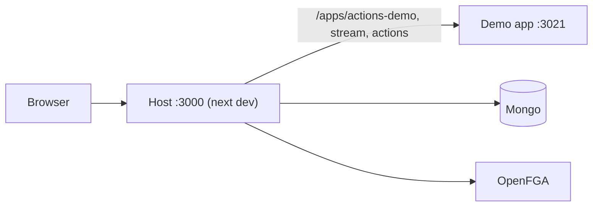

# Actions Demo

Test app for [message actions](../../../../docs/docs/ui/message-actions.md) in the host assistant.

- Serves a page in the host shell and answers the assistant with a fixed reply.
- Declares two actions on finished answers: **Flag answer** (dialog) and **Mark answer** (no dialog).
- Records every action call so you can see what the host sent.
- Local development only. It needs dev auth bypasses that must never run in production.



## Run it

Needs Docker, Node 24, and the repo's `ui/` dependencies (`npm ci`).

1. **Mongo and OpenFGA** (throwaway containers):

   ```bash
   docker run -d --name actions-demo-mongo -p 127.0.0.1:27017:27017 mongo:7
   docker run -d --name actions-demo-openfga -p 127.0.0.1:18080:8080 openfga/openfga:latest run
   STORE=$(curl -s -X POST localhost:18080/stores -H 'content-type: application/json' \
     -d '{"name":"caipe-openfga"}' | python3 -c 'import sys,json;print(json.load(sys.stdin)["id"])')
   curl -s -X POST localhost:18080/stores/$STORE/authorization-models -H 'content-type: application/json' \
     -d @../../../../charts/ai-platform-engineering/charts/openfga/authorization-model.json
   ```

   - The host asks OpenFGA for a user's teams when it lists agents. The dev bypass does not cover that call.
   - The store is in memory. Redo this step after restarting the container.

2. **Host config.** Copy `env.local.example` to `ui/.env.local` and replace the two secrets (32+ bytes each).

3. **Placeholder agent.** The host lists the assistant only if an enabled agent with the same id exists:

   ```bash
   node seed-agent.mjs
   ```

4. **Demo app.** Use the same `AGENTIC_APP_TOKEN_SECRET` as `ui/.env.local`:

   ```bash
   AGENTIC_APP_TOKEN_SECRET=<same value> node server.mjs
   ```

5. **Host:** `cd ui && npm run dev`.

6. **Sign in.** With SSO off the host has no login, so create a session cookie:

   ```bash
   NEXTAUTH_SECRET=<value from ui/.env.local> node mint-session.mjs
   ```

   - In the browser, open `http://localhost:3000`, then DevTools > Application > Cookies.
   - Add a cookie named `next-auth.session-token` with that value, path `/`.
   - Optional arguments set the user: `node mint-session.mjs secondary-user secondary@example.test`.

7. Open `http://localhost:3000/apps/actions-demo`.

## Automated UI check

With everything above running (Google Chrome installed):

```bash
NEXTAUTH_SECRET=<value from ui/.env.local> node check-ui.mjs
```

- Drives the real UI headless and exits non-zero on any failure.
- Set `SCREENSHOT_DIR=./shots` to keep screenshots.
- Covers: launcher gating, streamed answer, both actions, dialog prefill and focus, error text, length limit, Escape, per-user show and hide, and actions on a reloaded conversation.

## Manual checks

Follow the [quickstart](../../../../docs/docs/specs/2026-11-15-host-message-actions/quickstart.md), then try each error path by typing these words into the **Flag answer** dialog:

| Text contains | The app answers | The user should see |
|---|---|---|
| anything else | 200 `{"message":"Recorded"}` | Success toast "Recorded" |
| `fail` | 422 `{"error":"Demo failure","code":"DEMO_FAILURE"}` | "Demo failure" in the dialog |
| `expired` | 401 with an error | The app's text, as a failure, never as an expired host session |
| `html` | 200 `text/html` | "The app returned an invalid response" |
| `redirect` | 302 | "The app returned an invalid response". The redirect is not followed. |
| `slow` | answers after 35 s | "The app did not respond in time" after about 30 s |

Also check by eye, since the script cannot judge them:

- Dialog and toast look right in the host theme.
- Keyboard and screen reader use of the action buttons and dialog.
- Safari and Firefox: focus returns to the action after the dialog closes.
- A second signed-in user: untick an action on the demo page and confirm it disappears for that user only.

The demo page lists every call the app received, newest first: the signed-in user, the stored `message_id` and `turn_id`, and the submitted text.

## What dev mode cannot check

- With `CAIPE_UNSAFE_RBAC_BYPASS` on, a request with no session runs as an anonymous admin, and any user can act on any conversation.
- So the 401, service-account and non-owner refusals are covered by unit tests, not by this demo.

## Troubleshooting

| Symptom | Cause |
|---|---|
| Page spinner, or a "No Auth" badge | No session cookie. Do step 6. |
| `/api/dynamic-agents/available` returns `OPENFGA_HTTP is not set` | Step 1 or the `ui/.env.local` value is missing. Restart `npm run dev` after editing it. |
| No "Ask Demo" launcher | The agent is not seeded, or the page has not called `configure`. The page shows the bridge status. |
| Launcher shows but no action buttons | The page's checkboxes are unticked, or the answer has not been saved yet. Wait a second and retry. |
| Agent list looks stale after seeding | It is cached for 10 seconds. |

## Clean up

```bash
docker rm -f actions-demo-mongo actions-demo-openfga
rm ui/.env.local
```

## Files

| File | Purpose |
|---|---|
| `server.mjs`, `auth.mjs` | The demo app and its app-token check |
| `public/` | The page shown in the host |
| `agentic-apps.yaml` | Catalog entry with the declared actions |
| `seed-agent.mjs` | Placeholder agent |
| `mint-session.mjs` | Dev session cookie |
| `check-ui.mjs` | Automated UI check |
| `env.local.example` | Host settings for local development |
| `test/` | `npm test` unit tests for the app |
